# CSR Generator Specification

| Item | Value |
|---|---|
| Document | Specification of APB-CSR-Generator: script flow, workbook reference, user guide, normative design specification, implementation history |
| Product | `CSR_Generation.py`, a generator of APB4, AXI4-Lite, or AHB-Lite CSR modules from an Excel register map |
| Generator version described | 3.4 (read decode of repeated registers fixed; see the version table); Part B retains the APB4 2.4 baseline, Part C records the 3.0 bus backends, 3.1 `wo` field, and 3.2 `wo` hardware clear |
| Document date | 2026-11-05 |
| Language | English; Vietnamese summaries and appendices where marked |
| Replaces | `README.md` (technical content), `APB_CSR_Generator_Design_Specification.md`, `Repeated_Register_Generation_Specification.md`, `CSR_Attribute_Extension_Specification.md` |

## Contents

- [Part A. Overview, script flow, option reference and user guide](#part-a-overview-script-flow-option-reference-and-user-guide)
  - [A.1 Introduction](#a1-introduction)
  - [A.2 Overview and architecture](#a2-overview-and-architecture)
  - [A.3 Script flow](#a3-script-flow)
  - [A.4 Workbook reference](#a4-workbook-reference)
  - [A.5 Option reference](#a5-option-reference)
  - [A.6 User guide](#a6-user-guide)
- [Part B. Normative design specification of the APB4 baseline (2.4)](#part-b-normative-design-specification-of-generator-24)
  - [B.1 Purpose, scope, and product context](#b1-purpose-scope-and-product-context)
  - [B.2 Normative references and precedence](#b2-normative-references-and-precedence)
  - [B.3 Requirements and traceability](#b3-requirements-and-traceability)
  - [B.4 Features and configurations](#b4-features-and-configurations)
  - [B.5 Architecture](#b5-architecture)
  - [B.6 External interfaces and ports](#b6-external-interfaces-and-ports)
  - [B.7 Clock, reset, and power](#b7-clock-reset-and-power)
  - [B.8 Parameters and elaboration configurations](#b8-parameters-and-elaboration-configurations)
  - [B.9 Data representation and arithmetic](#b9-data-representation-and-arithmetic)
  - [B.10 Detailed functional behavior](#b10-detailed-functional-behavior)
  - [B.11 Register and programming model](#b11-register-and-programming-model)
  - [B.12 Error handling and recovery](#b12-error-handling-and-recovery)
  - [B.13 Performance, power, and area](#b13-performance-power-and-area)
  - [B.14 RTL implementation contract](#b14-rtl-implementation-contract)
  - [B.15 Verification specification](#b15-verification-specification)
  - [B.16 DFT and testability](#b16-dft-and-testability)
  - [B.17 Physical design and timing integration](#b17-physical-design-and-timing-integration)
  - [B.18 Security, safety, and reliability](#b18-security-safety-and-reliability)
  - [B.19 Requirement-to-verification traceability](#b19-requirement-to-verification-traceability)
  - [B.20 Assumptions, dependencies, and decisions](#b20-assumptions-dependencies-and-decisions)
  - [B.21 Glossary](#b21-glossary)
  - [B.22 References used to shape this template](#b22-references-used-to-shape-this-template)
  - [B.23 Repeated register generation](#b23-repeated-register-generation)
- [Part C. Extension research and implemented multi-protocol support (3.2)](#part-c-extension-research-and-implemented-multi-protocol-support-generator-32)
  - [C.0 Tóm tắt bằng tiếng Việt](#c0-tóm-tắt-bằng-tiếng-việt)
  - [C.1 Purpose and scope](#c1-purpose-and-scope)
  - [C.2 Research summary](#c2-research-summary)
  - [C.3 Recommendation and rationale](#c3-recommendation-and-rationale)
  - [C.4 Workbook format changes](#c4-workbook-format-changes)
  - [C.5 Field access types and hardware interface](#c5-field-access-types-and-hardware-interface)
  - [C.6 Write protection and write-once](#c6-write-protection-and-write-once)
  - [C.7 Access control and error responses](#c7-access-control-and-error-responses)
  - [C.8 Functional register structures](#c8-functional-register-structures)
  - [C.9 Reset, integrity, and debug](#c9-reset-integrity-and-debug)
  - [C.10 Generated interface naming](#c10-generated-interface-naming)
  - [C.11 Generated collateral](#c11-generated-collateral)
  - [C.12 Considered and not recommended](#c12-considered-and-not-recommended)
  - [C.13 Requirements](#c13-requirements)
  - [C.14 Decisions and open items](#c14-decisions-and-open-items)
  - [C.15 Verification plan](#c15-verification-plan)
  - [C.16 Roadmap](#c16-roadmap)
  - [C.17 References](#c17-references)
  - [C.18 Appendix: giải thích chi tiết từng đề xuất (tiếng Việt)](#c18-appendix-giải-thích-chi-tiết-từng-đề-xuất-tiếng-việt)
  - [C.19 Logic diagrams of the planned options](#c19-logic-diagrams-of-the-planned-options)
  - [C.20 Implemented multi-protocol CSR interface generation](#c20-multi-protocol-csr-interface-generation)
  - [C.21 Implemented write-only field support](#c21-implemented-write-only-field-support)
  - [C.22 Hardware clear for write-only fields](#c22-hardware-clear-for-write-only-fields)
- [Part D. Appendices](#part-d-appendices)
  - [D.1 Revision history](#d1-revision-history)
  - [D.2 Figure index](#d2-figure-index)
  - [D.3 Repository layout](#d3-repository-layout)
  - [D.4 Merge record](#d4-merge-record)

## Part A. Overview, script flow, option reference and user guide

### A.1 Introduction

#### A.1.1 Purpose

APB-CSR-Generator is a Python tool that reads a register map from an Excel workbook and writes one synthesizable SystemVerilog CSR module. A sheet selects APB4, AXI4-Lite, or AHB-Lite; each generated module contains only that bus interface and the workbook's registers and fields.

| Input | Output |
|---|---|
| Workbook sheet with a configuration table and a register-definition table | `RTL/<module>.sv`, `RTL/filelist.f`, behavioral models under `RTL/models/`, `Debug/debug.json` |

This document is the single specification of the generator. It replaces the former `README.md`, `APB_CSR_Generator_Design_Specification.md`, `Repeated_Register_Generation_Specification.md` and `CSR_Attribute_Extension_Specification.md`.

#### A.1.2 How to read this document

| Part | Content | Reader |
|---|---|---|
| A | Overview, script flow, workbook and option reference, user guide | Everyone; start with A.6 to use the tool |
| B | Normative design specification of the APB4 2.4 baseline | APB4 users and maintainers |
| C.1–C.19 | Historical register-attribute research and proposals; `wo` is implemented in 3.1/C.21 and its clear input in 3.2/C.22 | Future planning, except for the implemented `wo` features |
| C.20 | Normative specification of implemented generator 3.0 AXI4-Lite/AHB-Lite support | AXI4-Lite/AHB-Lite users and maintainers |
| C.21 | Normative specification of implemented 3.1 write-only field support across generated buses | CSR map authors and IP integrators |
| C.22 | Normative specification of implemented 3.2 hardware clear for write-only fields | CSR map authors and IP integrators |
| D | Revision history, figure index, repository layout | Maintainers |

Status legend used in Part A: **[implemented]** the behavior exists in the current source; **[proposal]** the item remains unimplemented and is explicitly labeled as such.

#### A.1.3 Version and status

| Item | Value |
|---|---|
| Generator version | 3.4 (`VERSION` in `CSR_Generation.py`); 3.4 only changes the read-data decode of repeated registers: every element is an item of the one case, so a readable repeated register is no longer zeroed by a later group |
| RTL rule baseline | VLSIT RTL Design Rule v2 (naming, port layout, header, process labels) |
| Existing verification evidence | Generator regression and AXI4-Lite/AHB-Lite protocol simulation results are recorded in C.20.7; APB4 2.4 evidence remains in B.15.5 |
| Version 3.4 status | Defect fixed 2026-11-07: a readable repeated register (`ro` field in a `PARAMETERIZED` group) read back 0 when a later repeated group existed, because each group had its own read `case` with `default: w_rdata_nxt = '0` in sequence. Each element is now an item of the single read `case`. Evidence: `sim/tests/generator_test` (27 of 27), `sim/tests/golden_test --quick` (pass), examples regenerated, readback of both chain registers in the MKV IP |
| Version 3.2 status (historical) | `wo` hardware-clear is generated and exercised on APB4, AXI4-Lite, and AHB-Lite; generator, golden-map, protocol, and coverage regressions pass (coverage results in `sim/results/coverage/`) |
| Not done | CDC/RDC signoff, synthesis/area characterization, formal equivalence across versions |

#### A.1.4 Reading the schematics

The figures of this part are gate-level schematics. Their cells are named after the cells of the VLSIT basic cell library (`VLSIT_CELL_AND2`, `_AND3`, `_AND4`, `_NAND2`, `_NAND4`, `_OR2`, `_OR3`, `_XOR2`, `_INV`, `_MUX2`, `_DFF_RN`, `_DFF_SN`, `_SYNC_2FF_RN`, `_TIEL`, `_TIEH`). Conventions:

- A multiplexer has inputs `0` and `1` and a select `S`; with `S` = 1 the output is input `1`.
- A flip-flop `DFF_RN` is clocked on the rising edge and cleared by an asynchronous active-low reset; `DFF_SN` is set by it. A short blue stub marks the clock pin and a short red stub marks the reset pin; the stub label names the signal.
- A label in the form `w_*` is a combinational signal, `reg_*` a flop output, `i_*`/`o_*` a port of the generated module.
- Text boxes (`BOX`) stand for a block that is a tree of the basic cells and is not drawn in full (for example a 16-bit comparator).
- The figures are produced by `spec/figures/tools/make_figures.py`; the drawn logic follows the templates of `CSR_Generation.py` and the APB4 reference RTL in `examples/APB4_Synchronous/RTL/m_vlsi_apb4_csr.sv`.

### A.2 Overview and architecture

#### A.2.1 Features

| Feature | Description |
|---|---|
| Selectable CSR bus | One generated interface per sheet: APB4, AXI4-Lite, or AHB-Lite |
| Field types | `rw`, `ro`, `rwi`, `w1c`, `w0c`, `w2c`, `r2c`, `wo`, and `reserved` bits |
| Hardware interface | Output per stored field, including `wo`; input per `ro` field; `i_hw_clr_` input per `wo` field; load enable and load data for `rwi`, `w1c`, `w0c`, `w2c`, `r2c` |
| Register replication | `NONE`, `FIXED` (N named copies), `PARAMETERIZED` (one bank with an elaboration count) |
| Clock architecture | `PARA_ASYNCHRONOUS=0` uses the selected bus clock; `1` uses the separate register clock and protocol request/response FIFOs |
| APB4 | SETUP/ACCESS phases, `PREADY`, `PSLVERR`, `PPROT`, `PSTRB`, and legacy access-check inputs |
| AXI4-Lite | Independent AW/W capture, configurable outstanding policy, byte strobes, held B/R responses |
| AHB-Lite | 32-bit bus, per-beat CSR accesses, subword lane mapping and two-cycle ERROR response |
| Reset | Asynchronous assertion, one reset value per field |
| Outputs | RTL, file list, synchronizer/FIFO models, JSON dump of what was read |
| Rule compliance | Output follows the VLSIT RTL Design Rule v2 |

#### A.2.2 Architecture

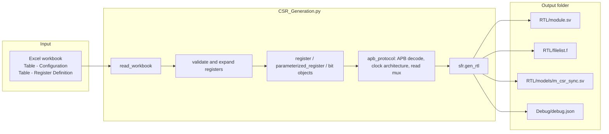

The generated module has these functional blocks (Section B.5):


| Block | Responsibility | Figures |
|---|---|---|
| APB decode and capture | SETUP detection, error check, capture of address, write data and error flag | L09, L10, L11 |
| Request path | CFG-SYNC: one-cycle delayed enables; CFG-ASYNC: request and acknowledge crossing | L12, L13, L14, L16 |
| Register decode | One address compare per register or per index | L17, L18 |
| Field logic | Next-value logic and flop of every stored bit | L01 to L08 |
| Read mux and data storage | Selection of the addressed register, read data flop(s) | L19, L20 |
| Clock and reset select | Parameter-selected register clock and reset | L15 |

#### A.2.3 Source files of the generator

| Object in `CSR_Generation.py` | Role |
|---|---|
| `read_workbook` | Reads the configuration rows and the register and field rows of one sheet |
| `main` | Command line, validation, expansion of repeated registers, name and address checks, file writing |
| `port`, `port_group`, `ports_rtl` | Port and signal declarations, grouped as rule FIL-06 asks |
| `bit` | One field: parses the range, makes the port set and the next-value equation by type |
| `register` | A scalar register: address decode, field flops, read value |
| `parameterized_register` | A `PARAMETERIZED` bank: packed-array ports, per-index decode and state |
| `apb_protocol` | APB decode, capture flops, CFG-SYNC and CFG-ASYNC control paths, read mux, read data storage |
| `sfr` | The whole module: header, parameters, port list, signals, `gen_json` |
| `SYNC_MODEL` | Text of `m_csr_sync` |

### A.3 Script flow

#### A.3.1 Top-level flow

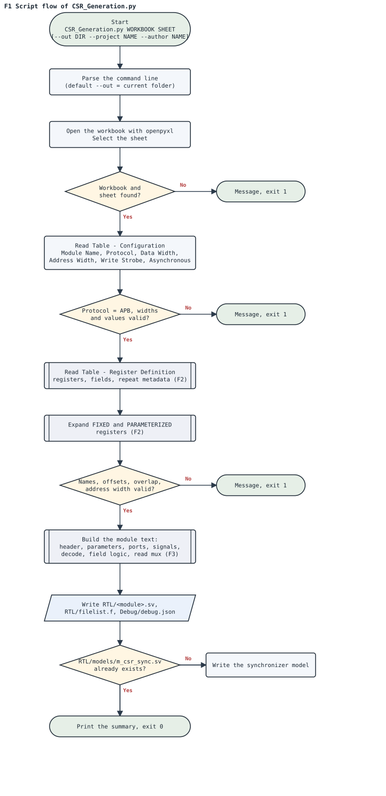

| Step | Action | Failure |
|---|---|---|
| 1 | Parse `WORKBOOK`, `SHEET`, `--out`, `--project`, `--author` | argparse usage message, exit 2 |
| 2 | Open the workbook with `openpyxl` and select the sheet | exception text from `openpyxl`, non-zero exit |
| 3 | Read the configuration rows: `Module Name`, `Protocol`, `Data Width`, `Address Width`, `Asynchronous` | message naming the missing key, exit 1 |
| 4 | Validate: `Asynchronous` is 0 or 1, `Address Width` 1 to 32, `Data Width` a byte multiple from 8 to 32, protocol `APB` | message, exit 1 |
| 5 | Read the register table (flow F2) | message, exit 1 |
| 6 | Expand `FIXED` and `PARAMETERIZED` registers; check identifiers, alignment, address width and overlap (flow F2) | message, exit 1 |
| 7 | Build the module text (flow F3) | internal; a port of width below 1 is an error |
| 8 | Write `RTL/<module>.sv`, `RTL/models/m_csr_sync.sv` (only if absent), `RTL/filelist.f`, `Debug/debug.json` | OS error |
| 9 | Print the summary and exit 0 | |

The messages of step 3 to 6 are listed in A.6.9. The tool never writes a partial result for a failed run: all validation happens before the first file is written.

#### A.3.2 Register table flow

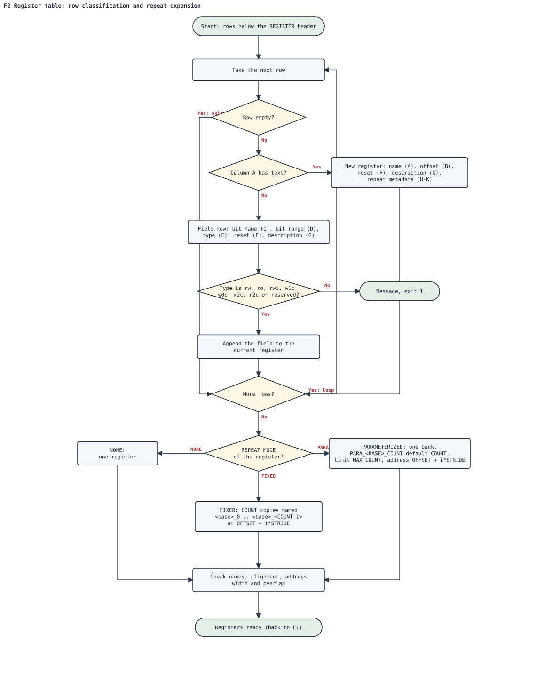

A row is classified by column A: text starts a new register; an empty cell makes the row a field of the last register; a row without bit name and bit range is an empty row and is skipped. Register rows carry the repeat metadata (columns H to K); a field row carries name, range, type, reset value and description.

#### A.3.3 RTL generation flow

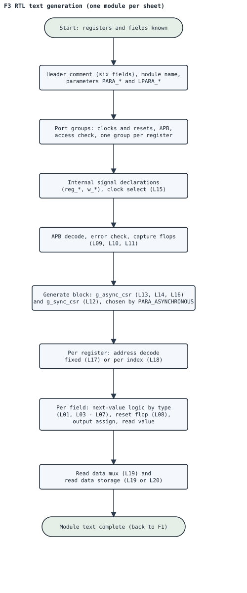

The module is written in the order the VLSIT file template demands: header comment, module declaration with parameters and ports, internal signals, clock select, APB decode and capture, the two clock-architecture generate blocks, the decode and field logic of every register, the read mux, the read data storage. Both clock architectures are always present in the text; the elaboration parameter `PARA_ASYNCHRONOUS` selects one.

#### A.3.4 Determinism and outputs

- For the same workbook, sheet and switches the output is byte-identical except for the `Date` field of the header (REQ-GEN-009).
- `RTL/models/m_csr_sync.sv` is written only when the file does not exist, so a technology synchronizer wrapper that you installed under that name is never overwritten. `filelist.f` and `debug.json` are rewritten every run.
- The generator does not edit the workbook.

### A.4 Workbook reference

#### A.4.1 Layout of a sheet

A sheet has two tables, read from top to bottom:

1. A configuration table that starts at the row whose first cell contains `Table - Configuration`: one `key / value / description` row per key.
2. A register-definition table whose header row has `REGISTER` in the first cell. Every following row belongs to the table.

`CSR_GOLDEN_FORMAT.xlsx` is the reference workbook. Its sheets `CSR` (default clock architecture 0) and `ASYNC_CSR` (default 1) describe the same register map: a global `engine` register, three `port` registers (`FIXED`) and a `monitor` bank (`PARAMETERIZED`, default count 2, maximum 4).

#### A.4.2 Configuration table

| Key (column A) | Value (column B) | Meaning | Check |
|---|---|---|---|
| `Module Name` | identifier | Name of the generated module and of the file | Must be a SystemVerilog identifier |
| `Protocol` | `APB` | Bus protocol | Only `APB` (case-insensitive); otherwise exit 1 |
| `Data Width` | 32 | Width of `PWDATA` and `PRDATA` | Byte multiple from 8 to 32; verified only for 32 |
| `Address Width` | 16 | Width of `PADDR` | 1 to 32; verified for 16 |
| `Asynchronous` | 0 or 1 | Default of the module parameter `PARA_ASYNCHRONOUS` | Must be 0 or 1 |
| `Write Strobe` | 4 | Informational row of the template; not read; the strobe width is 4 | None |

A key matches when the label contains the words above.

#### A.4.3 Register definition table

| Column | Header | Used on | Meaning |
|---|---|---|---|
| A | `REGISTER` | register row | Register name (base name for repeated registers); an empty cell makes the row a field row |
| B | `OFFSET` | register row | Byte address of the register; decimal or `0x` hexadecimal |
| C | `BIT NAME` | field row | Field name; the name `reserved` marks unused bits |
| D | `FIELD WIDTH` | field row | Bit range `[msb:lsb]` or `[bit]` |
| E | `BIT TYPE` | field row | `rw`, `ro`, `rwi`, `w1c`, `w0c`, `w2c`, `r2c`, `wo` |
| F | `RESET VALUE` | field row (register row informational) | Reset value of the field, decimal or hexadecimal |
| G | `DESCRIPTION` | both | Text; copied to `debug.json` |
| H | `REPEAT MODE` | register row | `NONE` (or empty), `FIXED`, `PARAMETERIZED` |
| I | `COUNT / DEFAULT` | register row | Copies (`FIXED`) or default count (`PARAMETERIZED`) |
| J | `OFFSET STRIDE` | register row | Byte distance between copies |
| K | `MAX COUNT` | register row | Largest legal count (`PARAMETERIZED` only) |

Rules checked by the generator: every register has at least one field; field names are unique inside a register; a field has a name and a range; the type is one of the eight supported types; addresses are aligned to the word size, fit the address width and do not overlap; generated register, group, parameter and localparam names are unique; identifiers are valid. A reset value that does not fit the field width is an error.

#### A.4.4 Naming limits

Rule NAM-07 limits port names to 30 characters. The longest generated forms are `i_hw_wdata_<reg>_<field>` and `i_hw_we_<reg>_<field>`, so keep `<reg>` + `<field>` (with the index suffix for `FIXED` copies) within 17 characters. The generator does not check the length; the VLSIT rule checker does.

### A.5 Option reference

The option diagrams in this section document the APB4/register-field baseline from generator 2.4. Current AXI4-Lite and AHB-Lite bus options are specified in C.20.

#### A.5.1 Command-line options [implemented]

```text
python CSR_Generation.py WORKBOOK SHEET [--out DIR] [--project NAME] [--author "NAME (user)"]
```

| Option | Default | Effect |
|---|---|---|
| `WORKBOOK` | required | Path of the `.xlsx` file |
| `SHEET` | required | Name of the sheet to generate from |
| `--out DIR` | current folder | Folder that receives `RTL/` and `Debug/`; created if missing |
| `--project NAME` | `APB-CSR-Generator` | `Project` field of the file header (rule FIL-01) |
| `--author "NAME (user)"` | login name + ` (user)` | `Author` field of the file header |

The `Date` field of the header is the day of the run; the `AI Flow` fields name the VLSIT flow and its page.

#### A.5.2 Configuration options [implemented]

**Module Name.** Names the module and the file. Several sheets of one workbook can use different names; two modules of one design must not share a name.

**Protocol.** Selects the bus. Only `APB` exists. The ports follow APB4: `i_apb_psel`, `i_apb_penable`, `i_apb_pwrite`, `i_apb_paddr`, `i_apb_pwdata`, `i_apb_pstrb`, `i_apb_pprot`, `o_apb_pready`, `o_apb_pslverr`, `o_apb_prdata`.

**Data Width and Address Width.** Become the localparams `LPARA_DATA_W`, `LPARA_ADDR_W` and `LPARA_STRB_W` (= data width / 8); they size the APB data and address ports and the capture flops. Registers are one data word wide.

**Asynchronous.** Sets the default of the parameter `PARA_ASYNCHRONOUS`; see A.5.6.

#### A.5.3 Field types [implemented]

A field is one or more bits of a register. The type fixes what software and hardware may do. Next-value equations use these names: `we` the software write enable of the register (`w_we_<reg>`), `rd` the software read enable (`w_rd_<reg>`), `wdata` the captured write data (`reg_wdata`), `hw_we` and `hw_wdata` the hardware load ports, `Q` the stored value. For a multi-bit field the equations apply bit by bit, except `w2c`, which clears the whole field, and the hardware load, which replaces the whole field.

| Type | Software read | Software write | Hardware | Next value |
|---|---|---|---|---|
| `rw` | stored value | loads the written bits | reads `o_<reg>_<field>` | `we ? wdata : Q` |
| `ro` | live input | ignored | drives `i_<reg>_<field>` | no flop |
| `rwi` | stored value | loads the written bits | reads the output and loads (`hw_we`, `hw_wdata`) | `we ? wdata : (hw_we ? hw_wdata : Q)` (software first) |
| `w1c` | stored value | a written 1 clears the bit | loads; hardware wins | `hw_we ? hw_wdata : (we ? ~wdata & Q : Q)` |
| `w0c` | stored value | a written 0 clears the bit | loads; hardware wins | `hw_we ? hw_wdata : (we ? wdata & Q : Q)` |
| `w2c` | stored value | any write to the register clears the whole field | loads; hardware wins | `hw_we ? hw_wdata : (we ? 0 : Q)` |
| `r2c` | value before the clear | ignored | loads; hardware wins | `hw_we ? hw_wdata : (rd ? 0 : Q)` |
| `wo` | 0 | loads the written bits | reads `o_<reg>_<field>` | `we ? wdata : Q` |
| `reserved` | 0 | ignored | none | no flop |

Ports per type (`<reg>` and `<field>` from the workbook, `[W-1:0]` omitted for one bit):

| Type | Input ports | Output ports |
|---|---|---|
| `ro` | `i_<reg>_<field>` | none |
| `rw` | none | `o_<reg>_<field>` |
| `wo` | `i_hw_clr_<reg>_<field>` (3.3; clear behavior added in 3.2) | `o_<reg>_<field>` |
| `rwi`, `w1c`, `w0c`, `w2c`, `r2c` | `i_hw_we_<reg>_<field>`, `i_hw_wdata_<reg>_<field>` | `o_<reg>_<field>` |

A hardware load and a software access that meet in the same register-clock cycle are resolved by the order in the next-value column. For `rwi` the software write wins; for the four clear types the hardware load wins, so a new event is never lost (decision DEC-006).

For `wo`, the software write updates a resettable field flop, but the read-data mux leaves the field bits at zero. The hardware output sees the stored value. Version 3.2 adds the synchronous clear input described in C.22; it does not add a hardware write-data or write-enable input.

**`rw`: logic diagram.**

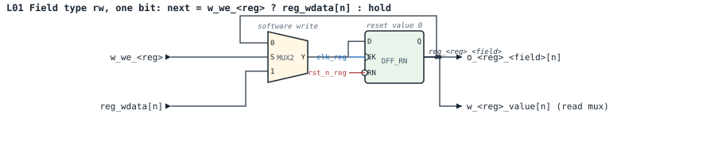

The multiplexer selects the captured write data when the register is written and feeds the flop output back otherwise. The flop output drives the port and the read value.

**`ro` and `reserved`: logic diagram.**

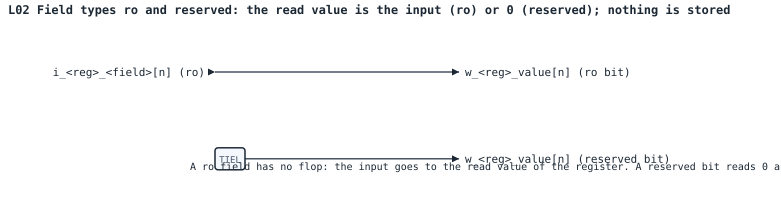

An `ro` field has no flop; its input joins the read value of the register. A reserved bit is the constant 0 in the read value.

**`rwi`: logic diagram.**

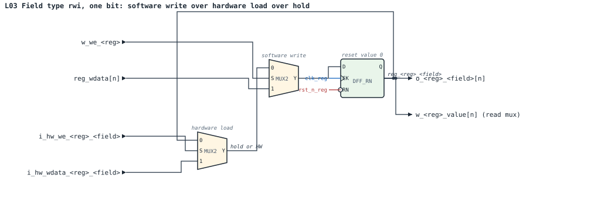

Two multiplexers in series: the hardware load selects between hold and `i_hw_wdata`; the software write selects between that result and `reg_wdata`, so software has the last word.

**`w1c`: logic diagram.**

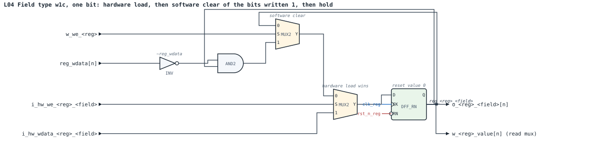

The gate `AND2(~wdata, Q)` clears the bits written as 1 and keeps the others. A multiplexer applies it only for a write to this register, and the hardware-load multiplexer after it has priority. Use: sticky status flags that hardware sets and software acknowledges.

**`w0c`: logic diagram.**

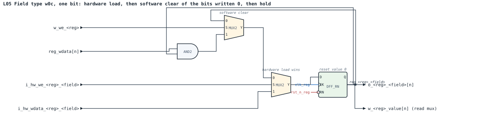

`AND2(wdata, Q)` clears the bits written as 0. Any write to the register that does not carry a 1 in the bit clears it.

**`w2c`: logic diagram.**

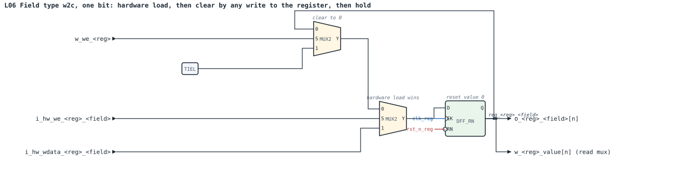

A write to the register selects the constant 0 (`TIEL`) for every bit of the field, whatever data was written.

**`r2c`: logic diagram.**

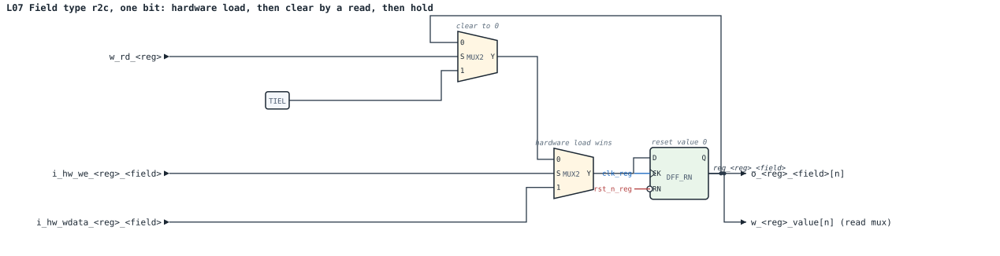

The clear is controlled by the read enable `w_rd_<reg>`. The read data flop captures the value in the same cycle, so the read returns the value before the clear.

**Reset flop: logic diagram.**

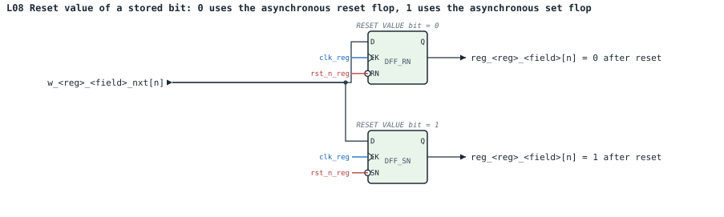

Every stored bit has an asynchronous reset. A reset value bit of 0 maps to `DFF_RN`, a 1 to `DFF_SN`. The reset input is `i_rst_n_apb` in CFG-SYNC and `i_rst_n_reg` in CFG-ASYNC (A.5.6).

**Limits.** A field must not overlap another field of the same register (checked by the VLSIT CSR validation flow, not by the generator). Bits not covered by a field read 0 and ignore writes. A field wider than the data width is not supported.

#### A.5.4 Reset value [implemented]

Column F of a field row gives the reset value of the field, decimal or `0x` hexadecimal. The generator converts it to a sized literal (for example `4'h5`) and assigns it in the reset branch of the register process. A value that needs more bits than the field has is an error. Fields of type `ro` and `reserved` have no storage, so the value is only documentation. The reset is asynchronous (`negedge i_rst_n`), so fields take the reset value while the reset is asserted; the reset must be released synchronously to the clock by the integrator (REQ-RESET-003).

#### A.5.5 Register replication [implemented]

Columns H to K of a register row select the mode.

| Mode | Behavior | Ports | Use |
|---|---|---|---|
| `NONE` (or empty) | One register at `OFFSET` | Scalar ports | Ordinary register |
| `FIXED` | The template is expanded at generation into `COUNT` registers named `<base>_0` to `<base>_<COUNT-1>` at `OFFSET + i * STRIDE` | One scalar port set per copy | A fixed number of blocks that need individually named signals |
| `PARAMETERIZED` | One bank of `PARA_<BASE>_COUNT` entries (default `COUNT`, at most `MAX COUNT`), entry `i` at `OFFSET + i * STRIDE` | Packed arrays `[PARA_<BASE>_COUNT-1:0]`, field width inside | The count changes at elaboration without regenerating |

Rules: `STRIDE` is a multiple of the word size and at least one word; `FIXED` with count 1 may leave `STRIDE` blank; `FIXED` must leave `MAX COUNT` blank; `PARAMETERIZED` needs `COUNT`, `STRIDE` and `MAX COUNT` with `1 <= COUNT <= MAX COUNT`; the address range up to `MAX COUNT` must not overlap another register. Field type, reset value and description are shared by all copies. An `r2c` read clears only the addressed entry.

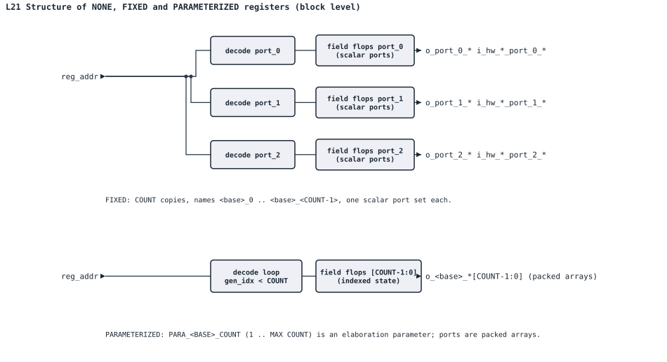

**Address decode of a fixed register.**

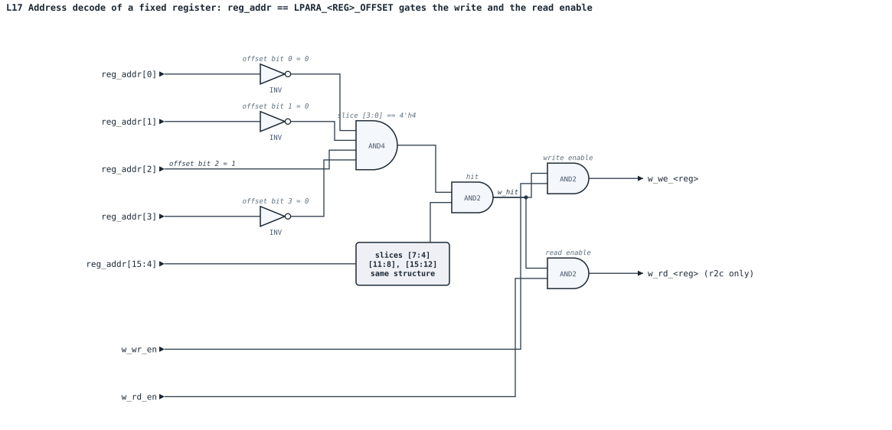

The address captured at the last transfer is compared with the register offset: bits that are 0 in the offset pass through an inverter, bits that are 1 pass directly, and AND gates combine the slices. The hit is ANDed with the write enable and, for `r2c` registers, with the read enable.

**Address decode of a `PARAMETERIZED` bank.**

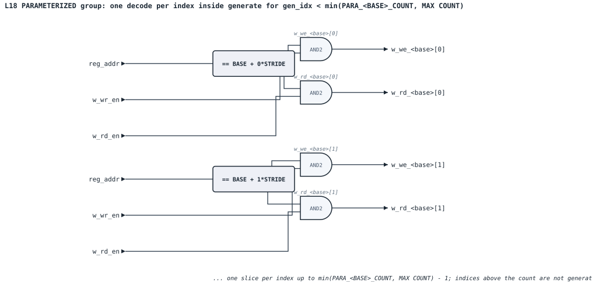

A generate loop creates one decode per index below both the count parameter and the maximum count; the compare constant is `BASE + index * STRIDE`, a constant at elaboration. Indices above the count are not generated, so their addresses behave as unmapped.

#### A.5.6 Clock architecture: `Asynchronous` and `PARA_ASYNCHRONOUS` [implemented]

One module contains both architectures. The elaboration parameter `PARA_ASYNCHRONOUS` (default from the workbook) selects one; the port list is the same in both, so `i_clk_reg` and `i_rst_n_reg` always exist.

| | PARA_ASYNCHRONOUS = 0 (CFG-SYNC) | PARA_ASYNCHRONOUS = 1 (CFG-ASYNC) |
|---|---|---|
| Register clock and reset | `i_clk_apb`, `i_rst_n_apb` | `i_clk_reg`, `i_rst_n_reg` |
| Wait states of a transfer | Exactly one (PREADY in the third cycle) | Depends on the clock ratio |
| Write visible on the field output | In the cycle with PREADY | Before PREADY |
| Crossing | None | Request and acknowledge crossing, four single-bit crossings, two bundled-data paths |

**Clock and reset select.**

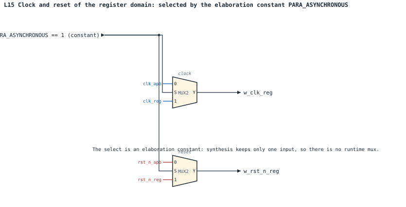

The selects are elaboration constants, so synthesis keeps one input and no runtime multiplexer remains.

**CFG-SYNC control path.**

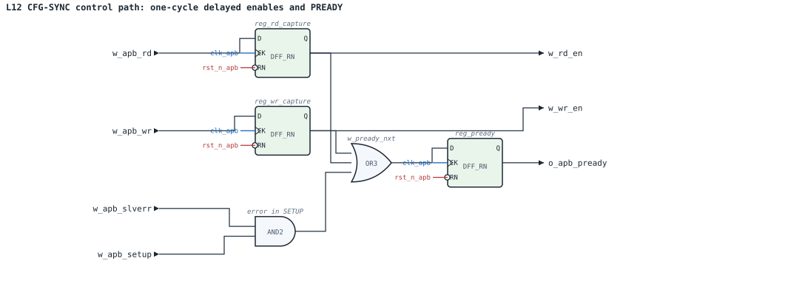

The read and write strobes of the SETUP phase are delayed by one flop to become the register-side enables `w_rd_en` and `w_wr_en`. `PREADY` is a flop whose input is the OR of the two enables and of an error found in the SETUP phase. The timing is shown by the waveforms WF-002 and WF-003 (Section B.10.3).

**CFG-ASYNC write path (read path identical).**

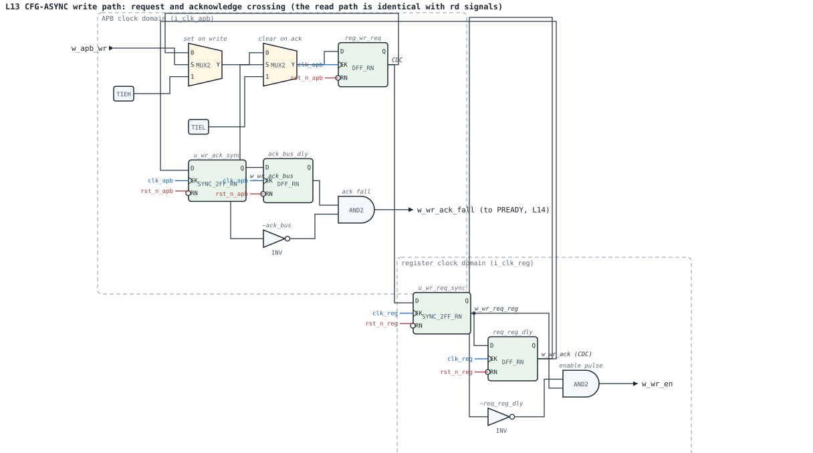

A request flag in the APB domain is set by the write strobe and cleared by the synchronized acknowledge. It crosses to the register domain through `m_csr_sync`; a flop and an AND gate turn the synchronized level into a one-cycle enable pulse `w_wr_en`; the delayed level is the acknowledge, which crosses back through a second `m_csr_sync` and ends the request. The falling edge of the synchronized acknowledge is `w_wr_ack_fall`. The register update happens at `w_wr_en`, before the acknowledge returns, so the field is updated before PREADY.

**CFG-ASYNC PREADY.**

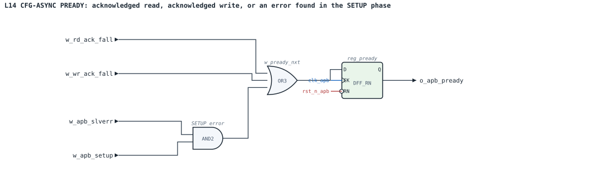

**Synchronizer.**


`m_csr_sync` has the parameter `PARA_LEVELS` (default 2) and the ports `i_clk_dst`, `i_rst_n_dst`, `i_d`, `o_q`. It is a behavioral model; replace the file by a wrapper of your technology synchronizer cell (for example `VLSIT_CELL_SYNC_2FF_RN`) without changing the port names.

#### A.5.7 Access checks [implemented]

Two static inputs control the checks; both must be constant after reset.

| Input | Meaning |
|---|---|
| `i_protect_en` | 1: a transfer with `PPROT[1]` = 1 (non-secure) is an error |
| `i_slverr_en` | 1: error checks are active and `PSLVERR` is driven; 0: no error response, `PSTRB` is ignored and a write stores the whole word |

With `i_slverr_en` = 1 a SETUP phase is an error when any of these holds: `i_protect_en` = 1 and `PPROT[1]` = 1; `PADDR[1:0]` is not 00; the transfer is a write and `PSTRB` is not 1111. An error transfer changes no field, captures no address or data, and answers in the first ACCESS cycle with `PREADY` = 1 and `PSLVERR` = 1. `PSLVERR` stays high until the next SETUP phase. A read or write of an aligned address that is not a register completes without error (read 0, write ignored).

**Error detection.**

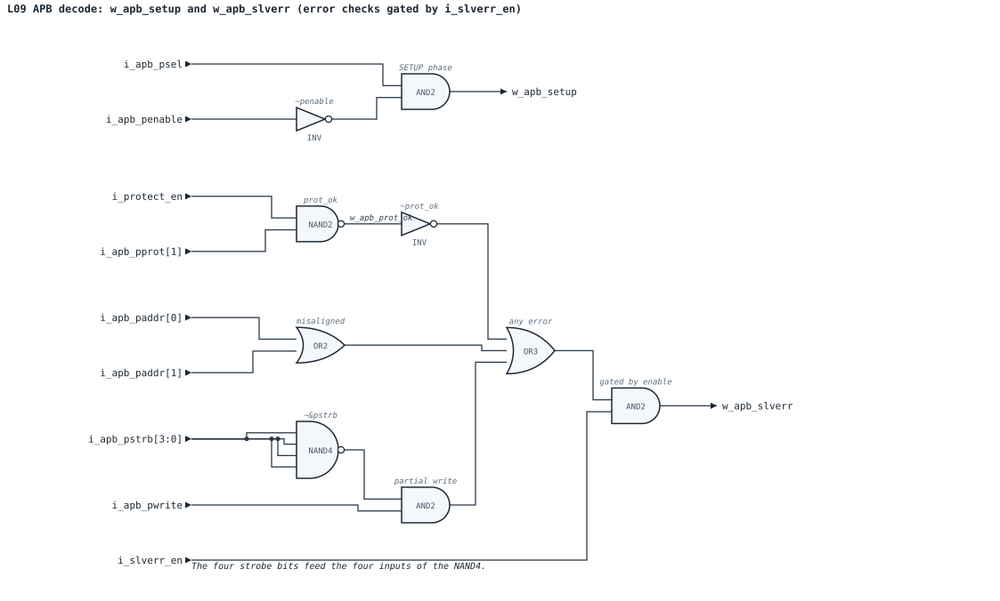

`NAND2(i_protect_en, PPROT[1])` gives `w_apb_prot_ok`; the three error sources (protection, misaligned address from `OR2`, partial write from `NAND4` of the strobes and `AND2` with `PWRITE`) join in an `OR3`; the enable `i_slverr_en` gates the result into `w_apb_slverr`.

**Transfer classification.**

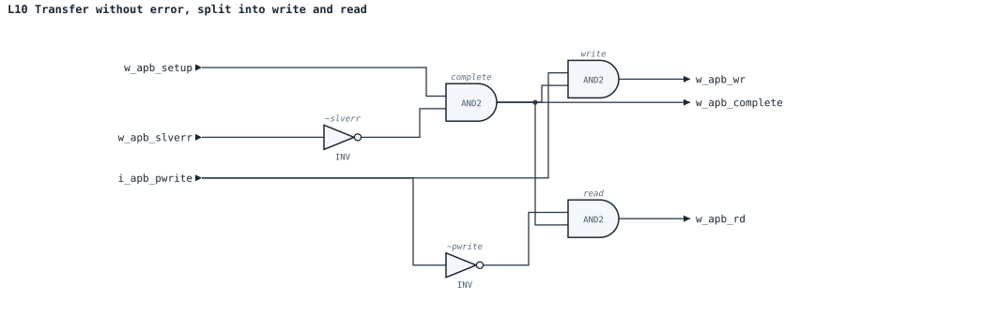

**Capture flops.**

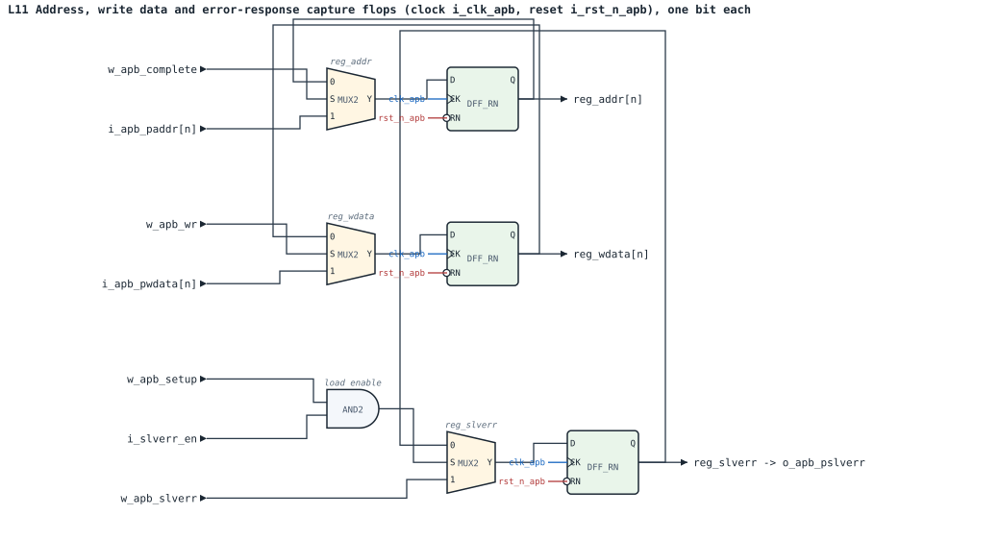

The address flop loads in every transfer without error, the write data flop only in a write without error, and the error flop in every SETUP phase while `i_slverr_en` is 1; its output is `o_apb_pslverr`.

#### A.5.8 Read data path [implemented]

The addressed register is selected by an address compare; the selected value goes through an AND-OR multiplexer; the data are stored in a flop so that `PRDATA` is stable for the whole transfer.

**CFG-SYNC read data.**

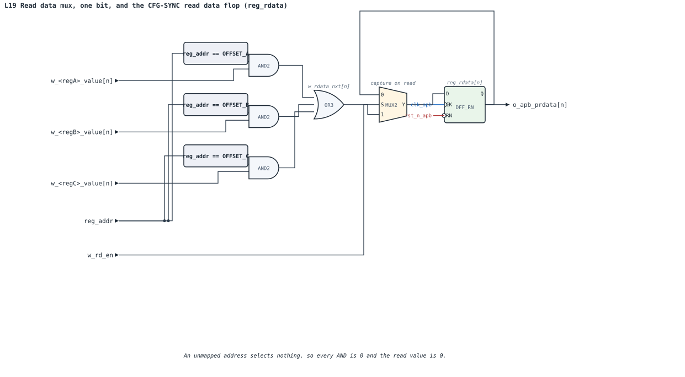

**CFG-ASYNC read data.**

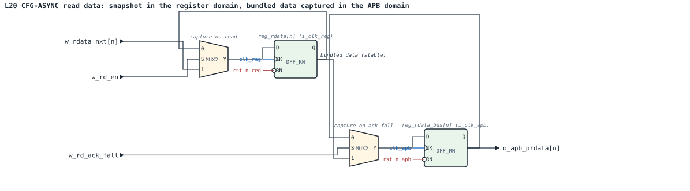

In CFG-ASYNC the value is first captured on the register clock at the read enable, and the APB-domain flop copies this stable bundle when the synchronized acknowledge falls, so no changing bit crosses the clock boundary. `PRDATA` holds the data of the last read without error.

#### A.5.9 Elaboration parameters and localparams [implemented]

| Name | Kind | Default | Meaning |
|---|---|---|---|
| `PARA_ASYNCHRONOUS` | parameter | workbook | 0 or 1, clock architecture |
| `PARA_<BASE>_COUNT` | parameter | `COUNT / DEFAULT` | Number of entries of a `PARAMETERIZED` bank, 1 to `MAX COUNT` |
| `LPARA_ADDR_W`, `LPARA_DATA_W`, `LPARA_STRB_W` | localparam | from the workbook | Bus widths |
| `LPARA_SYNC_STAGES` | localparam | 2 | Stages of every `m_csr_sync` |
| `LPARA_<REG>_OFFSET` | localparam | `OFFSET` | Byte address of a register |
| `LPARA_<BASE>_BASE_OFFSET`, `_OFFSET_STRIDE`, `_MAX_COUNT` | localparam | workbook | Address constants of a `PARAMETERIZED` bank |

#### A.5.10 Generated outputs [implemented]

| File | Content |
|---|---|
| `RTL/<module>.sv` | The CSR module; header with the six fields of rule FIL-01 |
| `RTL/models/m_csr_sync.sv` | Behavioral synchronizer; written only if absent |
| `RTL/filelist.f` | `models/m_csr_sync.sv` and `<module>.sv`, paths relative to the folder of the file |
| `Debug/debug.json` | Generator version, configuration, every register and field as read, with offset, range, type, reset and description |

#### A.5.11 Planned options [planned]

The historical proposals in C.1–C.19 cover new field types, per-bit hardware set/clear, access pulses, locks, access levels, interrupt groups, counters, aliases, external windows, C header/UVM output and checks. Except for `wo` (implemented in 3.1 and specified in C.21), those proposals remain unimplemented. Protocol-specific strobe handling and AXI4-Lite/AHB-Lite generation are implemented and specified in C.20.

### A.6 User guide

#### A.6.0 Hướng dẫn nhanh (tiếng Việt)

1. Cài Python 3 và `openpyxl`: `pip install openpyxl`.
2. Sao chép `CSR_GOLDEN_FORMAT.xlsx`, đổi tên sheet, sửa bảng cấu hình (`Module Name`, `Asynchronous`...) và bảng thanh ghi (mỗi thanh ghi một dòng, các field ở các dòng dưới).
3. Chạy: `python CSR_Generation.py file.xlsx TênSheet --out build --project TênDựÁn --author "Tên (user)"`.
4. Đọc `build/Debug/debug.json` để chắc workbook đã được đọc đúng, rồi lint `build/RTL` bằng `filelist.f`.
5. Tích hợp: tạo instance module, đặt `PARA_ASYNCHRONOUS` và các `PARA_<BASE>_COUNT`, nối cổng phần cứng, giữ `i_protect_en`/`i_slverr_en` hằng số sau reset, thay `m_csr_sync` bằng cell đồng bộ của công nghệ.
6. Mỗi lần đổi bản đồ thanh ghi thì sinh lại; không sửa tay file RTL.

#### A.6.1 Prerequisites

| Item | Version | Use |
|---|---|---|
| Python | 3.8 or newer | runs the generator |
| `openpyxl` | any recent | reads the workbook (`pip install openpyxl`) |
| Verilator 5 or slang | optional | lint of the output |
| iverilog 12 or newer | optional | simulation of the golden testbench |
| `vlsit_rtl_check.py` | optional | VLSIT rule check |

On Windows with the OSS CAD Suite, call `verilator_bin.exe` (the `verilator` wrapper needs Perl modules) and set `VERILATOR_ROOT`.

#### A.6.2 Designer flow

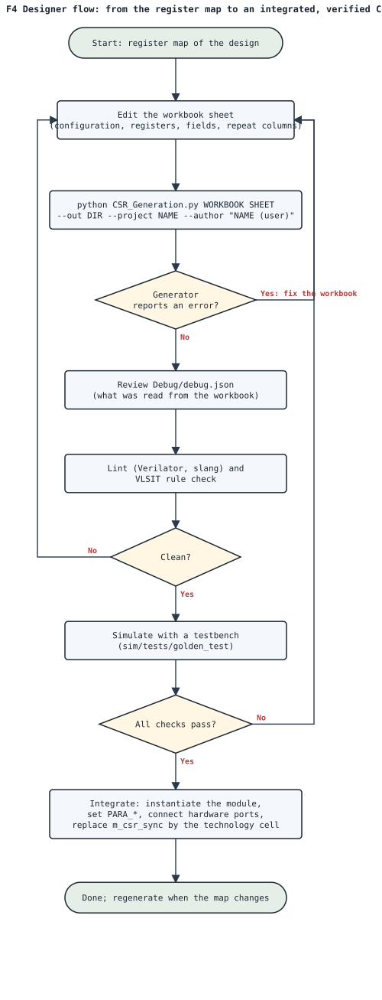

#### A.6.3 Prepare the workbook

1. Copy `CSR_GOLDEN_FORMAT.xlsx` and rename the sheet you will use.
2. Edit the configuration table:

   | Config | Value |
   |---|---|
   | Module Name | `m_mydev_csr` |
   | Protocol | `APB` |
   | Data Width | `32` |
   | Address Width | `16` |
   | Write Strobe | `4` |
   | Asynchronous | `0` |

3. Describe each register. A register row starts the register; the field rows follow:

   | REGISTER | OFFSET | BIT NAME | FIELD WIDTH | BIT TYPE | RESET VALUE | DESCRIPTION |
   |---|---|---|---|---|---|---|
   | ctrl | 0x0 | | | | 0x0 | Control register |
   | | | enable | [0] | rw | 0x0 | Enable the block |
   | | | start | [1] | rwi | 0x0 | Software starts, hardware clears when accepted |
   | | | mode | [5:2] | rw | 0x1 | Operation mode |
   | | | reserved | [31:6] | ro | 0x0 | Unused |
   | status | 0x4 | | | | 0x0 | Status register |
   | | | busy | [0] | ro | 0x0 | Hardware busy flag |
   | | | err | [1] | w1c | 0x0 | Sticky error, software writes 1 to clear |
   | | | done | [2] | r2c | 0x0 | Completion flag, a read clears it |
   | | | reserved | [31:3] | ro | 0x0 | Unused |

4. For a repeated register fill columns H to K on the register row (A.5.5), for example `FIXED`, count 4, stride 4, or `PARAMETERIZED`, default 2, stride 4, maximum 8.
5. Choose the field type with the table of A.5.3: status the hardware raises and software acknowledges is `w1c`; a read-to-acknowledge flag is `r2c`; a command bit the hardware consumes is `rwi`; pure configuration is `rw`; a hardware value to read is `ro`.

#### A.6.4 Run the generator

```bash
python CSR_Generation.py my_map.xlsx CTRL_SHEET --out build --project MyProject --author "Your Name (user)"
```

The tool prints the registers and fields it reads, then the output path. Open `build/Debug/debug.json` and compare it with the sheet: every register, offset, field range, type and reset value must be what you intended.

#### A.6.5 Check the result

```bash
cd build/RTL
verilator_bin.exe --lint-only --sv -Wall --top-module m_mydev_csr -f filelist.f
slang --top m_mydev_csr -f filelist.f
python <skills>/vlsit-rtl-generator/scripts/vlsit_rtl_check.py check m_mydev_csr.sv models/m_csr_sync.sv
```

Expected: no error. Verilator reports `UNUSEDSIGNAL` for the unused bits of `i_apb_pprot` (only bit 1 is checked) and for `reg_wdata` bits of `ro`/reserved fields; they are accepted.

#### A.6.6 Integrate the module

```systemverilog
m_vlsi_csr #(
  .PARA_ASYNCHRONOUS (32'd0),         // 0: register clock = APB clock, 1: separate i_clk_reg
  .PARA_MONITOR_COUNT (32'd2)         // only for a PARAMETERIZED group; 1 .. MAX COUNT
) u_csr (
  .i_clk_apb (clk_apb), .i_rst_n_apb (rst_n_apb),
  .i_clk_reg (clk_apb), .i_rst_n_reg (rst_n_apb),     // tie to the APB clock/reset when PARA_ASYNCHRONOUS = 0
  .i_apb_psel (psel), .i_apb_penable (penable), .i_apb_pwrite (pwrite),
  .i_apb_paddr (paddr), .i_apb_pwdata (pwdata), .i_apb_pstrb (pstrb), .i_apb_pprot (pprot),
  .o_apb_pready (pready), .o_apb_pslverr (pslverr), .o_apb_prdata (prdata),
  .i_protect_en (1'b1), .i_slverr_en (1'b1),         // static after reset
  // per field: .o_<reg>_<field>, .i_<reg>_<field>, .i_hw_we_<reg>_<field>, .i_hw_wdata_<reg>_<field>
  ...
);
```

Integration checklist:

- **Resets** are released synchronously to their clock by the integrator; the module has no reset synchronizer.
- **Static enables**: hold `i_protect_en` and `i_slverr_en` constant after reset.
- **Hardware ports** (`i_hw_we_*`, `i_hw_wdata_*`, `i_<reg>_<field>`) belong to the register clock domain (`i_clk_reg` when `PARA_ASYNCHRONOUS` = 1, otherwise `i_clk_apb`); bring signals from other domains in first.
- **Asynchronous mode**: constrain the two bundled-data paths (`reg_addr`, `reg_wdata` to the register domain; `reg_rdata` to the APB domain) with a maximum-delay constraint, and declare the four request/acknowledge synchronizers as CDC crossings (Section B.17).
- **Synchronizer cell**: replace `RTL/models/m_csr_sync.sv` by a wrapper of the technology synchronizer, keeping the module name and ports.
- **Software**: a transfer to a register completes only when `PREADY` = 1; in CFG-ASYNC the number of wait states depends on the clock ratio.

#### A.6.7 Simulate

The repository has a self-checking testbench and a driver:

```bash
python sim/tests/golden_test/run_golden_test.py            # nine configurations
python sim/tests/golden_test/run_golden_test.py --mutants  # also ten single-fault mutants
python sim/tests/generator_test/run_generator_test.py      # tests of the tool itself
```

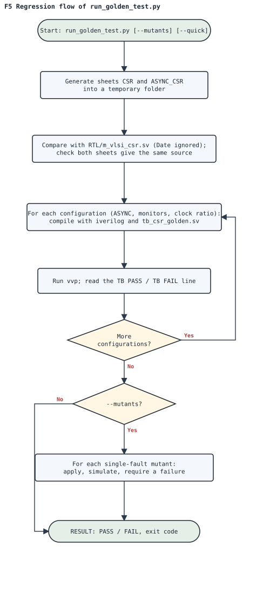

`run_golden_test.py` regenerates sheets `CSR` and `ASYNC_CSR` of `CSR_GOLDEN_FORMAT.xlsx`, compares the generated module with `examples/APB4_Synchronous/RTL/m_vlsi_apb4_csr.sv` after normalizing the module name, simulates the module with `tb_csr_golden.sv` for both clock architectures, one to four monitor entries and multiple clock ratios, and with `--mutants` requires that ten injected faults are detected. To test your own map, run the generator on your sheet and adapt the testbench (its reference model is register-by-register).

#### A.6.8 Regenerate and maintain

- Treat the generated files as build products: change the workbook and run the tool again, never edit the RTL.
- The only generated file that you may replace is `RTL/models/m_csr_sync.sv`.
- Compare `Debug/debug.json` between runs to review a change of the map.
- Keep the generator version (`Generator version` in `debug.json`) with the project.

#### A.6.9 Messages and troubleshooting

| Message (start of the text) | Cause | Fix |
|---|---|---|
| `the configuration table ... has no value for <key>` | A required row is missing | Add the row (`Module Name`, `Protocol`, `Data Width`, `Address Width`, `Asynchronous`) |
| `Asynchronous must be 0 or 1` | Wrong value | Use 0 or 1 |
| `Address Width must be between 1 and 32 bits` | Wrong value | Correct it |
| `Data Width must be a byte multiple from 8 through 32 bits` | Wrong value | Use 8, 16, 24 or 32 |
| `Protocol must be APB4, AXI4-Lite, or AHB-Lite` | `Protocol` value is unsupported | Select one of the supported protocol values in C.20.2 |
| `<label> must be a valid SystemVerilog identifier` | Register or module name with illegal characters | Rename |
| `unsupported bit type '<x>'; supported types: ...` | `BIT TYPE` outside the supported set | Use one of `rw ro rwi w1c w0c w2c r2c wo` |
| `register <r> contains a field without a name or bit range` | Incomplete field row | Fill column C and D |
| `register <r> has duplicate field name <f>` | Two fields with one name | Rename |
| `register <r> must define at least one field` | A register row without field rows | Add fields |
| `... must be a non-negative decimal or hexadecimal integer` | Offset, reset, count or stride is not a number | Write `4`, `0x4` or `0x1000` |
| `... value ... does not fit in <n> bits` | Reset value wider than the field | Reduce it |
| `register <r> address ... exceeds Address Width` | Offset (or the last copy) beyond the address space | Lower it or widen `Address Width` |
| `register <r> address ... is not aligned to <n> bytes` | Offset not a multiple of the word size | Align it |
| `register address ... overlaps another register or repeated group` | Two registers share an address | Move one |
| `register <r> REPEAT MODE must be NONE, FIXED, or PARAMETERIZED` | Misspelled mode | Correct it |
| `register <r> has repeat metadata but REPEAT MODE is NONE` | Columns I to K filled with mode NONE | Clear them or set a mode |
| `FIXED mode requires COUNT / DEFAULT`, `count must be at least 1`, `FIXED mode with count > 1 requires OFFSET STRIDE`, `FIXED mode must leave MAX COUNT blank` | Incomplete or extra repeat data | Fix columns I to K |
| `PARAMETERIZED mode requires COUNT / DEFAULT, OFFSET STRIDE, and MAX COUNT` | Incomplete data | Fill all three |
| `requires 1 <= default count <= maximum count` | Count outside the limits | Correct it |
| `OFFSET STRIDE must be a multiple of <n> bytes and at least one register wide` | Stride too small or unaligned | Use a multiple of 4 that is at least 4 |
| `generated register name ... is duplicated`, `register group name`, `parameter name`, `localparam name collision` | Two names produce the same generated identifier | Rename a register |

Symptoms without a message:

| Symptom | Likely cause |
|---|---|
| `PSLVERR` on a byte write | `i_slverr_en` = 1 and `PSTRB` is not 1111; write a whole word or set `i_slverr_en` = 0 (the whole word is then stored) |
| `PSLVERR` on every access | `i_protect_en` = 1 and the master sends `PPROT[1]` = 1, or the address is not word aligned |
| A hardware load does nothing | `i_hw_we_*` must be 1 in a register-clock cycle; for `rwi`, a software write in the same cycle wins |
| A flag clears by itself | A `w0c` field clears on any write that does not carry a 1 in its bit; a `w2c` field clears on any write to its register |
| Reading a register twice gives different values | The field is `r2c`: the first read clears it |
| Lint warns about unused bits | See A.6.5; the three warnings are accepted |

#### A.6.10 Frequently asked questions

**Can I use a data width other than 32?** The generator accepts byte multiples from 8 to 32, but the testbench and the verification evidence cover only 32. Verify any other width yourself.

**How do I add a register?** Add a register row and its field rows in the sheet at an unused, aligned offset and run the generator again.

**How do I get a command bit that clears itself?** Use `rwi`: software writes 1; hardware loads 0 through `i_hw_we_*`/`i_hw_wdata_*` when the command is accepted.

**How do I count events in a register?** The generator has no counter field type. Count in your logic and present the value as an `ro` field; counters remain a proposal in C.1–C.19.

**Why is there a second clock input in a synchronous design?** The port list is fixed so that the same module serves both modes; tie `i_clk_reg` and `i_rst_n_reg` to the APB clock and reset when `PARA_ASYNCHRONOUS` = 0.

**Does the module support wait states from the hardware?** No. `PREADY` timing is fixed by the architecture (A.5.6); there is no hardware-ready input.

#### A.6.11 Limitations

- APB4 does not add APB5 signals (`PWAKEUP`, user signals, parity). AXI4-Lite/AHB-Lite profiles and limits are in C.20.
- One transfer at a time; no pipelining.
- APB4 uses `i_slverr_en`: when enabled, a partial write returns `PSLVERR`; when disabled, `PSTRB` selects the byte lanes that update. AXI4-Lite/AHB-Lite use the `Strobe Mode` configuration in C.20.
- Only `PPROT[1]` is checked, and only with `i_protect_en` = 1 and `i_slverr_en` = 1.
- Field overlaps and name lengths are not checked by the generator.
- No CDC tool or synthesis result exists for the module (Section B.15.5).

APB4 compliance:

| APB4 feature | Supported |
|---|---|
| Two-phase SETUP/ACCESS transfer | Yes |
| `PREADY` wait states | Fixed one wait state in CFG-SYNC; bounded by the handshake in CFG-ASYNC; not driven by register-specific latency |
| `PSLVERR` error response | Yes (protection, alignment, strobe) |
| `PPROT` | Partial: only `PPROT[1]` (secure/non-secure), gated by `i_protect_en` |
| `PSTRB` | Checked, not honored: a partial write is rejected with `PSLVERR` or stored as a whole word |

## Part B. Normative design specification of generator 2.4

> **Purpose:** Normative design contract for architecture, RTL, verification, DFT, and physical integration of this IP.
>
> This specification describes generator version 2.4. Normative behavior is derived from `CSR_Generation.py`; the verification evidence of the current version is in Section B.15.5.
>
> Version 2.2 adds `w0c`, `w2c`, and `r2c` fields and a single generated RTL module with the
> elaboration parameter `PARA_ASYNCHRONOUS`. Version 2.3 adds `FIXED` and `PARAMETERIZED`
> repeated-register generation; the generator validates replication metadata, generated names, address
> alignment, address width, and address overlap. Version 2.4 changes only the text of the generated
> RTL (lint clean-up) and adds the golden-map simulation testbench; behavior is unchanged from 2.3.
>
> Requirement terms: **shall** = mandatory and testable; **should** = recommended; **may** = optional. Every mandatory requirement has a stable REQ-<AREA>-<NNN> identifier and a verification method.

### B.1 Purpose, scope, and product context

#### B.1.1 Purpose and scope

The APB CSR Generator removes the hand-written register block from an ASIC IP. A designer describes the control and status registers of the IP in a sheet of the VLSIT CSR workbook; the generator, a Python tool, turns that sheet into one synthesizable SystemVerilog module, an APB4 Completer (the register bank with its bus interface). The IP then controls its datapath through the output ports of the module (settings, start bits) and reports status and events through its input ports (state, error flags), while software reaches both sides over APB.

This document specifies two things: the tool (Section B.10.2, tool operations TOOL-001 to TOOL-004) and the module that the tool generates (Sections B.6 to B.12). The module has no register map of its own; the map comes from the workbook, so Section B.11 states the rules of the programming model and no table of registers.

**Included:** the command line and workbook reader of `CSR_Generation.py`; one generated RTL module with parameter-selected synchronous and asynchronous clock paths; the field types `rw`, `ro`, `rwi`, `w1c`, `w0c`, `w2c`, and `r2c`; `NONE`, `FIXED`, and `PARAMETERIZED` repeated-register modes; the APB4 Completer behavior including error responses; the placeholder synchronizer model `m_csr_sync`; the generated `filelist.f` and per-run `Debug/debug.json`; and the checked-in APB4 example outputs under `examples/APB4_Synchronous/`.

**Excluded:** field-bit overlap checking and other design-specific semantic review of the workbook (the generator checks repeat metadata, identifiers, address alignment, address width, and address overlap); protocols other than APB; byte-lane (sparse) writes; data widths other than 32 bits and address widths other than 16 bits; interrupt aggregation; the technology synchronizer cell (the integrator replaces `m_csr_sync`); the connection of the module to the rest of the IP.

#### B.1.2 Deployment assumptions

| Item | Specification |
|---|---|
| Target SoC / product class | Any ASIC or FPGA design that needs a memory-mapped control/status register bank on an APB4 bus (peripheral, bridge, accelerator control) |
| Technology / library assumptions | Synthesizable RTL; no library cell inside the module; the synchronizer model `m_csr_sync` is replaced by a wrapper of the technology synchronizer cell before tape-out (DEP-004) |
| Operating modes and workload | One APB Requester; one transfer in flight; register access only (no data streaming) |
| Security / privilege context | Optional check of `PPROT[1]` (non-secure access) only; no other privilege or secure-state logic |
| External dependencies | APB Requester or bridge; a reset controller that releases each reset synchronously to its clock; Python 3 with `openpyxl` for the tool; the design that connects the field ports |

#### B.1.3 Feature summary

| Feature ID | Feature | Required / optional | Configuration condition | Requirements |
|---|---|---|---|---|
| FEAT-001 | Generation of the CSR module from a workbook sheet | Required | Always present | REQ-GEN-001 to REQ-GEN-010 |
| FEAT-002 | APB4 Completer with PREADY wait state and PSLVERR | Required | Always present | REQ-IF-001, REQ-FUNC-001, REQ-FUNC-008 |
| FEAT-003 | Field types rw, ro, rwi, w1c, w0c, w2c, r2c, and wo at bit-field granularity | Required | Always present | REQ-IF-003, REQ-FUNC-002 to REQ-FUNC-007, REQ-WO-001 to REQ-WO-004 |
| FEAT-004 | Access checks: protection, word alignment, full-strobe write | Optional | Runtime enable inputs `i_protect_en`, `i_slverr_en` | REQ-ERR-001 to REQ-ERR-005 |
| FEAT-005 | Parameter-selected synchronous or asynchronous register access | Optional architecture | `PARA_ASYNCHRONOUS=0` or `1`; default comes from workbook cell Asynchronous | REQ-CLK-002, REQ-FUNC-009 |
| FEAT-006 | Debug dump of the parsed workbook | Required | Always present | REQ-GEN-008 |
| FEAT-007 | Repeated registers expanded in the workbook or selected by an elaboration parameter | Optional per register row | `NONE`, `FIXED`, or `PARAMETERIZED` | REQ-GEN-011, REQ-GEN-012, REQ-IF-006, REQ-PARAM-002 |

### B.2 Normative references and precedence

#### B.2.1 Normative references

| Ref ID | Document and revision | Applicable clauses | Authority / notes |
|---|---|---|---|
| REF-001 | Arm IHI 0024D (ID041221), AMBA APB Protocol Specification, APB2 to APB5, converted file `vlsit_apb_amba_apb_ihi0024d.md` of the specification skill | 2.1 signals, 3.1 write transfers, 3.2 write strobes, 3.3 read transfers, 3.4 error response, 3.5 protection | Protocol authority; the module is an APB4 Completer |
| REF-002 | APB-CSR-Generator version 2.4: `CSR_Generation.py`, `RTL/` and `sim/tests/` of the repository; this document is its specification | Whole repository | Generator behavior as implemented; simulation evidence is limited to versions explicitly stated in Section B.15 |
| REF-003 | VLSIT RTL Design Rules v2, VLSIT_RTL_Design_Rule.md (`spec_template/` of `VLSIT_RTL_Generator_AI_Model`) | All applicable rules | Mandatory RTL coding, hierarchy, reset, CDC, and naming baseline |
| REF-004 | IEEE 1800-2017 SystemVerilog | Synthesizable subset | Subject to REF-003 and selected frontend support |
| REF-005 | VLSIT CSR Specification Template workbook, VLSIT_CSR_Specification_Template.xlsx (`spec_template/`) | Sheets `CSR` and `ASYNC_CSR`: configuration table and register definition table | Authority for the input format of the generator (columns, field types); this IP has no register map of its own (DEC-001) |
| REF-006 | Repeated register generation, Section B.23 of this document | Repeat modes, workbook columns H–K, generated naming, parameterized arrays, and address reservation | Normative detail for REQ-GEN-011, REQ-GEN-012, REQ-IF-006, REQ-FUNC-011, and REQ-PARAM-002 |
| REF-007 | Repository golden workbook, `CSR_GOLDEN_FORMAT.xlsx` | Sheets `CSR` and `ASYNC_CSR`; sample `engine`, fixed `port`, and parameterized `monitor` register groups | Current generator example only; it does not define a register map for this IP specification |

#### B.2.2 Source-of-truth and conflict handling

1. The selected external protocol revision (REF-001) defines protocol behavior for the declared interface profile.
2. The design as built (REF-002) defines product-specific behavior; where it differs from REF-001 on a recommendation, the difference is declared in Section B.2.3.
3. This specification defines the IP contract and shall remain consistent with REF-001, REF-002, and the VLSIT RTL Design Rules v2.
4. REF-003 is the mandatory RTL coding, hierarchy, reset, CDC, and naming baseline. The generated RTL complies with it (REQ-RTL-001); do not create a local RTL exception.
5. REF-005 defines the workbook format. The registers of a design that uses this generator are declared only in that design's workbook, never in a specification of the design.
6. The protocol is AMBA APB, revision IHI 0024D, role Completer, with the optional signals PSTRB, PPROT, and PSLVERR; PWAKEUP, the user signals, and the parity (check) signals are not present.
7. Resolve conflicts through an explicit product decision; do not guess or weaken a requirement.

**Naming rule:** the default naming rule of the skill vlsit-rtl-generator, VLSIT_RTL_Design_Rule.md v2, section 2, path `VLSIT_RTL_Generator_AI_Model/spec_template/VLSIT_RTL_Design_Rule.md` (copy `reference/templates/VLSIT_RTL_Design_Rule.md` of the specification skill), version v2 (rule R-026), chosen by the user on 2026-10-28.

#### B.2.3 Compliance declaration

| Standard | Revision / profile | Role implemented | Options | Deviations |
|---|---|---|---|---|
| AMBA APB | IHI 0024D, APB4 profile | Completer | PSTRB, PPROT, PSLVERR present; 32-bit data, 16-bit address; PWAKEUP, PAUSER, PWUSER, PRUSER, PBUSER, and check signals absent | DEV-001: after an error response, PSLVERR stays HIGH until the next SETUP phase, although REF-001 section 3.4 recommends LOW when PSEL, PENABLE, or PREADY is LOW (a recommendation, not a requirement). DEV-002: sparse writes are rejected; REF-001 section 3.2.1 allows a Completer that supports a limited set of access types if the limit is documented, which Section B.6.3 does. DEV-003: with `i_slverr_en` = 0, PSLVERR keeps its last value (ERR-004 of Section B.12). |

### B.3 Requirements and traceability

Areas: GEN (the tool), IF (interfaces), FUNC (function), CLK, RESET, ERR, PARAM, PERF, RTL, VER, SEC. "CFG-SYNC" and "CFG-ASYNC" are the configurations of Section B.4.

| ID | Requirement using shall/should/may | Source | Applies to | Verification method |
|---|---|---|---|---|
| REQ-GEN-001 | The tool shall be run as `CSR_Generation.py WORKBOOK SHEET` with the optional switches `--out DIR` (default: the current folder), `--project NAME`, and `--author "NAME (user)"`, and shall exit with status 1 when the workbook or the sheet cannot be opened (the Python error is printed) or when a required configuration value is missing (the message names the value). | REF-002 CSR_Generation.py main | All configurations | Test TEST-001 |
| REQ-GEN-002 | The tool shall read the configuration table below `Table - Configuration` by matching first-column labels `Module Name`, `Protocol`, `Data Width`, `Address Width`, and `Asynchronous`, then start the register table at the first row whose first column contains `REGISTER`. `Asynchronous` shall be 0 or 1 and sets the default of generated parameter `PARA_ASYNCHRONOUS`. | REF-002 read_workbook | All configurations | Generator input check |
| REQ-GEN-003 | The tool shall treat a row with text in column A as a new register (name in A, offset in B, reset in F, description in G, and optional repeat metadata in H–K) and every other row as a field of the last register (bit name in C, bit range in D, type in E, reset in F, description in G), and shall skip a row whose bit name and bit range are both empty. | REF-002 read_workbook | All configurations | Generator input check |
| REQ-GEN-004 | The tool shall accept only the protocol `APB` and shall exit with status 1 and a message for any other protocol. | REF-002 sfr.__init__ | All configurations | Test TEST-001 |
| REQ-GEN-005 | The tool shall write `RTL/{Module Name}.sv`, `RTL/filelist.f` (paths relative to the folder of the file), and `Debug/debug.json` under the folder of `--out`, and shall create the folders when they are absent. | REF-002 main | All configurations | Test TEST-001 |
| REQ-GEN-006 | The tool shall write `RTL/models/m_csr_sync.sv` only if it does not exist and shall always include it in `RTL/filelist.f`, because the generated parameter can be overridden after generation. | REF-002 main | All configurations | Test TEST-001 |
| REQ-GEN-007 | The tool shall start every generated `.sv` file with the six header fields Project, Author, AI Flow, AI Flow Page, Date, and Description, where Project and Author come from `--project` and `--author` (defaults: `APB-CSR-Generator` and the login name followed by ` (user)`) and the Description states that the RTL follows the VLSIT RTL Design Rule v2. | REF-003 FIL-01 | All configurations | Rule check TEST-009 |
| REQ-GEN-008 | `Debug/debug.json` shall contain the module name, the widths, the Asynchronous value, the generator version, and, for every register and field, name, offset, bit range, type, reset value, and description; register entries shall also report repeat mode, count/default, stride, and maximum count. | REF-002 sfr.gen_json | All configurations | Generator output inspection |
| REQ-GEN-009 | For the same workbook, sheet, and switches the generated files shall be identical except for the Date field of the header. | REF-002 | All configurations | Test TEST-002 |
| REQ-GEN-010 | The generated module and `m_csr_sync` shall pass `vlsit_rtl_check.py check` without an ERROR and shall pass verilator and slang lint without an error. | REF-003 | All configurations | Rule check and lint TEST-009 |
| REQ-GEN-011 | For `FIXED`, the tool shall expand a register template into `COUNT` registers named `<base>_0` through `<base>_<COUNT-1>` at `base_offset + index × stride`; each copy shall have the same fields, reset values, field behavior, and separate scalar ports. `COUNT` shall be at least 1. | REF-002; REF-006 §3.1, §4 | `FIXED` rows | Directed generation checks |
| REQ-GEN-012 | For `PARAMETERIZED`, the tool shall emit `PARA_<BASE>_COUNT` with the workbook count as its default, packed-array field ports, indexed state and address decode. The legal count shall be 1 through `MAX COUNT`; the group's full maximum address range shall be reserved against overlap. | REF-002; REF-006 §3.2, §4 | `PARAMETERIZED` rows | Elaboration and address-map checks |
| REQ-IF-001 | The generated module shall be an APB4 Completer with the ports PSEL, PENABLE, PWRITE, PADDR (16 bits), PWDATA (32 bits), PSTRB (4 bits), PPROT (3 bits) as inputs and PREADY, PRDATA (32 bits), PSLVERR as outputs, named with the tag `apb` per REF-003 PRT-01, and shall have no other APB signal. | REF-001 §2.1; REF-003 PRT-01 | All configurations | Lint, port check TEST-009 |
| REQ-IF-002 | The generated module shall have a static port list containing both `i_clk_apb`/`i_rst_n_apb` and `i_clk_reg`/`i_rst_n_reg`. `PARA_ASYNCHRONOUS=0` selects the APB clock/reset for the register bank; value 1 selects the register clock/reset and CDC path. | REF-003 PRT-02 | All configurations | Lint, port check TEST-009 |
| REQ-IF-003 | For each non-reserved field the module shall expose: `ro` input `i_{reg}_{field}`; `rw` output `o_{reg}_{field}`; and `rwi`, `w1c`, `w0c`, `w2c`, or `r2c` output `o_{reg}_{field}` plus same-width `i_hw_wdata_{reg}_{field}` and one-bit `i_hw_we_{reg}_{field}` inputs. `reserved` fields have no ports. | REF-002 register.gen_port_logic | All configurations | Port check and simulation |
| REQ-IF-004 | Every output of the module shall be a flip-flop output, so no combinational path leads from an input to an output. | REF-002 | All configurations | Inspection, rule check TEST-009 |
| REQ-IF-005 | The module shall take `i_protect_en` and `i_slverr_en` as static inputs that are constant after reset. | REF-002; ERR-004 | All configurations | Inspection; integration check |
| REQ-IF-006 | In `PARAMETERIZED` mode, every non-reserved field port shall be a packed array indexed `[PARA_<BASE>_COUNT-1:0]`; vector fields shall retain their field-width packed dimension. Index 0 shall map to the base offset. | REF-002; REF-006 §3.2, §4 | `PARAMETERIZED` rows | Port inspection and elaboration |
| REQ-FUNC-001 | A transfer shall start in the SETUP phase, that is in a cycle with PSEL = 1 and PENABLE = 0; in a SETUP phase without error the module shall capture PADDR, and for a write also PWDATA, into holding flip-flops. | REF-001 §3.1, §3.3 | All configurations | Simulation TEST-004 |
| REQ-FUNC-002 | An error-free software write shall update fields by type: `rw` and `rwi` load their PWDATA bits; `w1c` clears bits written as 1; `w0c` clears bits written as 0; `w2c` clears its entire field on any write to its register; `ro`, `r2c`, and `reserved` ignore software writes. `rwi` and hardware-clear fields follow REQ-FUNC-003 priorities. | REF-002 bit.next_value_cal | All configurations | Directed field-type checks |
| REQ-FUNC-003 | On a register-clock edge, `rwi` priority is software write, then hardware load, then hold. `w1c`, `w0c`, and `w2c` priority is hardware load, then software clear, then hold. `r2c` priority is hardware load, then read clear, then hold. A hardware load replaces the full field with `i_hw_wdata_{reg}_{field}`. | REF-002 bit.next_value_cal; DEC-006 | All configurations | Directed priority checks |
| REQ-FUNC-004 | An error-free read shall return the register value at the captured address, including stored `rw`, `rwi`, `w1c`, `w0c`, `w2c`, and `r2c` fields and live `ro` inputs. An `r2c` read returns its pre-clear value; the field clears on the read enable unless a simultaneous hardware load takes priority. Reserved and uncovered bits read as 0. | REF-002 register.gen_rtl, bit.next_value_cal | All configurations | Directed read/clear checks |
| REQ-FUNC-005 | A read of an aligned address that is not a register offset shall return 0 and complete without error; a write to such an address shall change nothing and complete without error. | REF-002 prdata_rtl | All configurations | Simulation TEST-006 |
| REQ-FUNC-006 | After reset every stored field (`rw`, `rwi`, `w1c`, `w0c`, `w2c`, and `r2c`) shall hold its workbook reset value. `reserved` and `ro` fields have no field storage. | REF-002 register.gen_rtl | All configurations | Reset checks |
| REQ-FUNC-007 | An `ro` field shall be a direct pass-through of its input to the read value, with no flip-flop in the module other than the read data register. | REF-002 register.gen_rtl | All configurations | Inspection, simulation TEST-004 |
| REQ-FUNC-008 | In CFG-SYNC a transfer without error shall complete with PREADY = 1 in the second ACCESS cycle, that is with exactly one wait state, and a write shall be visible on the field output in the cycle in which PREADY is 1. | REF-001 §3.1.2; REF-002 | CFG-SYNC | Simulation TEST-004 |
| REQ-FUNC-009 | In CFG-ASYNC a transfer without error shall complete when the acknowledge of the register clock domain has been synchronized back, with PREADY = 1 for one cycle; the register update of a write shall happen before PREADY; PRDATA shall be valid in the cycle in which PREADY is 1; the number of wait states shall not be promised. | REF-002 | CFG-ASYNC | Simulation TEST-007 |
| REQ-FUNC-010 | PRDATA shall hold the read data of the last read without error and shall not change in a cycle in which PREADY = 1 for a write or for an error. | REF-001 §3.4; REF-002 | All configurations | Simulation TEST-004 |
| REQ-FUNC-011 | A successful read of a repeated-register group shall return the addressed index. An `r2c` field shall clear only in that addressed index; unrelated indices shall retain their values. | REF-002; REF-006 §4 | `FIXED`, `PARAMETERIZED` | Directed read/clear checks |
| REQ-ERR-001 | When `i_slverr_en` = 1 the module shall give an error response to a SETUP phase in which any of these holds: `i_protect_en` = 1 and PPROT[1] = 1; PADDR[1:0] is not 00; the transfer is a write and PSTRB is not 4'b1111. | REF-002 apb_access; REF-001 §3.2.1, §3.4, §3.5 | All configurations | Simulation TEST-008 |
| REQ-ERR-002 | A transfer with an error response shall change no field, shall not capture address or data, and shall not update PRDATA. | REF-002 apb_access | All configurations | Simulation TEST-008 |
| REQ-ERR-003 | An error response shall have PREADY = 1 and PSLVERR = 1 in the first ACCESS cycle (no wait state), and PSLVERR shall stay 1 until the next SETUP phase while `i_slverr_en` = 1. | REF-002; DEV-001 | All configurations | Simulation TEST-008 |
| REQ-ERR-004 | When `i_slverr_en` = 0 the module shall generate no error response: PSTRB shall be ignored and a write shall store the whole word, and PSLVERR shall keep the value that it had before; the integrator shall therefore hold `i_slverr_en` constant after reset. | REF-002; DEV-003 | All configurations | Simulation TEST-008 |
| REQ-ERR-005 | When `i_protect_en` = 0 the module shall not check PPROT; PPROT bits other than bit 1 shall never cause an error. | REF-002 apb_access; REF-001 §3.5 | All configurations | Simulation TEST-008 |
| REQ-RESET-001 | An asserted `i_rst_n_apb` (and `i_rst_n_reg` in CFG-ASYNC) shall asynchronously clear every flip-flop of its domain: fields to their workbook reset values, and the address and data holding flip-flops, PREADY, PSLVERR, and PRDATA to 0. | REF-002; REF-003 RST-01 | All configurations | Simulation TEST-003 |
| REQ-RESET-002 | A reset asserted in the middle of a transfer shall abandon the transfer: PREADY and PSLVERR are 0 while the reset is asserted and no write takes effect after the reset. | REF-002 | All configurations | Simulation TEST-003 |
| REQ-RESET-003 | The reset inputs shall be released synchronously to the clock of their domain by the integrator; the module contains no reset synchronizer. | REF-003 RST-02; DEP-003 | All configurations | Integration review |
| REQ-CLK-001 | When `PARA_ASYNCHRONOUS=0`, every flip-flop shall be clocked by `i_clk_apb` on its rising edge; `i_clk_reg` and `i_rst_n_reg` shall not affect behavior. | REF-002 | CFG-SYNC | Inspection, lint |
| REQ-CLK-002 | In CFG-ASYNC the field flip-flops and the read data snapshot shall be clocked by `i_clk_reg`, the APB capture, request, acknowledge, PREADY, PSLVERR, and PRDATA flip-flops by `i_clk_apb`, and the four single-bit crossings (read request, write request, read acknowledge, write acknowledge) shall each pass through a `m_csr_sync` instance with `PARA_LEVELS` = `LPARA_SYNC_STAGES` (2). | REF-002; REF-003 CLK-01, CLK-02 | CFG-ASYNC | Inspection, CDC analysis TEST-011 |
| REQ-CLK-003 | In CFG-ASYNC the address and write-data holding registers (clock `i_clk_apb`) and the read data snapshot (clock `i_clk_reg`) shall change only before the request or acknowledge that qualifies them can be seen in the other domain, so that the destination samples a stable value. | REF-002 | CFG-ASYNC | CDC analysis TEST-011 |
| REQ-PARAM-001 | The module shall expose `PARA_ASYNCHRONOUS`, a 32-bit elaboration parameter whose allowed values are 0 (synchronous) and 1 (asynchronous); its default shall equal the workbook `Asynchronous` value. The address/data/strobe widths and register offsets remain generated localparams. | REF-002; REF-003 PAR-01 | All configurations | Elaboration and inspection |
| REQ-PARAM-002 | For every `PARAMETERIZED` group the module shall expose the distinct 32-bit elaboration parameter `PARA_<BASE>_COUNT`, default it to `COUNT / DEFAULT`, and implement each index below both that count and `MAX COUNT`. | REF-002; REF-006 §3.2, §4 | `PARAMETERIZED` rows | Elaboration and structural inspection |
| REQ-PERF-001 | In CFG-SYNC a transfer without error shall take three cycles from SETUP to the cycle in which PREADY = 1, and an error response shall take two cycles. | REF-002 | CFG-SYNC | Simulation TEST-004, TEST-008 |
| REQ-PERF-002 | The module shall accept one transfer at a time; a new SETUP phase shall be started only after the cycle in which PREADY = 1. | REF-001 §3 | All configurations | Protocol checker |
| REQ-RTL-001 | The generated files shall follow REF-003: names, `input wire`/`output logic` ports in aligned groups, header, process labels, case defaults without don't-care values, no latch, no unused declaration. | REF-003 | All configurations | Rule check TEST-009 |
| REQ-RTL-002 | The model `m_csr_sync` shall keep its module name and port names (`i_clk_dst`, `i_rst_n_dst`, `i_d`, `o_q`, parameter `PARA_LEVELS`), so that a wrapper of the technology synchronizer cell can replace it without changing the generated module. | REF-002; REF-003 CLK-02 | CFG-ASYNC | Inspection |
| REQ-VER-001 | The behavior and timing of generator version 2.1 shall equal those of version 1.2 in cycle-by-cycle comparison under random APB traffic with errors and resets, except in a cycle in which a hardware load and a software clear meet on a `w1c` field (DEC-006). | REF-002 README revisions 2.0 and 2.1; DEC-006 | All configurations | Equivalence run TEST-010 |
| REQ-SEC-001 | The module shall treat PPROT[1] = 1 as a non-secure access only when `i_protect_en` = 1 and `i_slverr_en` = 1, and shall implement no other access-control function. | REF-001 §3.5; REF-002 | All configurations | Simulation TEST-008 |

### B.4 Features and configurations

| Configuration ID | Enabled features | Disabled features | Interfaces / widths | Intended use | Verification target |
|---|---|---|---|---|---|
| CFG-SYNC | Elaborate with `PARA_ASYNCHRONOUS=0`; workbook `Asynchronous=0` supplies this default | CDC synchronizers and request/acknowledge path are removed | APB4 Completer 16-bit address, 32-bit data; static ports include both clock/reset pairs | All logic uses `i_clk_apb` / `i_rst_n_apb`; register clock/reset ports are unused | Verification required for this elaboration |
| CFG-ASYNC | Elaborate with `PARA_ASYNCHRONOUS=1`; workbook `Asynchronous=1` supplies this default | None | APB4 Completer 16-bit address, 32-bit data; static ports include both clock/reset pairs | APB uses `i_clk_apb`; the register bank uses `i_clk_reg` | Verification required for this elaboration, including CDC analysis |

The reference workbook is used only to illustrate the generator. Field ports follow the supplied workbook (DEC-002). `CSR` and `ASYNC_CSR` are conventional sheet names, not separate RTL architectures: either sheet emits one static-port module, and its `Asynchronous` cell supplies the default parameter value. A module instance may override `PARA_ASYNCHRONOUS` at elaboration.

### B.5 Architecture

#### B.5.1 Overview and block responsibilities

The generator reads one sheet, builds an in-memory model of registers and fields (classes `register`, `bit`), and emits the module from templates (classes `apb_protocol`, `sfr`). The generated module has an APB side and a register side. `PARA_ASYNCHRONOUS=0` selects one shared clock domain; `PARA_ASYNCHRONOUS=1` selects separate APB and register clock domains joined by a request/acknowledge handshake with two-flop synchronizers.

| Block | Responsibility | Inputs / outputs | Clock/reset domain | State or storage |
|---|---|---|---|---|
| Workbook reader (tool) | Parse configuration and register rows of the sheet | Workbook, sheet name / in-memory model | Not applicable (software) | None |
| RTL emitter (tool) | Write module, file list, synchronizer model, and debug dump | Model / files | Not applicable (software) | None |
| APB decode and check | Detect SETUP, evaluate the error conditions, capture address and write data, hold PSLVERR | APB inputs, `i_protect_en`, `i_slverr_en` / error flag, read and write enables | `i_clk_apb` / `i_rst_n_apb` | Address, write data, PSLVERR flip-flops |
| Request/acknowledge bridge (CFG-ASYNC only) | Carry the read and write enables to the register clock and the acknowledge back | Enables, acknowledges / synchronized pulses | Both clocks | Request and delayed-acknowledge flip-flops |
| Register bank | Hold the fields, evaluate each field's next value, expose the field ports | Write enable, write data, field inputs / field outputs | `i_clk_apb` (CFG-SYNC) or `i_clk_reg` (CFG-ASYNC) | One flip-flop per stored `rw`, `rwi`, `w1c`, `w0c`, `w2c`, or `r2c` field bit |
| Read mux and read data register | Select the register at the captured address and register the value | Register values, captured address / PRDATA | Selected register clock, then APB clock in CFG-ASYNC | Read data register (and one APB-clock copy in CFG-ASYNC) |
| PREADY generator | Produce PREADY one cycle after the enable, or after an error SETUP phase | Enables, error flag / PREADY | `i_clk_apb` | PREADY flip-flop |
| Synchronizer model `m_csr_sync` | Two-flop synchronizer of one bit (placeholder) | Bit and destination clock / synchronized bit | Destination clock | `PARA_LEVELS` flip-flops |

#### B.5.2 Block diagram


*Figure 5-1. Block diagram of the generated module, two-clock configuration (CFG-ASYNC); the one-clock module has no synchronizer block and no register-side handshake. Source: `figures/block_diagram.drawio` (draw.io, VLSIT library, drawn by `vlsit_spec_diagram.py`). The frame is the top module, the blocks are its instances, each connector is one interface with its mnemonic, and the two tables under the diagram in the source file describe the blocks and the interfaces.*

#### B.5.3 Transaction and dataflow

**Write (CFG-SYNC).** In the SETUP phase the module evaluates the error conditions. Without an error it captures the address and the data and, one cycle later, raises the write enable; the register at the captured address loads its fields at the end of that cycle; PREADY is raised one cycle after the enable. **Read** is the same up to the enable; the read data register then loads the value of the selected register; PRDATA is valid when PREADY is 1. **Error:** in the SETUP phase PSLVERR is loaded and PREADY is raised at once, the enables stay low, and nothing is captured.

**CFG-ASYNC.** The enable becomes a request that toggles in the APB domain, crosses through two flip-flops, becomes a one-cycle enable in the register domain (which updates the fields or the read data register), and is acknowledged back through two flip-flops; the falling edge of the synchronized acknowledge raises PREADY and, for a read, copies the read data to the APB clock domain.

#### B.5.4 Invariants

- At most one transfer is in flight; a request flip-flop is set only by a transfer without error and is cleared only by the matching acknowledge.
- A field flip-flop changes only through a write enable of its own register, a hardware load, or reset.
- `reserved` bits and unmapped addresses read as 0 and cannot be written.
- PREADY is a single-cycle pulse per transfer.
- PRDATA changes only in the cycle in which a read completes (or at reset).

### B.6 External interfaces and ports

#### B.6.1 Interface inventory

| Interface ID | Type and revision | Role | Direction at IP boundary | Clock domain | Required / optional | Configurations |
|---|---|---|---|---|---|---|
| IF-001 | AMBA APB, IHI 0024D, APB4 profile | Completer | Requester to IP (control), IP to Requester (response) | CLK-APB | Required | All |
| IF-002 | Register field ports (custom, one set per field) | Provider of settings and consumer of status | IP internal logic to and from the module | CLK-REG (CLK-APB in CFG-SYNC) | Required when the workbook has a field of that type | All |
| IF-003 | Access check control (static levels) | Configuration | Integrator to module | CLK-APB (static) | Required | All |
| IF-004 | Clock and reset | Clock and reset inputs | Integrator to module | CLK-APB, CLK-REG | Required | Both pairs are static ports; CLK-REG is selected only in CFG-ASYNC |

#### B.6.2 Complete port list

The ports of the APB interface, the clocks, the resets, and the access check control are fixed. The field ports follow the workbook (DEC-002): the table of field port patterns below the port list gives one set of ports per field as REQ-IF-003 says. The module has no test, interrupt, or sideband port.

| Port | Direction | Width | Meaning (function) | Clock domain | Signal type | Reset / idle value | Timing / sampling | Configurations |
|---|---|---:|---|---|---|---|---|---|
| i_clk_apb | Input | 1 | APB clock; clocks every flip-flop of the APB side (and of the register side in CFG-SYNC) | CLK-APB | clock | Not applicable | Rising edge | All |
| i_rst_n_apb | Input | 1 | Active-low reset of the APB side (and of the register side in CFG-SYNC) | CLK-APB | reset | Not applicable | Asynchronous assertion, release synchronous to i_clk_apb | All |
| i_clk_reg | Input | 1 | Register clock; selected only when `PARA_ASYNCHRONOUS=1`; otherwise unused | CLK-REG | clock | Not applicable | Rising edge when selected | All; used in CFG-ASYNC |
| i_rst_n_reg | Input | 1 | Active-low register reset; selected only when `PARA_ASYNCHRONOUS=1`; otherwise unused | CLK-REG | reset | Not applicable | Asynchronous assertion, release synchronous to i_clk_reg when selected | All; used in CFG-ASYNC |
| i_apb_psel | Input | 1 | APB select of this Completer (PSELx) | CLK-APB | level (held through the transfer) | Requester drives 0 in reset | Sampled at the rising edge of i_clk_apb | All |
| i_apb_penable | Input | 1 | APB enable; 0 in the SETUP phase, 1 in the ACCESS phase | CLK-APB | level (held through the ACCESS phase) | Requester drives 0 in reset | Sampled at the rising edge | All |
| i_apb_pwrite | Input | 1 | Direction: 1 write, 0 read | CLK-APB | data (valid while i_apb_psel is 1) | Not significant | Sampled in the SETUP phase | All |
| i_apb_paddr | Input | 16 | Byte address of the register; bits [1:0] shall be 00 | CLK-APB | data (valid while i_apb_psel is 1) | Not significant | Sampled in the SETUP phase | All |
| i_apb_pwdata | Input | 32 | Write data | CLK-APB | data (valid while i_apb_psel and i_apb_pwrite are 1) | Not significant | Sampled in the SETUP phase | All |
| i_apb_pstrb | Input | 4 | Byte strobes of a write; all four shall be 1 | CLK-APB | data (valid while i_apb_psel and i_apb_pwrite are 1) | Not significant | Sampled in the SETUP phase | All |
| i_apb_pprot | Input | 3 | Protection type; only bit 1 (non-secure when 1) is used | CLK-APB | data (valid while i_apb_psel is 1) | Not significant | Sampled in the SETUP phase | All |
| o_apb_pready | Output | 1 | Transfer ready; ends the wait states | CLK-APB | level (high for one cycle per transfer) | 0 | Flip-flop output, changes after the rising edge | All |
| o_apb_pslverr | Output | 1 | Transfer error response | CLK-APB | level (valid while psel, penable, and pready are 1; held high until the next SETUP after an error) | 0 | Flip-flop output | All |
| o_apb_prdata | Output | 32 | Read data | CLK-APB | data (valid in the cycle in which o_apb_pready is 1 for a read) | 0 | Flip-flop output | All |
| i_protect_en | Input | 1 | 1 enables the non-secure access check on PPROT[1] | CLK-APB | static (constant after reset) | 0 or 1 | Sampled in the SETUP phase | All |
| i_slverr_en | Input | 1 | 1 enables the error conditions (protection, alignment, strobe) | CLK-APB | static (constant after reset) | 0 or 1 | Sampled in the SETUP phase | All |

**Field port patterns** (DEC-002): one set per field of the workbook; they are patterns, not port names.

| Pattern | Direction | Width | Meaning (function) | Clock domain | Signal type | Reset / idle value | Timing / sampling | Configurations |
|---|---|---:|---|---|---|---|---|---|
| `i_{reg}_{field}` | Input | field width | Status value of a field of type ro, read by software | CLK-REG (CLK-APB in CFG-SYNC) | data (sampled in the cycle of the read enable) | Not significant | Sampled at the rising edge of the register clock | All |
| `o_{reg}_{field}` | Output | field width | Setting or state of a field of type rw, rwi, w1c, w0c, w2c, or r2c, for the IP logic | CLK-REG (`CLK-APB` in CFG-SYNC) | level | Reset value of the field | Flip-flop output | All |
| `i_hw_wdata_{reg}_{field}` | Input | field width | Value that hardware loads into a field of type rwi, w1c, w0c, w2c, or r2c | CLK-REG (`CLK-APB` in CFG-SYNC) | data (valid while the matching load enable is 1) | Not significant | Sampled at the rising edge of the selected register clock | All |
| `i_hw_we_{reg}_{field}` | Input | 1 | Load enable of the hardware value (one cycle loads once; held high loads in every cycle) | CLK-REG (CLK-APB in CFG-SYNC) | pulse (1 cycle minimum, loads once per cycle in which it is 1) | 0 | Sampled at the rising edge of the register clock | All |

#### B.6.3 Protocol behavior

The module is an APB4 Completer of REF-001 (revision IHI 0024D), without PWAKEUP, the user signals, and the parity signals (REF-001 §2.1). Transfers follow §3.1 and §3.3: the SETUP phase has PSEL = 1 and PENABLE = 0; the ACCESS phase has PENABLE = 1 and lasts until the Completer raises PREADY. The Requester shall hold the address, direction, and write data from the SETUP phase until the transfer completes (§3.1.1).

| Case | Legal behavior | Illegal / unsupported case | IP response | Requirement IDs |
|---|---|---|---|---|
| Write of a full word to a register offset | PSTRB = 4'b1111, PADDR[1:0] = 00 | Not applicable | Fields load per their type; one wait state in CFG-SYNC; completes with PSLVERR = 0 | REQ-FUNC-002, REQ-FUNC-008 |
| Read of a register offset | PWRITE = 0, PADDR[1:0] = 00 | Not applicable | Returns the register value; one wait state in CFG-SYNC | REQ-FUNC-004, REQ-FUNC-008 |
| Write with a partial strobe (REF-001 §3.2) | Not supported (sparse writes) | PSTRB not 4'b1111 on a write | With `i_slverr_en` = 1: error response, no change. With 0: whole word stored | REQ-ERR-001, REQ-ERR-004 |
| Read with PSTRB not 0 (REF-001 §3.2: Requester drives PSTRB LOW on a read) | PSTRB = 0 | Requester error | PSTRB is not checked on a read | REQ-ERR-001 |
| Unaligned PADDR (REF-001 §2.1.1: result UNPREDICTABLE) | PADDR[1:0] = 00 | PADDR[1:0] not 00 | With `i_slverr_en` = 1: error response. With 0: matches no register (read 0, write ignored) | REQ-ERR-001, REQ-ERR-004 |
| Aligned address that is not a register | Any 4-byte aligned address | Not applicable | Read 0, write ignored, PSLVERR = 0 | REQ-FUNC-005 |
| Non-secure access (REF-001 §3.5, PPROT[1]) | PPROT[1] = 0 or `i_protect_en` = 0 | PPROT[1] = 1 with `i_protect_en` = 1 | Error response (when `i_slverr_en` = 1), no change | REQ-ERR-001, REQ-SEC-001 |
| Error response (REF-001 §3.4) | PSLVERR valid when PSEL, PENABLE, PREADY are 1 | Not applicable | PREADY and PSLVERR in the first ACCESS cycle; PSLVERR then stays 1 until the next SETUP (DEV-001) | REQ-ERR-003 |
| New SETUP before PREADY | Not allowed by REF-001 | Requester violates the protocol | Not detected; behavior unspecified | REQ-PERF-002 |

#### B.6.4 Interrupts and events

**N/A:** the module has no interrupt or event output; sticky events are `w1c` fields that the IP logic sets through the hardware load ports and that software reads and clears, and the integrator forms any interrupt from the field outputs.

### B.7 Clock, reset, and power

#### B.7.1 Clock domains

| Domain | Clock port | Edge | Frequency range | Source | Relationship to other clocks | Gating policy |
|---|---|---|---|---|---|---|
| CLK-APB | i_clk_apb | Rising | Not defined by the generator (TBD-001) | APB bus clock of the SoC | Asynchronous to CLK-REG when `PARA_ASYNCHRONOUS=1`; sole clock when 0 | No gating inside the module; any gating is outside |
| CLK-REG | i_clk_reg | Rising | Not defined by the generator (TBD-001); any ratio to CLK-APB is supported functionally | Clock of the IP that owns the registers | Used only when `PARA_ASYNCHRONOUS=1`; tied off / ignored when 0 | No gating inside the module |

#### B.7.2 CDC and RDC

All crossings exist only in CFG-ASYNC. The single-bit crossings use the toggle-level handshake of `apb_protocol`: a request is set by a transfer without error and held until its acknowledge returns, so each crossing is a level that changes at most once per transfer and is stable for many cycles. The synchronizer is `m_csr_sync` (two flip-flops, placeholder model) instantiated in the generated module; the integrator replaces it with the technology cell wrapper (DEP-004).

| Crossing ID | From → to | Signals | Structure | Reset handling | Constraints / verification |
|---|---|---|---|---|---|
| CDC-001 | CLK-APB → CLK-REG | Read request (flip-flop output of the APB side) | `m_csr_sync`, 2 stages, instance `u_rd_req_sync`, then edge detect | Both resets clear the request and the delay flip-flops | `set_clock_groups -asynchronous`; CDC tool; simulation with several clock ratios (TEST-007) |
| CDC-002 | CLK-APB → CLK-REG | Write request | `m_csr_sync`, 2 stages, instance `u_wr_req_sync` | As CDC-001 | As CDC-001 |
| CDC-003 | CLK-REG → CLK-APB | Read acknowledge (the delayed read request of the register side) | `m_csr_sync`, 2 stages, instance `u_rd_ack_sync`, then falling-edge detect | As CDC-001 | As CDC-001 |
| CDC-004 | CLK-REG → CLK-APB | Write acknowledge | `m_csr_sync`, 2 stages, instance `u_wr_ack_sync` | As CDC-001 | As CDC-001 |
| CDC-005 | CLK-APB → CLK-REG | Address and write data holding registers (bundled data, quasi-static) | No synchronizer; qualified by CDC-001 or CDC-002 | Holding registers cleared by `i_rst_n_apb` | Stable for at least the synchronizer latency before the enable; bound by TBD-003 |
| CDC-006 | CLK-REG → CLK-APB | Read data snapshot (bundled data, quasi-static) | No synchronizer; sampled by the falling edge of the synchronized read acknowledge (CDC-003) | Snapshot cleared by `i_rst_n_reg` | Stable before the sampling pulse; bound by TBD-003 |

Reset-domain crossing: a reset asserted in one domain only leaves the other domain's request and acknowledge flip-flops in their old state; the integrator shall assert both resets together (DEP-003, ASM-004).

#### B.7.3 Reset domains and sequencing

| Reset ID | Port | Polarity / assertion | Sync or async | Scope | Deassertion | Reset value |
|---|---|---|---|---|---|---|
| RST-APB | i_rst_n_apb | Active-low | Asynchronous assertion; release shall be synchronous to i_clk_apb | APB side and, when `PARA_ASYNCHRONOUS=0`, the register bank | Synchronous release by the integrator | Address, data, PSLVERR, PREADY, PRDATA, requests: 0; fields: workbook reset values (CFG-SYNC) |
| RST-REG | i_rst_n_reg | Active-low | Asynchronous assertion; release shall be synchronous to i_clk_reg | Register side (CFG-ASYNC) | Synchronous release by the integrator | Fields: workbook reset values; read data snapshot and register-side delay flip-flops: 0 |

There is one reset source per domain; there is no software reset and no warm or partial reset. While a reset is asserted PREADY and PSLVERR are 0. A stopped clock freezes the module; after reset release the module is idle and accepts the next SETUP phase.

#### B.7.4 Power intent (if applicable)

**N/A:** the module has no power domain, isolation, or retention; it is part of the power domain of the IP that instantiates it.

### B.8 Parameters and elaboration configurations

The generated module exposes `PARA_ASYNCHRONOUS` as an elaboration-time parameter (REQ-PARAM-001). The workbook `Asynchronous` value sets its default; the module instance may override it. A `PARAMETERIZED` register group also exposes `PARA_<BASE>_COUNT`; the workbook count is its default. Widths and address constants remain generated localparams. `LPARA_SYNC_STAGES` fixes the synchronizer depth, and the placeholder model also has `PARA_LEVELS`.

| Parameter | Purpose | Default | Legal values / range | Dependencies / invalid combinations | Effect |
|---|---|---|---|---|---|
| PARA_LEVELS (`m_csr_sync`) | Number of flip-flops of the synchronizer model | 2 | 2 or more | The generated module instantiates it with `LPARA_SYNC_STAGES` = 2; a wrapper of the technology cell keeps the name | Latency of each crossing in destination-clock cycles |
| LPARA_ADDR_W | Width of the address port | 16 | 16 (fixed by the template workbook; the generator does not check it) | Equals the Address Width cell | Width of `i_apb_paddr` and of the captured address |
| LPARA_DATA_W | Width of the data ports | 32 | 32 | Equals the Data Width cell | Width of PWDATA, PRDATA, and the register value |
| LPARA_STRB_W | Number of byte strobes | 4 | LPARA_DATA_W / 8 | Derived | Width of `i_apb_pstrb` |
| LPARA_SYNC_STAGES | Stages of every synchronizer instance (CFG-ASYNC only) | 2 | 2 | Passed as `PARA_LEVELS` | Latency of the handshake |
| PARA_{BASE}_COUNT | Number of registers in one parameterized group | Workbook `COUNT / DEFAULT` | 1 through `MAX COUNT` | Count must not exceed the workbook maximum | Width of packed field ports and generated register state |
| LPARA_{REG}_OFFSET | Byte offset of a register | From the workbook | 4-byte aligned, below 0x10000 | Unique per register; the generator checks address alignment, range, and overlap | Address decode |
| LPARA_{BASE}_BASE_OFFSET / OFFSET_STRIDE / MAX_COUNT | Base byte address, per-index address increment, and maximum group count | Workbook values | Word-aligned stride, maximum count at least the default | The full maximum address set is reserved | Parameterized address decode and overlap checking |

| Configuration | Parameter overrides | Features/interfaces | Expected hierarchy | Elaboration/lint/synthesis target |
|---|---|---|---|---|
| CFG-SYNC | None | One clock; APB side only plus field ports | One module (the generated module) | verilator and slang lint, rule check, simulation; reference sheet `CSR` |
| CFG-ASYNC | None | Two clocks; handshake bridge | The generated module with four instances of `m_csr_sync` (`u_rd_ack_sync`, `u_wr_ack_sync`, `u_rd_req_sync`, `u_wr_req_sync`) | verilator and slang lint, rule check, simulation with several clock ratios, CDC analysis; reference sheet `ASYNC_CSR` |

The generator rejects unsupported field types, invalid repeat metadata, invalid identifiers, unaligned or out-of-range addresses, and overlapping register addresses. It does not check overlapping or out-of-range bit fields, reserved-field policy, or the semantic suitability of reset and field values. The VLSIT skill scripts `vlsit_csr_tool.py validate` and `vlsit_csr_generate.py` remain responsible for broader workbook validation (DEP-002).

### B.9 Data representation and arithmetic

Bit 0 is the least significant bit. A register is a 32-bit word at a 4-byte aligned byte offset; PWDATA[31:0] and PRDATA[31:0] map to bits 31 to 0 of the register. The fields of a register are given in the workbook as `[hi:lo]` ranges; a field port is `hi-lo+1` bits wide (one bit has no range). There is no endianness, extension, or arithmetic in the module except the bit-wise clear of `w1c`.

| Quantity | Width | Encoding / range | Extension / truncation | Overflow / invalid behavior |
|---|---:|---|---|---|
| Register offset | 16 | Byte address, multiple of 4, below 0x10000 | None | An address that is not an offset reads 0 and ignores a write (REQ-FUNC-005) |
| Register value | 32 | Concatenation of the field values | A bit covered by no field reads 0 | None |
| Field of type rw / rwi | 1 to 32 | Binary value as written | None | None |
| Field of type w1c | 1 to 32 | Binary value; a software write of 1 clears the bit | None | A hardware load replaces the whole value and wins over a same-cycle software clear |
| Field of type ro | 1 to 32 | Binary value of the input at the read enable | None | None |
| Field named `reserved` | 1 to 31 | Reads 0 | None | A write is ignored |
| Reset value of a field | Field width | Hexadecimal text `0x...` of the workbook | The reset text is written as a sized hexadecimal literal of the field width | A value that does not fit gives a lint width warning (checked by the VLSIT scripts) |
| PSTRB | 4 | 4'b1111 for every write | Bit n qualifies PWDATA[8n+7:8n] | Any other value on a write is a sparse write: rejected (REQ-ERR-001) |
| PPROT | 3 | Bit 1 = 1 non-secure; bits 0 and 2 unused | None | None |

### B.10 Detailed functional behavior

#### B.10.1 Modes and state transitions

The module has no FSM and no enumerated state. A transfer passes through phases that are visible on the ports; the table names them for the cycle descriptions.

| Mode/state | Entry condition | Behavior | Exit condition | Outputs / side effects |
|---|---|---|---|---|
| Idle | Reset released, or the cycle after PREADY | PSEL = 0 or no transfer; all enables low | PSEL = 1 with PENABLE = 0 | PREADY = 0 |
| SETUP | PSEL = 1 and PENABLE = 0 | Error conditions evaluated; address and data captured if there is no error | Next cycle | PREADY rises next cycle if there is an error; else the enable rises next cycle |
| ACCESS (waiting) | PENABLE = 1, PREADY = 0 | Enable active (sync) or handshake running (async); fields update or the read data register loads | PREADY = 1 | PREADY = 0 |
| Complete | PREADY = 1 with PSEL and PENABLE | One cycle; the Requester samples PRDATA and PSLVERR | Next cycle | PREADY = 1 for one cycle |

#### B.10.2 Operations

| Operation ID | Inputs / preconditions | Processing semantics | Result / completion | Latency / ordering |
|---|---|---|---|---|
| OP-001 | Write transfer, full strobe, aligned address, no error condition | Field next values by type (REQ-FUNC-002, REQ-FUNC-003) | PREADY = 1, PSLVERR = 0 | CFG-SYNC: 3 cycles from SETUP; CFG-ASYNC: depends on the clocks; one transfer at a time |
| OP-002 | Read transfer, aligned address, no error condition | Select the register at the address (0 if none); load the read data register | PREADY = 1, PRDATA valid, PSLVERR = 0 | As OP-001 |
| OP-003 | Transfer with an error condition and `i_slverr_en` = 1 | No capture, no register change, no PRDATA update | PREADY = 1 in the first ACCESS cycle, PSLVERR = 1 until the next SETUP | 2 cycles from SETUP (both configurations) |
| OP-004 | `i_rst_n_apb` or `i_rst_n_reg` asserted | Clear flip-flops of the domain | Idle state; fields at reset values | Asynchronous assertion |
| OP-005 | `i_hw_we_{reg}_{field}` = 1 on a field of type rwi or w1c; for rwi there is no same-cycle software write to its register, for w1c the hardware load needs no such condition | Load `i_hw_wdata_{reg}_{field}` | Field output changes in the next cycle | One register-clock cycle |

Tool operations (software, no waveform; they run in the VLSIT scripts of the repository):

| Tool operation ID | Inputs / preconditions | Processing semantics | Result / completion |
|---|---|---|---|
| TOOL-001 | Workbook path and sheet name | Read configuration and register rows (REQ-GEN-001 to REQ-GEN-004) | In-memory model, or exit status 1 with a message |
| TOOL-002 | Model | Emit the module, file list, and synchronizer model when the model file is absent (REQ-GEN-005 to REQ-GEN-007) | `RTL/` files |
| TOOL-003 | Model | Write `Debug/debug.json` (REQ-GEN-008) | `Debug/debug.json` |
| TOOL-004 | Generated files | Check with `vlsit_rtl_check.py` and lint (REQ-GEN-010) | PASS or findings |

#### B.10.3 Cycle-level behavior

**Waveform plan (rule R-024).** The list below was proposed by the author and confirmed by the user on 2026-10-28 (option A, ten waveforms). These figures and WaveJSON files are historical APB/CDC examples using the retired `abc`/`def` register map. They illustrate transfer timing but do not represent the current `CSR_GOLDEN_FORMAT.xlsx` register map (REF-007) and are not verification evidence for the regenerated golden-map RTL. The WaveJSON source is beside each image.

| Waveform ID | Function / operation | Scenario (success / error / corner) | Signals shown | Figure | Confirmed by user |
|---|---|---|---|---|---|
| WF-001 | OP-004 reset in the middle of a transfer | Corner: reset asserted in the ACCESS phase, then released | i_rst_n_apb, APB signals, o_abc_start1, o_abc_start3, o_def_start0 | [figures/wf-001.svg](figures/wf-001.svg); [WaveJSON](figures/wf-001.json) | 2026-10-28 |
| WF-002 | OP-001 write, one clock | Success: write 0xFFFFFFFF to the first register | APB signals, o_abc_start1 to o_abc_start4 | [figures/wf-002.svg](figures/wf-002.svg); [WaveJSON](figures/wf-002.json) | 2026-10-28 |
| WF-003 | OP-002 read, one clock | Success: write, then read the same register with the ro input at 1 | APB signals, i_abc_start0, o_abc_start1 | [figures/wf-003.svg](figures/wf-003.svg); [WaveJSON](figures/wf-003.json) | 2026-10-28 |
| WF-004 | OP-003 error response | Error: write with partial strobe 4'b0011 | APB signals, i_slverr_en, o_abc_start1 | [figures/wf-004.svg](figures/wf-004.svg); [WaveJSON](figures/wf-004.json) | 2026-10-28 |
| WF-005 | OP-001, OP-002 unmapped address | Corner: read and write of an aligned address that is not a register | APB signals, o_abc_start1, o_def_start0 | [figures/wf-005.svg](figures/wf-005.svg); [WaveJSON](figures/wf-005.json) | 2026-10-28 |
| WF-006 | OP-001 write, two clocks | Success: write with a separate register clock | Both clocks, APB signals, o_abc_start1 to o_abc_start4 | [figures/wf-006.svg](figures/wf-006.svg); [WaveJSON](figures/wf-006.json) | 2026-10-28 |
| WF-007 | OP-002 read, two clocks | Success: write, then read with a separate register clock | Both clocks, APB signals, i_abc_start0, o_abc_start1 | [figures/wf-007.svg](figures/wf-007.svg); [WaveJSON](figures/wf-007.json) | 2026-10-28 |
| WF-008 | OP-005 hardware load of a w1c field | Corner: hardware load and software clear in the same cycle (the hardware load wins), then a software clear alone | APB signals, i_hw_we_def_start2, i_hw_wdata_def_start2, o_def_start2 | [figures/wf-008.svg](figures/wf-008.svg); [WaveJSON](figures/wf-008.json) | 2026-10-28 |
| WF-009 | OP-005 hardware load of an rwi field | Corner: software write wins over a hardware load in the same cycle | APB signals, i_hw_we_abc_start2, i_hw_wdata_abc_start2, o_abc_start2 | [figures/wf-009.svg](figures/wf-009.svg); [WaveJSON](figures/wf-009.json) | 2026-10-28 |
| WF-010 | OP-003 protection | Error: non-secure access (PPROT[1] = 1) with the check on | APB signals, i_protect_en, o_abc_start1 | [figures/wf-010.svg](figures/wf-010.svg); [WaveJSON](figures/wf-010.json) | 2026-10-28 |

All values are sampled at the rising edge of `i_clk_apb`; a figure column is the value seen at that edge. The numbers below were read from the simulations.

**Write without error, CFG-SYNC (WF-002).**

| Cycle / event | Input condition | State/action | Output condition |
|---|---|---|---|
| T0 SETUP | PSEL = 1, PENABLE = 0, PWRITE = 1, PSTRB = 4'hF | Error conditions evaluated (none); address and data captured at the end of T0 | PREADY = 0 |
| T1 ACCESS | PENABLE = 1 | Write enable active; fields load at the end of T1 | PREADY = 0 (the wait state) |
| T2 ACCESS | PENABLE = 1 | Fields hold the new value | PREADY = 1, PSLVERR = 0; field outputs show the new value |

**Read without error, CFG-SYNC (WF-003).** T0 SETUP; T1 ACCESS with the read enable active, the read data register loads the register value at the end of T1 (the input of an `ro` field is sampled in T1); T2 ACCESS with PREADY = 1 and PRDATA valid. With the reference write of 0xFFFFFFFF and `i_abc_start0` = 1, the read returns 0xFE000000.

**Error response, either configuration (WF-004, WF-010).** T0 SETUP with the error condition; at the end of T0 PSLVERR and PREADY are loaded; T1 ACCESS has PREADY = 1 and PSLVERR = 1 (no wait state); nothing else changes; PSLVERR stays 1 until the next SETUP phase.

**CFG-ASYNC (WF-006, WF-007).** T0 SETUP; the request toggles at the end of T0 and crosses two flip-flops into the register domain; the register-side enable updates the fields (a write is visible on the field output while the transfer still waits: in WF-006 at T3 for the shown clock ratio); the acknowledge returns through two flip-flops of the APB clock; PREADY rises with PRDATA valid. For the reference ratio (equal periods, half-period shift) PREADY is 1 in T11, that is ten wait states; the number grows with the ratio of the clock periods and shall not be assumed (REQ-FUNC-009).

#### B.10.4 Arbitration, buffering, and throughput

**N/A:** there is one Requester and one transfer in flight, so there is no arbitration, FIFO, or outstanding transfer. Throughput is one transfer per three cycles at best in CFG-SYNC (REQ-PERF-001); a new SETUP phase can follow the cycle in which PREADY is 1.

#### B.10.5 Memories and storage

**N/A:** the module contains no memory or macro; its storage is flip-flops (Section B.5.1).

### B.11 Register and programming model

This IP has no register map of its own (DEC-001): the registers of a design are defined by the workbook of that design and built into the generated module. This section states the rules of the programming model that hold for every workbook.

#### B.11.1 CSR specification source

The input of the generator is a sheet of the VLSIT CSR Specification Template workbook (REF-005). The sheet defines the module and every register; this specification does not declare registers, fields, offsets, or reset values for a design. The workbook of a design is checked with the VLSIT skill script `vlsit_csr_tool.py validate` and the module ports are listed with `vlsit_csr_tool.py ports`.

| Item | Specification |
|---|---|
| CSR workbook file | Supplied by the user of the generator; reference: `VLSIT_CSR_Specification_Template.xlsx` |
| Bundled golden example | `CSR_GOLDEN_FORMAT.xlsx` (REF-007); demonstrates both clock defaults, the previously implemented field types, and `NONE`, `FIXED`, and `PARAMETERIZED` groups; `wo` has no bundled workbook example yet |
| Sheet used for this IP | Any valid sheet; `CSR` and `ASYNC_CSR` are conventional names. Each emits the same static-port RTL structure. |
| Workbook revision / date | The revision of the template that REF-005 names |
| CSR generator | APB-CSR-Generator, version 2.4 (`https://github.com/nguyenquanicd/APB-CSR-Generator`) |
| CSR module name | The `Module Name` cell, in the project naming rule (for example `m_{project}_{ip}_csr`) |
| Asynchronous | Default for `PARA_ASYNCHRONOUS`: 0 selects `i_clk_apb` and removes CDC logic; 1 selects `i_clk_reg` and elaborates CDC logic. A module instance may override the parameter. |
| Repeated register groups | Optional columns H–K select `NONE`, `FIXED`, or `PARAMETERIZED`; details and examples are in REF-006. |
| APB clock and register clock | Chosen by the integrator: the register clock is the clock of the logic that uses the fields |
| Source of `i_protect_en` and `i_slverr_en` | Static inputs of the module, tied or driven from a configuration that is constant after reset (REQ-IF-005) |

The workbook requirements: each sheet has `Table - Configuration` with Module Name, Protocol (APB), Data Width (32), Address Width (16), Write Strobe (4), and Asynchronous (0 or 1); `Table - Register Definition` has REGISTER, OFFSET, BIT NAME, FIELD WIDTH, BIT TYPE, RESET VALUE, DESCRIPTION, REPEAT MODE, COUNT / DEFAULT, OFFSET STRIDE, and MAX COUNT columns. Repeat metadata is entered only on a register-start row. Blank repeat metadata means `NONE`; `FIXED` expands to indexed scalar registers; `PARAMETERIZED` creates a packed-array bank and an elaboration count parameter. See REF-006 for exact examples and limits. BIT TYPE accepts `rw`, `ro`, `rwi`, `w1c`, `w0c`, `w2c`, or `r2c`. A `w0c` write clears field bits written as 0; any `w2c` write to its register clears the entire field; an `r2c` read returns the value before clearing. Hardware load has priority over software clear for `w1c`, `w0c`, and `w2c`, and over read clear for `r2c`. For repeated groups, an `r2c` read clears only the addressed index. Reserved bits use the bit name `reserved` with type `ro`; offsets and resets are decimal or `0x...` values.

#### B.11.2 Software sequences

**Not required (confirmed by user, 2026-10-28):** this IP has no registers of its own, so there is no initialization or service sequence; the software sequences of a design belong to the specification of that design.

#### B.11.3 CSR connection to the design

The integrator connects the field ports of the generated module to the logic of the IP as follows.

| Workbook field type | Direction at the CSR | Design signal | Clock domain of the signal | Behavior notes |
|---|---|---|---|---|
| rw | Control out (`o_{reg}_{field}`) | Setting that the IP logic reads (enable, mode, threshold) | Register clock | Holds the value that software wrote; reset value from the workbook |
| ro | Status in (`i_{reg}_{field}`) | State of the IP logic (busy, level, version) | Register clock | Sampled in the cycle of the read enable; no coherence between fields of different registers; hold a snapshot in the IP when coherence is needed |
| rwi | Control out and hardware load (`o_`, `i_hw_wdata_`, `i_hw_we_`) | Bit that software starts and hardware finishes (start, enable cleared by hardware) | Register clock | Software write wins over hardware load in the same cycle |
| w0c | Status/event out with hardware load | Sticky status | Register clock | Hardware load wins; software writing 0 clears selected bits, writing 1 holds them |
| w2c | Status/event out with hardware load | Sticky status | Register clock | Hardware load wins; any software write to the register clears the whole field |
| r2c | Status/event out with hardware load | Read-clear status | Register clock | Hardware load wins over read clear; the read returns the pre-clear value |
| w1c | Status/event out and hardware load | Sticky event (error, overflow, done) | Register clock | Hardware load wins; write 1 to clear selected bits |

A signal from a clock domain other than the register clock shall be synchronized by the IP, not by the CSR (DEP-005). The generated module offers no interrupt output; the IP forms interrupts from the field outputs.

#### B.11.4 APB access behavior of the CSR

| Case | Behavior |
|---|---|
| Normal read or write | CFG-SYNC: PREADY after one wait state. CFG-ASYNC: wait states depend on the clock ratio; software waits for PREADY |
| Write with PSTRB not all ones | PSLVERR and no change when `i_slverr_en` = 1; whole word stored when 0 |
| Address not word aligned | PSLVERR when `i_slverr_en` = 1; with 0 it matches no register (read 0, write ignored) |
| Aligned address that is not a register | OKAY; read returns 0; write is ignored |
| Non-secure access (PPROT[1] = 1) | PSLVERR when `i_protect_en` = 1 and `i_slverr_en` = 1 |
| Reserved bits | Read as 0; write ignored |
| Reset | Fields take the reset value of the workbook; asynchronous assertion; release synchronous to the register clock |

### B.12 Error handling and recovery

| Error ID | Detection condition | Observable response/status | Interrupt | Clear/recovery | Reset behavior |
|---|---|---|---|---|---|
| ERR-001 | `i_slverr_en` = 1, `i_protect_en` = 1, and PPROT[1] = 1 in a SETUP phase | PREADY = 1 and PSLVERR = 1 in the first ACCESS cycle; no change | None | PSLVERR clears at the next SETUP phase of a transfer without error | PSLVERR = 0 |
| ERR-002 | `i_slverr_en` = 1 and PADDR[1:0] not 00 in a SETUP phase | As ERR-001 | None | As ERR-001 | As ERR-001 |
| ERR-003 | `i_slverr_en` = 1, a write, and PSTRB not 4'b1111 in a SETUP phase | As ERR-001; the write is rejected | None | As ERR-001 | As ERR-001 |
| ERR-004 | `i_slverr_en` = 0 | No error is ever generated; PSTRB ignored; a misaligned address matches no register; PSLVERR keeps its last value (DEV-003) | None | Hold `i_slverr_en` constant after reset; if it changes, one transfer without error with `i_slverr_en` = 1 clears a stale PSLVERR | PSLVERR = 0 |
| ERR-005 | Aligned address that is not a register | No error; read 0; write ignored | None | None | Not applicable |
| ERR-006 | Requester violates the protocol (a new SETUP phase before PREADY, a change of address or data during the transfer) | Not detected; the result is unspecified | None | Reset | Not applicable |

Several error conditions in one SETUP phase give one error response; there is no priority because there is only one response code. A transfer that receives an error does not change a register (REQ-ERR-002).

### B.13 Performance, power, and area

The generator does not define frequency, area, or power targets. The latency figures are measured by simulation and are hard requirements only where Section B.3 says so.

| Metric ID | Metric | Target / limit | Conditions | Measurement method | Hard / goal |
|---|---|---|---|---|---|
| PPA-001 | Maximum frequency | TBD-001 | To be set per project: technology, corner, configuration | STA with the constraints of Section B.17 | Goal |
| PPA-002 | Area | TBD-001 | Depends on stored field bits (`rw`, `rwi`, `w1c`, `w0c`, `w2c`, `r2c`) and APB state. Synchronous mode omits CDC state; asynchronous mode includes it. No v2.2 synthesis count is claimed. | Cell area after synthesis | Goal |
| PPA-003 | Dynamic/leakage power | TBD-001 | Activity of the APB bus | Power analysis | Goal |
| PERF-001 | Latency of a transfer without error, CFG-SYNC | 3 cycles from SETUP to PREADY = 1 (one wait state) | Any traffic | Simulation (TEST-004) | Hard (REQ-PERF-001) |
| PERF-002 | Latency of an error response | 2 cycles from SETUP to PREADY = 1 | `i_slverr_en` = 1 | Simulation (TEST-008) | Hard (REQ-PERF-001) |
| PERF-003 | Latency of a transfer without error, CFG-ASYNC | Not promised; measured 11 cycles of `i_clk_apb` from SETUP to PREADY = 1 for equal clock periods shifted by half a period | Placeholder synchronizers, two stages | Simulation (TEST-007) | Goal |

Do not claim timing closure from this specification: the clock constraints are in Section B.17 and the targets are open (TBD-001).

### B.14 RTL implementation contract

#### B.14.1 Required coding baseline

The VLSIT RTL Design Rules v2 in VLSIT_RTL_Design_Rule.md (REF-003) are the mandatory RTL coding authority. Generated files shall follow them (REQ-RTL-001): one module per file with a matching file name; ANSI ports with `input wire` and `output logic` in aligned functional groups; names `i_`, `o_`, `reg_`, `w_`, `LPARA_`, `u_`, and process labels `p_ff_` and `p_com_`; unsigned four-state logic only; `always_ff` with asynchronous active-low reset and one clock per process; `always_comb` with a default at the top and a `default` branch in every `case`; no latch, no `casex`, no `default_nettype`, no hierarchical reference; comment lines of at most 100 characters; header fields Project, Author, AI Flow, AI Flow Page, Date, Description. The two documented exceptions are the instance names `u_*_sync` (they name a design module, not a library cell) and the fact that the module has both logic and instances (WARN HIE-02 of the rule check; the module is a leaf, not a structural top). Versions 2.2 and 2.3 have not been rule-checked or linted.

#### B.14.2 RTL hierarchy

| Module | Responsibility | Parent / instance | Clock/reset domains | Interface |
|---|---|---|---|---|
| The workbook's `Module Name` (for example, `m_vlsi_csr`) in either mode | APB decode and check, capture registers, register bank, read mux, read data register, PREADY | Instantiated by the IP that owns the registers, as `u_csr` | CLK-APB (CFG-SYNC), CLK-APB and CLK-REG (CFG-ASYNC) | Section B.6.2 |
| m_csr_sync | One-bit synchronizer of `PARA_LEVELS` flip-flops (placeholder model) | The generated module, as `u_rd_ack_sync`, `u_wr_ack_sync`, `u_rd_req_sync`, `u_wr_req_sync` (CFG-ASYNC only) | Destination clock of each crossing | `i_clk_dst`, `i_rst_n_dst`, `i_d`, `o_q` |

Functional blocks inside the generated module (CFG-ASYNC example). They are groups of processes of one module, except the synchronizer block; the block diagram of Section B.5.2 draws them.

| Block | Responsibility | Parent / instance | Clock/reset domains | Interface |
|---|---|---|---|---|
| apb_decode | Detects the SETUP phase, evaluates the error conditions, captures address and write data | m_vlsi_csr | CLK-APB | APBI, CFG, TRN, CAP |
| apb_response | Holds request and acknowledge state, PREADY, PSLVERR, and the bus-clock copy of the read data | m_vlsi_csr | CLK-APB | TRN, REQ, RDD, APBO |
| u_*_sync (x4) | Four synchronizers of one bit | m_csr_sync as u_rd_req_sync, u_wr_req_sync, u_rd_ack_sync, u_wr_ack_sync | Destination clock of each | REQ, RQS |
| reg_handshake | One-cycle read and write enables on the register clock, acknowledge back | m_vlsi_csr | CLK-REG | RQS, WEN, REN, CKR |
| read_mux | Selects the register at the captured address, holds the read data on the register clock | m_vlsi_csr | CLK-REG | REN, VAL, RDD, FLDI |
| register_bank | Field flip-flops, next-value logic, field outputs | m_vlsi_csr | CLK-REG | WEN, CAP, VAL, HWL, FLDO |

The generated module is a leaf that holds all functional logic; it is not a structural top. The IP that uses it is the structural top and contains the connection of Section B.11.3. State owners: the address, write data, PSLVERR, PREADY, request, and delayed-acknowledge flip-flops (APB side), the field flip-flops and the read data register (register side).

#### B.14.3 Synthesis assumptions

| Item | Value / source |
|---|---|
| Top / source file list | The generated module as top; `RTL/filelist.f` always lists `models/m_csr_sync.sv` and `MODULE.sv`, with paths relative to the folder of the file |
| Frontend version and options | Not recorded by the generator; the lint in Section B.15 uses verilator and slang from OSS CAD Suite |
| Parameters/configuration | None to override (Section B.8) |
| Libraries/corners | Not defined (TBD-001) |
| Memory flow | None |
| Lint rule configuration | `vlsit_lint_rtl.py` default; verilator reports unused bits of `i_apb_pprot` (bits 2 and 0) and of the write data holding register, which are by design |

### B.15 Verification specification

#### B.15.1 Scope and strategy

The levels are block simulation, rule check, lint, and mutation checking of the testbench; equivalence between generator versions, CDC analysis and synthesis are planned and not done. Simulation uses one self-checking testbench, `sim/tests/golden_test/tb_csr_golden.sv`, with a reference model of the register fields, driven by `sim/tests/golden_test/run_golden_test.py` over nine configurations (both clock architectures, one to four monitor entries, six clock ratios). The generator itself is tested by `sim/tests/generator_test/run_generator_test.py`. Results of the current version are in Section B.15.5. Waveform figures and TEST-010 are historical and refer to the retired `abc`/`def` register map.

#### B.15.2 Requirement-based test plan

| Test ID | Requirements | Scenario / stimulus | Expected result | Test type | Configuration |
|---|---|---|---|---|---|
| TEST-001 | REQ-GEN-001 to REQ-GEN-006, REQ-GEN-008, REQ-IF-003 | Run the tool on the reference sheets, on a missing sheet, a protocol other than APB, and a missing configuration cell | Files as specified; exit status 1 with a message for the negative inputs; the ports equal the pattern of REQ-IF-003 | Directed (script `sim/tests/generator_test/run_generator_test.py`) | CFG-SYNC, CFG-ASYNC |
| TEST-002 | REQ-GEN-009 | Run the tool twice | Outputs equal except the Date field | Directed (same script) | CFG-SYNC, CFG-ASYNC |
| TEST-003 | REQ-FUNC-006, REQ-RESET-001, REQ-RESET-002 | Reset at power-up and in the middle of a transfer (WF-001) | Fields at reset values; PREADY and PSLVERR 0; no late write | Directed simulation (`sim/tests/golden_test/tb_csr_golden.sv`: `t_reset_values`, `t_reset_mid`) | CFG-SYNC, CFG-ASYNC |
| TEST-004 | REQ-FUNC-001, REQ-FUNC-002, REQ-FUNC-004, REQ-FUNC-007, REQ-FUNC-008, REQ-FUNC-010, REQ-PERF-001 | Write and read every field type; read back the register; back-to-back transfers (WF-002, WF-003) | Values per type; one wait state; PRDATA only at a read | Directed and random simulation (`sim/tests/golden_test/tb_csr_golden.sv`: `t_fields`, `t_timing`, `t_random`) | CFG-SYNC, CFG-ASYNC |
| TEST-005 | REQ-FUNC-003 | Same-cycle software write and hardware load on rwi and w1c fields (WF-008, WF-009) | rwi: software wins; w1c: hardware wins | Directed simulation (`sim/tests/golden_test/tb_csr_golden.sv`: `t_collisions`) | CFG-SYNC, CFG-ASYNC |
| TEST-006 | REQ-FUNC-005 | Read and write of an unmapped aligned address (WF-005) | Read 0, no change, no error | Directed and random simulation (`sim/tests/golden_test/tb_csr_golden.sv`: `t_independence`, `t_random`) | CFG-SYNC, CFG-ASYNC |
| TEST-007 | REQ-FUNC-009 | Write and read (WF-006, WF-007) with clock ratios 1:1, 1:3, 3:1, and a non-integer ratio | Every transfer completes; data correct; register updated before PREADY | Directed and random simulation with the period ratios APB:register of 1:1, 1:3.3, 3.3:1, 1.43:1, 1:1.43 and 1:1.5 (`run_golden_test.py`) | CFG-ASYNC |
| TEST-008 | REQ-ERR-001 to REQ-ERR-005, REQ-SEC-001 | Partial strobe, misaligned address, non-secure access, with the enables on and off (WF-004, WF-010) | Error response of Section B.12; no change | Directed and random simulation with the static enables on and off (`sim/tests/golden_test/tb_csr_golden.sv`: `t_errors`, `t_random`) | CFG-SYNC, CFG-ASYNC |
| TEST-009 | REQ-GEN-007, REQ-GEN-010, REQ-IF-001, REQ-IF-002, REQ-IF-004, REQ-RTL-001 | `vlsit_rtl_check.py check` and verilator/slang lint on the generated files | No ERROR; only the WARN HIE-02 for CFG-ASYNC | Rule check, Verilator and slang lint (`lint/verilator/run_lint.sh`); three accepted `UNUSEDSIGNAL` warnings | CFG-SYNC, CFG-ASYNC |
| TEST-010 | REQ-VER-001 | Random APB traffic with errors and resets (300k cycles sync, 400k cycles async) on version 1.2 and version 2.1 in one testbench, with the hardware load enables of `w1c` fields kept out of the cycles of a transfer | No output differs in any cycle | Random equivalence; historical: the bench of version 2.1 was retired with the `abc`/`def` map and has no successor | CFG-SYNC, CFG-ASYNC |
| TEST-011 | REQ-CLK-002, REQ-CLK-003 | CDC analysis of the four single-bit crossings and the two bundled-data paths | Only the declared crossings; constraints per TBD-003 | CDC / static analysis | CFG-ASYNC |
| TEST-012 | REQ-FUNC-002 to REQ-FUNC-004 | Exercise `w0c`, `w2c`, and `r2c`, including HW-load collisions and an `r2c` read | Written 0 bits clear for `w0c`; any accepted register write clears the full `w2c` field; `r2c` returns its pre-clear value; HW load has the documented priority | Directed simulation (`sim/tests/golden_test/tb_csr_golden.sv`: `t_hw_and_sw_clear`, `t_collisions`); mutants 1 to 6 of `run_golden_test.py --mutants` | CFG-SYNC, CFG-ASYNC |
| TEST-013 | REQ-PARAM-001, REQ-CLK-001, REQ-CLK-002 | Elaborate the same generated source with parameter values 0 and 1, including a value that overrides the workbook default | Static port list is unchanged; mode 0 uses APB clock/reset and has no elaborated synchronizers; mode 1 uses both domains and CDC synchronizers | Simulation of one source with `PARA_ASYNCHRONOUS` 0 and 1, and Verilator lint with both values; CDC analysis not run | CFG-SYNC, CFG-ASYNC |
| TEST-014 | REQ-GEN-011 | Generate a `FIXED` template with count 5 and stride 4 | Five scalar register copies named from index 0, with consecutive addresses and identical field maps | Generator inspection (`run_generator_test.py` port check and the `port` group of the golden workbook) | `FIXED` |
| TEST-015 | REQ-GEN-012, REQ-IF-006, REQ-PARAM-002 | Generate a parameterized group; elaborate with count 1, the workbook default, and `MAX COUNT` | Port/state dimensions and addresses follow each legal count; addresses above active count are unmapped | Elaboration and simulation with `PARA_MONITOR_COUNT` 1, 2, 3 and 4 | `PARAMETERIZED` |
| TEST-016 | REQ-FUNC-011 | Read/write multiple indices, including an `r2c` field | Only the addressed index is read or cleared; other indices retain state | Directed simulation (`sim/tests/golden_test/tb_csr_golden.sv`: `t_independence`) with `PARA_MONITOR_COUNT` 1 to 4 | `FIXED`, `PARAMETERIZED` |

#### B.15.3 Assertions and coverage

The properties are checked by procedural monitors and checks of `tb_csr_golden.sv` (the open-source simulator has no concurrent assertions); each is disabled while the reset of its domain is asserted. SVA-001 and SVA-004 are monitored with hit counts, SVA-002 is covered by the error-response checks (two cycles, PSLVERR = 1), and SVA-003 is covered indirectly by the comparison of every field output with the model after every transfer; a dedicated monitor is not written.

| Property / coverage ID | Intent | Requirements | Checker / source set | Acceptance criterion |
|---|---|---|---|---|
| SVA-001 | PREADY is high for one cycle per transfer, only while PSEL and PENABLE are high | REQ-PERF-002 | Verification | No violation in any test |
| SVA-002 | After an error SETUP, PREADY and PSLVERR are high in the next cycle | REQ-ERR-003 | Verification | No violation |
| SVA-003 | A field output changes only in a cycle after a write enable, a hardware load, or reset | REQ-FUNC-002, REQ-FUNC-003 | Verification | No violation |
| SVA-004 | In CFG-ASYNC the register update of a write precedes PREADY | REQ-FUNC-009 | Verification | No violation |
| COV-001 | Each field type written, read, hardware-loaded, and loaded in the cycle of a software write | REQ-FUNC-002, REQ-FUNC-003 | Verification (counters printed as `COVER` lines) | All bins hit |
| COV-002 | Each error condition alone and together, with the enables on and off | REQ-ERR-001 to REQ-ERR-005 | Verification | All bins hit |
| COV-003 | Clock ratio bins for CFG-ASYNC (faster, equal, slower, non-integer) | REQ-FUNC-009 | Verification | All bins hit |

The X policy: outputs are 0 after reset; the field inputs and APB inputs may be X while not qualified. There is no resetless payload: every flip-flop has a reset.

#### B.15.4 Formal, CDC, and RDC

| Analysis | Scope | Assumptions / constraints | Evaluation method |
|---|---|---|---|
| Formal | Equivalence of two generator versions for fixed workbooks; SVA-001 to SVA-004 | Same clocks and resets | Planned; the random equivalence of TEST-010 is the evidence so far |
| CDC / RDC | The four crossings and two bundled-data paths of Section B.7.2 (CFG-ASYNC) | Synchronizers are `m_csr_sync` or its replacement; resets asserted together | Planned; TBD-003 |

#### B.15.5 Results of generator version 2.4 (2026-11-02)

| Check | Scope | Result |
|---|---|---|
| `run_generator_test.py` | Files, ports, error exits, repeatability on both sheets | PASS, 16 of 16 checks |
| `run_golden_test.py` | Nine simulation configurations: ASYNC 0 with 1, 2, 4 monitor entries; ASYNC 1 with 2 entries at 1:1, 1:3.3, 3.3:1, 3 entries at 1.43:1, 4 entries at 1:1.43, 1 entry at 1:1.5; 7 573 to 12 205 checks each | PASS, 0 failed checks |
| Reference RTL | `examples/APB4_Synchronous/RTL/m_vlsi_apb4_csr.sv` equals the module generated from sheet `CSR` after module-name normalization; sheets `CSR` and `ASYNC_CSR` differ only in the module name and the default of `PARA_ASYNCHRONOUS` | PASS |
| Mutation check | Ten single faults (priority of `rwi`, `w1c`; `w0c`, `w2c`, `r2c` semantics; `r2c` clearing all indices; PSTRB and PPROT checks; monitor stride; `rw` bit slice) | 10 of 10 detected |
| Verilator 5 `-Wall` | Four parameter sets (ASYNC 0 and 1, monitor count 1, 2, 4) | Only `UNUSEDSIGNAL` for `i_apb_pprot[2,0]`, `reg_wdata[31:24,16:0]` and (ASYNC 0) `w_rd_ack_fall`; accepted |
| slang | Top `m_vlsi_csr` | 0 errors, 0 warnings |
| `vlsit_rtl_check.py` | `m_vlsi_csr.sv`, `m_csr_sync.sv` | 0 errors; CMT-01 warnings |
| Not done | CDC / RDC analysis, formal equivalence with version 2.1, synthesis | Open (TBD-003, TBD-005) |

### B.16 DFT and testability

| Topic | Requirement / decision |
|---|---|
| Scan architecture and scan eligibility | All flip-flops are scan-eligible; the module has no latch, no clock gating, and no internal tri-state |
| Scan/test clocks, controls, reset behavior | No test port in the module (DEC-004); the reset is asynchronous active-low and is controlled by the wrapper of the IP in test mode (REF-003 RST-04) |
| Test-mode entry/exit and safe state | Not applicable inside the module |
| MBIST, memory repair, LBIST | N/A: no memory |
| Test access, wrappers, test points | Provided by the wrapper of the IP |
| Clock-gating test enable | N/A: no clock gate |
| ATPG constraints and exclusions | `i_protect_en` and `i_slverr_en` shall be constant in test mode; the two clocks are separate scan clocks in CFG-ASYNC |
| DFT insertion architecture and generated test artifacts | Out of scope of the generator |

### B.17 Physical design and timing integration

#### B.17.1 Timing constraints and budgets

The generator delivers no SDC. This section defines the contract; the SDC of a design is written by the integrator from it. The values are open (TBD-001, TBD-003).

##### B.17.1.1 Clock and analysis scenarios

| Clock ID | Port / source object | Primary/generated and master | Period, waveform, phase / ratio | Latency / uncertainty / transition | Clock group / mode | Constraint source |
|---|---|---|---|---|---|---|
| CLK-APB | `i_clk_apb` | Primary | Project value (TBD-001), 50 % duty cycle | Project value | Group A | Integrator SDC |
| CLK-REG | `i_clk_reg` (CFG-ASYNC) | Primary | Project value (TBD-001), 50 % duty cycle | Project value | Group B, asynchronous to group A | Integrator SDC |

##### B.17.1.2 Interface timing budgets

| Interface / port group | Direction | Reference clock | External min / max delay | Input transition / output load | IP timing budget | Mode / condition | Constraint source |
|---|---|---|---|---|---|---|---|
| APB inputs (`i_apb_*`, `i_protect_en`, `i_slverr_en`) | Input | CLK-APB | Project value (TBD-001) | Project value | The inputs reach flip-flops through the error check, so budget a share of the period for it | All | Integrator SDC |
| Field status inputs (`i_{reg}_{field}`, `i_hw_*`) | Input | CLK-REG (CLK-APB in CFG-SYNC) | Project value | Project value | Short logic: the inputs go to the read mux or the next-value logic | All | Integrator SDC |
| APB outputs, field outputs | Output | CLK-APB, CLK-REG | Project value | Project value | Flip-flop outputs: only clock-to-output delay | All | Integrator SDC |

Asynchronous control inputs: `i_protect_en` and `i_slverr_en` are static and need no synchronizer; a false path from their source is acceptable only if the source is constant after reset.

##### B.17.1.3 Timing exception inventory

| Exception ID | Type / SDC command | From | Through | To | Value and setup/hold/min/max meaning | Mode / condition | Technical rationale |
|---|---|---|---|---|---|---|---|
| EXC-001 | `set_clock_groups -asynchronous` | Clocks of group A (`CLK_APB`) | None | Clocks of group B (`CLK_REG`) | The two clocks have no timing relationship | CFG-ASYNC | The crossings of Section B.7.2 are synchronized and are analyzed by the CDC flow |
| EXC-002 | `set_max_delay -datapath_only` (value TBD-003) | Address and write-data holding registers, read data snapshot | None | Field flip-flops, read data register of the other domain | A bound smaller than the latency of the synchronizer, so that the bundled data is stable when the qualifying pulse arrives | CFG-ASYNC | The bundled-data paths of CDC-005 and CDC-006 are not synchronized |

Illustrative SDC forms (use exact objects of the design; the period variables are set by the project):

~~~tcl
create_clock -name CLK_APB -period $T_APB [get_ports i_clk_apb]
create_clock -name CLK_REG -period $T_REG [get_ports i_clk_reg]
set_clock_groups -asynchronous -group [get_clocks CLK_APB] -group [get_clocks CLK_REG]
set_input_delay -clock CLK_APB -max $D_APB_IN_MAX [get_ports i_apb_*]
set_input_delay -clock CLK_APB -min $D_APB_IN_MIN [get_ports i_apb_*]
set_output_delay -clock CLK_APB -max $D_APB_OUT_MAX [get_ports o_apb_*]
set_output_delay -clock CLK_APB -min $D_APB_OUT_MIN [get_ports o_apb_*]
~~~

#### B.17.2 Physical assumptions

| Topic | Requirement / assumption |
|---|---|
| Hard/memory macros and views | None |
| Floorplan, placement region, pin placement | Not defined; keep the two synchronizer flip-flops of each crossing adjacent |
| Utilization/congestion target | Not defined |
| Power intent, clock/reset trees | One clock tree per domain; each reset is distributed in its domain |
| High-fanout controls, physical-only cells | The write enable of a register fans out to its field flip-flops; no special handling |
| ECO/spare cells | Not defined |
| Extraction and timing-analysis corners | Project corners |
| Delivery form: RTL/netlist/hardened layout | Soft RTL, generated per design |

### B.18 Security, safety, and reliability

| Topic | Requirement / rationale | Verification method / expected behavior |
|---|---|---|
| Security boundary and threat assumptions | N/A: the module is a register bank, not a security block | Not applicable |
| Access control / privilege | Required: a non-secure access (PPROT[1] = 1) gets an error response when `i_protect_en` = 1 and `i_slverr_en` = 1; no other privilege check (REQ-SEC-001) | Simulation TEST-008 |
| Secure clearing / zeroization | N/A: no secret is stored | Not applicable |
| Information leakage / side channels | N/A: no secret | Not applicable |
| ECC/parity and fault detection | N/A: no ECC or parity on the registers or the bus (check signals of REF-001 are absent) | Not applicable |
| Safety goal / integrity level | N/A: no safety goal is defined for the generator | Not applicable |
| Diagnostics, fail-safe state, recovery | The error response of Section B.12; recovery by reset | Simulation TEST-008 |

### B.19 Requirement-to-verification traceability

| Requirement ID | RTL module/location | Test/property | Verification method / analysis | Configuration |
|---|---|---|---|---|
| REQ-GEN-001 | `CSR_Generation.py` main | TEST-001 | Script run | All |
| REQ-GEN-002 | `read_workbook` | TEST-001 | Script run | All |
| REQ-GEN-003 | `read_workbook` | TEST-001 | Script run | All |
| REQ-GEN-004 | `sfr.__init__` | TEST-001 | Script run | All |
| REQ-GEN-005 | `main` | TEST-001 | Script run | All |
| REQ-GEN-006 | `main` | TEST-001 | Script run | CFG-ASYNC, CFG-SYNC |
| REQ-GEN-007 | `sfr.gen_rtl` | TEST-009 | Rule check | All |
| REQ-GEN-008 | `sfr.gen_json` | TEST-001 | Script run | All |
| REQ-GEN-009 | `main` | TEST-002 | Script run | All |
| REQ-GEN-010 | Generated files | TEST-009 | Rule check, lint | All |
| REQ-GEN-011 | `main` fixed-mode expansion | Directed generation checks | Script output inspection | `FIXED` |
| REQ-GEN-012 | `parameterized_register`, address checks | Elaboration and address-map checks | Script output inspection, elaboration | `PARAMETERIZED` |
| REQ-IF-001 | Port list of the generated module | TEST-009 | Lint, rule check | All |
| REQ-IF-002 | Port list | TEST-009 | Lint, rule check | All |
| REQ-IF-003 | `register.gen_port_logic` | TEST-001, TEST-004 | Script run, simulation | All |
| REQ-IF-004 | Output assignments | TEST-009 | Inspection, rule check | All |
| REQ-IF-005 | Integration | Integration review | Inspection of the integration | All |
| REQ-IF-006 | `parameterized_register` ports | Port inspection and elaboration | Inspection, elaboration | `PARAMETERIZED` |
| REQ-FUNC-001 | `p_ff_addr`, `p_ff_wdata` | TEST-004 | Simulation | All |
| REQ-FUNC-002 | `w_{reg}_{field}_nxt`, `p_ff_{reg}` | TEST-004, SVA-003 | Simulation | All |
| REQ-FUNC-003 | `w_{reg}_{field}_nxt` | TEST-005, SVA-003 | Simulation | All |
| REQ-FUNC-004 | `p_com_{reg}_value`, `p_com_rdata` | TEST-004 | Simulation | All |
| REQ-FUNC-005 | `p_com_rdata`, `w_we_{reg}` | TEST-006 | Simulation | All |
| REQ-FUNC-006 | `p_ff_{reg}` | TEST-003 | Simulation | All |
| REQ-FUNC-007 | `p_com_{reg}_value` | TEST-004 | Inspection, simulation | All |
| REQ-FUNC-008 | `p_ff_capture`, `p_ff_pready` | TEST-004 | Simulation | CFG-SYNC |
| REQ-FUNC-009 | Request/acknowledge bridge | TEST-007, SVA-004 | Simulation | CFG-ASYNC |
| REQ-FUNC-010 | `p_ff_rdata`, `p_ff_rdata_bus` | TEST-004 | Simulation | All |
| REQ-FUNC-011 | Per-index read decode and `r2c` clear | Directed read/clear checks | Simulation | `FIXED`, `PARAMETERIZED` |
| REQ-ERR-001 | `w_apb_slverr` | TEST-008, SVA-002 | Simulation | All |
| REQ-ERR-002 | `w_apb_complete`, `w_apb_wr`, `w_apb_rd` | TEST-008 | Simulation | All |
| REQ-ERR-003 | `p_ff_slverr`, `p_ff_pready` | TEST-008, SVA-002 | Simulation | All |
| REQ-ERR-004 | `w_apb_slverr`, `p_ff_slverr` | TEST-008 | Simulation | All |
| REQ-ERR-005 | `w_apb_prot_ok` | TEST-008 | Simulation | All |
| REQ-RESET-001 | All `p_ff_*` | TEST-003 | Simulation | All |
| REQ-RESET-002 | All `p_ff_*` | TEST-003 | Simulation | All |
| REQ-RESET-003 | Integration | Integration review | Inspection of the integration | All |
| REQ-CLK-001 | All `p_ff_*` | TEST-009 | Inspection, lint | CFG-SYNC |
| REQ-CLK-002 | `u_*_sync`, `p_ff_*` | TEST-011 | Inspection, CDC analysis | CFG-ASYNC |
| REQ-CLK-003 | `p_ff_addr`, `p_ff_wdata`, `p_ff_rdata` | TEST-011 | CDC analysis | CFG-ASYNC |
| REQ-PARAM-001 | `PARA_ASYNCHRONOUS` and localparam list | TEST-013 | Elaboration, inspection | All |
| REQ-PARAM-002 | `PARA_<BASE>_COUNT`, generate loops | Parameter count elaboration | Elaboration, structural inspection | `PARAMETERIZED` |
| REQ-PERF-001 | `p_ff_capture`, `p_ff_pready` | TEST-004, TEST-008 | Simulation | CFG-SYNC |
| REQ-PERF-002 | APB decode | SVA-001 | Protocol checker | All |
| REQ-RTL-001 | Generated files | TEST-009 | Rule check | All |
| REQ-RTL-002 | `m_csr_sync` | TEST-009 | Inspection | CFG-ASYNC |
| REQ-VER-001 | Generated files | TEST-010 | Equivalence run | All |
| REQ-SEC-001 | `w_apb_prot_ok` | TEST-008 | Simulation | All |

### B.20 Assumptions, dependencies, and decisions

Record technical assumptions, external dependencies, and unresolved decisions here. Each item states its effect on behavior, interface, timing, verification, or integration.

| ID | Type | Assumption / dependency / unresolved decision | Technical impact / version / configuration | Resolution / status |
|---|---|---|---|---|
| ASM-001 | Assumption | The Requester follows APB: it holds address, direction, and write data from the SETUP phase to the end of the transfer and starts the next SETUP only after PREADY | Behavior is unspecified otherwise (ERR-006) | Needs confirmation |
| ASM-002 | Assumption | Register and field names are lower-case identifiers within the length limit and avoid NAM-08 words | Generated port names follow them | Checked by the VLSIT scripts, not by the generator |
| ASM-003 | Assumption | `i_protect_en` and `i_slverr_en` are constant after reset | A change can leave a stale PSLVERR (DEV-003) | Needs confirmation |
| ASM-004 | Assumption | In CFG-ASYNC both resets are asserted together | A reset of one domain only leaves a pending request in the other | Needs confirmation |
| DEP-001 | Dependency | Python 3 and `openpyxl` for the tool | Tool cannot run without them | External; openpyxl approved by the user on 2026-10-28 for the VLSIT skills |
| DEP-002 | Dependency | VLSIT skill scripts `vlsit_csr_tool.py` and `vlsit_csr_generate.py` validate field ranges and design-specific workbook semantics before generation | The generator checks repeat metadata, supported field types, identifiers, and address alignment/range/overlap | External |
| DEP-003 | Dependency | A reset controller that releases each reset synchronously to its clock | REQ-RESET-003 | External |
| DEP-004 | Dependency | A wrapper of the technology synchronizer cell replaces `m_csr_sync` (the VLSIT flow uses the adapter to `m_vlsit_apbcdc_cell_sync` written by `vlsit_csr_generate.py`) | CDC quality of CFG-ASYNC depends on it | External |
| DEP-005 | Dependency | The IP synchronizes every field input and hardware load from a clock domain other than the register clock | Section B.11.3 | External |
| DEC-001 | Decision | The IP has no register map of its own; Section B.11 states the rules of the programming model, 11.2 needs no sequences | Section B.11 | Closed 2026-10-28 |
| DEC-002 | Decision | The field ports are not fixed by this specification; they follow the workbook, and the four pattern rows of Section B.6.2 stand for them | Section B.6.2 | Closed 2026-10-28 |
| DEC-003 | Decision | Broad CSR semantic validation remains in the VLSIT scripts; the generator performs structural checks needed to safely emit RTL | The generator checks repeat metadata and register addresses, while skill scripts check broader field-map semantics | Closed 2026-11-01 |
| DEC-004 | Decision | The module has no DFT port; test controls belong to the wrapper of the IP | Section B.16 | Closed 2026-10-28 |
| DEC-005 | Decision | The specification describes the existing design and needs no reference IP research | Step 6 of the specification flow | Closed 2026-10-28 |
| DEC-006 | Decision | On a `w1c` field a hardware load has priority over a software clear in the same cycle, so a new event is never lost; `rwi` keeps software first. Generator 2.1 (generator 2.0 and earlier gave the software clear priority) | REQ-FUNC-003, Section B.11.3, WF-008 | Closed 2026-10-28 (user decision) |
| DEC-007 | Decision | A `w2c` software write clears the entire field, regardless of the written data; a simultaneous hardware load wins | REQ-FUNC-002, REQ-FUNC-003 | Closed 2026-11-01 (user decision) |
| DEC-008 | Decision | One RTL source contains both clock architectures. Workbook `Asynchronous` sets the default of `PARA_ASYNCHRONOUS`; an instance may override it at elaboration | REQ-PARAM-001, Section B.8 | Closed 2026-11-01 |
| DEC-009 | Decision | The APB4 example output in the repository is generated from sheet `CSR` (`examples/APB4_Synchronous/RTL/m_vlsi_apb4_csr.sv`, `examples/APB4_Synchronous/RTL/models/m_csr_sync.sv`, `examples/APB4_Synchronous/RTL/filelist.f`, and `examples/APB4_Synchronous/Debug/debug.json`); sheet `ASYNC_CSR` gives the same source and is used by the tests | DEC-008, REQ-GEN-005 | Updated 2026-11-04 |
| TBD-001 | TBD | Frequency, area, and power targets and the timing budgets are not defined | Impact: Sections B.7.1, B.13, B.17 cannot carry numbers; decision needed: project values | Open |
| TBD-002 | TBD | No bench covered the golden-map register groups and repeat modes | Closed 2026-11-02: `tb_csr_golden.sv` and `run_golden_test.py` (Section B.15.5) | Closed |
| TBD-003 | TBD | The bound of the bundled-data paths (EXC-002) and the CDC constraints | Impact: CDC sign-off of CFG-ASYNC; decision needed: the bound in destination-clock periods | Open |
| TBD-004 | TBD | PSLVERR stays high after an error and can be stale when `i_slverr_en` changes (DEV-001, DEV-003) | Impact: a Requester that samples PSLVERR outside the last cycle sees it high; decision needed: clear PSLVERR when PREADY falls, or accept | Open |
| TBD-005 | TBD | Version 2.3 and 2.4 behavior (repeated registers, `w0c`, `w2c`, `r2c`, parameter-selected clock architectures) has no CDC or synthesis check | Impact: simulation, lint and rule check pass (Section B.15.5); CDC and synthesis are open | Open (partly closed 2026-11-02) |

### B.21 Glossary

| Term / acronym | Definition |
|---|---|
| APB | AMBA Advanced Peripheral Bus; here revision IHI 0024D (APB4 profile) |
| Requester / Completer | The APB master side (bridge) and the slave side (this module) |
| CSR | Control and status register |
| Field | A bit range of a register with one access type |
| rw | Read/write field: software writes it, the IP reads it |
| ro | Read-only field: the IP drives it, software reads it |
| rwi | Read/write field that hardware can also load; software wins in the same cycle |
| w1c | Write-1-to-clear, hardware-settable; hardware load wins over software clear |
| w0c | Write-0-to-clear, hardware-settable; written 0 bits clear, written 1 bits hold |
| w2c | Any software write to the register clears the entire hardware-settable field |
| r2c | Read returns the old value then clears the hardware-settable field; hardware load wins |
| SETUP / ACCESS | The two phases of an APB transfer (PENABLE low, then high) |
| Wait state | An ACCESS cycle with PREADY low |
| Workbook | The VLSIT CSR Specification Template Excel file that the generator reads |
| Sheet | One register map in a workbook; the sheet name does not choose the elaborated clock architecture |
| Toggle handshake | A request level that is set by one domain and cleared by the acknowledge of the other |
| Bundled data | Multi-bit data that crosses clock domains without a synchronizer because a synchronized control bit qualifies it |

### B.22 References used to shape this template

These sources informed the document organization. Add exact licensed/project manuals to Section B.2.1 (normative references); this template does not replace them.

1. Arm, *Introducing the Arm architecture*: distinguishes architecture specifications, product-specific Technical Reference Manuals (TRMs), and Configuration/Integration Manuals (CIMs), with CIMs aimed at SoC integration.  
   https://developer.arm.com/-/media/Arm%20Developer%20Community/PDF/Learn%20the%20Architecture/Introducing%20the%20Arm%20architecture.pdf
2. Arm, *CoreLink SIE-200 System IP for Embedded Technical Reference Manual*, DDI 0571: functional-description example includes function, port list, bus properties, and read/write timing.  
   https://developer.arm.com/documentation/ddi0571/latest/functional-description/ahb5-to-internal-sram-interface-module
3. Synopsys, *DesignWare DW_axi IP Directory*: lists Databook, Installation Guide, Release Notes, and User Guide as distinct documents.  
   https://www.synopsys.com/dw/ipdir.php?c=DW_axi
4. Synopsys, *Using DW_ahb_dmac in an AXI Subsystem*: references Databook functional-description and integration-considerations chapters; discusses configuration, interface propagation, subsystem connections, clock assumptions, performance/area trade-offs, and integration.  
   https://www.synopsys.com/dw/dwtb/ahb_dmac/ahb_dmac.html
5. Synopsys, *What Is Static Timing Analysis?*: overview of static timing analysis and definitions of false-path and multicycle-path concepts.  
   https://www.synopsys.com/glossary/what-is-static-timing-analysis.html

### B.23 Repeated register generation

This section is the former `Repeated_Register_Generation_Specification.md`. It defines the `FIXED` and `PARAMETERIZED` modes in the style of the other documents (English and Vietnamese). The requirements REQ-GEN-011, REQ-GEN-012, REQ-IF-006 and REQ-PARAM-002 of Section B.3 are the normative statements; this section explains them. The tool is described in Section A.5.5.

**Status / Trạng thái:** Implemented in APB-CSR-Generator v2.3 / Đã triển khai trong APB-CSR-Generator v2.3  

#### B.23.1 Purpose / Mục đích

This extension defines two ways to generate repeated, structurally identical CSR registers. Both use one register template with a base address, an offset stride, and identical field definitions.  
Phần mở rộng này định nghĩa hai cách sinh các thanh ghi CSR lặp lại có cùng cấu trúc. Cả hai dùng một mẫu thanh ghi gồm địa chỉ cơ sở, bước địa chỉ và các field giống nhau.

The existing non-repeated register format remains valid. Blank replication metadata means `NONE`.  
Định dạng thanh ghi hiện tại vẫn hợp lệ. Để trống thông tin lặp nghĩa là `NONE`.

#### B.23.2 Replication modes / Các chế độ lặp

| Mode | Generation behavior | RTL interface | When to use |
|---|---|---|---|
| `NONE` | Generate one register. / Sinh một thanh ghi. | Scalar ports. / Port đơn. | Ordinary CSR. / CSR thông thường. |
| `FIXED` | Expand the template during generation into `COUNT` named registers. / Khi chạy generator, mở rộng mẫu thành `COUNT` thanh ghi có tên riêng. | One scalar port set per copy. / Mỗi bản sao có một bộ port đơn. | A fixed number of blocks with individually named RTL signals. / Số khối cố định, cần tín hiệu RTL đặt tên riêng. |
| `PARAMETERIZED` | Emit one parameterized register bank. / Sinh một bank thanh ghi có parameter. | Packed array ports sized by the parameter. / Port mảng packed có kích thước theo parameter. | The instance count changes by elaboration parameter without regenerating RTL. / Số lượng thay đổi bằng parameter khi elaboration, không cần sinh lại RTL. |

`PARAMETERIZED` is a compile-time/elaboration choice, not a software-programmable CSR. The generated count parameter is passed when the CSR module is instantiated.  
`PARAMETERIZED` là lựa chọn tại thời điểm biên dịch/elaboration, không phải CSR để software lập trình. Parameter số lượng được truyền khi instance module CSR.

#### B.23.3 Workbook columns / Các cột trong workbook

Append these columns to the register-definition table. They apply only to rows that start a register; field rows leave them blank.  
Thêm các cột sau vào bảng định nghĩa thanh ghi. Chỉ điền tại dòng bắt đầu thanh ghi; các dòng field để trống.

| Column | Meaning | `NONE` | `FIXED` | `PARAMETERIZED` |
|---|---|---|---|---|
| `REPEAT MODE` | `NONE`, `FIXED`, or `PARAMETERIZED` | Blank or `NONE` | Required | Required |
| `COUNT / DEFAULT` | Number of copies, or parameter default | Blank | Required, at least 1 | Required, at least 1 |
| `OFFSET STRIDE` | Address increment between adjacent copies | Blank | Required when count > 1 | Required |
| `MAX COUNT` | Maximum legal elaborated count | Blank | Blank | Required; must be at least the default |

The existing `REGISTER` name is the base name; `OFFSET` is the base byte address. Fields, reset values, descriptions, and field types are shared by every copy.  
`REGISTER` hiện có là tên cơ sở; `OFFSET` là địa chỉ byte cơ sở. Mọi bản sao dùng chung field, giá trị reset, mô tả và kiểu field.

`OFFSET STRIDE` must be at least one data word and aligned to the data-word size. The base offset must also be word-aligned. A blank stride in `FIXED` mode with count 1 defaults to one data word. / `OFFSET STRIDE` phải ít nhất bằng một data word và căn chỉnh theo kích thước data word. Offset cơ sở cũng phải căn chỉnh theo data word. Nếu `FIXED` có count 1 và để trống stride, generator dùng kích thước một data word.

##### B.23.3.1 Fixed expansion example / Ví dụ mở rộng cố định

```text
REGISTER=channel_cfg, OFFSET=0x0100
REPEAT MODE=FIXED, COUNT / DEFAULT=5, OFFSET STRIDE=0x0004
```

The generator emits `channel_cfg_0` through `channel_cfg_4` at offsets `0x0100`, `0x0104`, `0x0108`, `0x010C`, and `0x0110`. Names and indices start at zero. Each copy has its own scalar field ports.  
Generator sinh `channel_cfg_0` đến `channel_cfg_4` tại các offset tương ứng. Tên và chỉ số bắt đầu từ 0. Mỗi bản sao có bộ port field riêng.

##### B.23.3.2 Parameterized bank example / Ví dụ bank theo parameter

```text
REGISTER=channel_cfg, OFFSET=0x0100
REPEAT MODE=PARAMETERIZED, COUNT / DEFAULT=5, OFFSET STRIDE=0x0004, MAX COUNT=8
```

The generated module declares `PARA_CHANNEL_CFG_COUNT=5`, overridable from the instantiating module with a value from 1 through 8. The field ports are packed arrays, for example `o_channel_cfg_enable[PARA_CHANNEL_CFG_COUNT-1:0]`. Copy index `i` maps to `OFFSET + i * OFFSET_STRIDE`.  
Module được sinh với `PARA_CHANNEL_CFG_COUNT=5`; module cha có thể override trong khoảng 1 đến 8. Port field là packed array. Bản sao có chỉ số `i` ánh xạ tới `OFFSET + i * OFFSET_STRIDE`.

The parameterized count is a positive elaboration constant. A zero count is invalid. The address locations reachable up to `MAX COUNT` must not overlap another register or repeated group.  
Số lượng theo parameter phải là hằng elaboration dương; giá trị 0 không hợp lệ. Các địa chỉ có thể truy cập đến `MAX COUNT` không được chồng lấp thanh ghi hoặc nhóm lặp khác.

#### B.23.4 Generated RTL contract / Hợp đồng RTL được sinh

- Fixed mode emits explicit offsets, scalar field ports, write enables, and register state for each index. / Chế độ `FIXED` sinh offset, port field, write enable và trạng thái riêng cho từng chỉ số.
- Parameterized mode emits one count parameter per group, packed array ports, indexed state, and elaboration-time decode for `base + index * stride`. / Chế độ `PARAMETERIZED` sinh một parameter số lượng cho mỗi nhóm, port mảng packed, trạng thái theo chỉ số và decode tại elaboration.
- All copies use the template's field type and reset value. Existing `rw`, `ro`, `rwi`, `w1c`, `w0c`, `w2c`, and `r2c` behavior remains unchanged. / Mọi bản sao dùng kiểu field và giá trị reset của mẫu. Hành vi các kiểu field hiện có được giữ nguyên.
- `r2c` clears only the addressed register copy on a successful APB read; unrelated copies and registers retain their values. / `r2c` chỉ xóa bản sao được đọc thành công qua APB; các bản sao và thanh ghi khác giữ nguyên.
- The parameterized array order is `[count-1:0]`; index zero is the lowest address. / Thứ tự mảng parameter là `[count-1:0]`; chỉ số 0 ứng với địa chỉ thấp nhất.
- Fixed and parameterized address ranges are checked against the address width and against each other. / Dải địa chỉ của chế độ cố định và theo parameter được kiểm tra theo độ rộng địa chỉ và kiểm tra chồng lấp.
- A parameterized group generates only indices below both `PARA_<NAME>_COUNT` and `MAX COUNT`; software must configure a count from 1 through the maximum. / Nhóm parameter chỉ sinh chỉ số nhỏ hơn cả `PARA_<NAME>_COUNT` và `MAX COUNT`; cấu hình hợp lệ phải nằm từ 1 đến giá trị tối đa.

#### B.23.5 Diagram / Sơ đồ

See [Repeated Register Generation Options](figures/repeated_register_generation.drawio). The diagram compares workbook expansion with parameterized array generation and shows the common APB CSR output.  
Xem [sơ đồ các tùy chọn sinh thanh ghi lặp](figures/repeated_register_generation.drawio). Sơ đồ so sánh mở rộng từ workbook với sinh mảng theo parameter và đầu ra APB CSR dùng chung.

#### B.23.6 Compatibility / Tương thích

A workbook without the new columns continues to generate one register per register row. Existing module interfaces and register maps are unchanged.  
Workbook không có các cột mới vẫn sinh một thanh ghi trên mỗi dòng register. Interface module và register map hiện tại không thay đổi.


## Part C. Extension research and implemented multi-protocol support (generator 3.2)

Sections C.1–C.19 preserve earlier research and proposals. The `wo` field type was implemented in generator 3.1 and is specified in C.21; its hardware clear was added in 3.2 and is specified in C.22. The other proposed attributes remain unimplemented. Section C.20 specifies the implemented 3.0 AXI4-Lite and AHB-Lite backends. Section numbers inside Part C refer to Part C (written C.n); references to Part A and Part B are written with their letter.

### C.0 Tóm tắt bằng tiếng Việt

**Tình trạng hiện tại.** Generator 3.2 sinh giao diện APB4, AXI4-Lite hoặc AHB-Lite theo từng sheet; kiểu field `wo` và hardware-clear input được hỗ trợ trên cả ba bus. Hai backend AXI4-Lite/AHB-Lite dùng data 32 bit; AXI4-Lite có ba mode outstanding và độ sâu riêng cho read/write; AHB-Lite hỗ trợ truy cập nhỏ hơn word cùng ba quy tắc endian. Mục C.20 mô tả backend; C.21 mô tả `wo`; C.22 mô tả hardware clear. Các thuộc tính bổ sung khác vẫn là đề xuất lịch sử.

**Mục tiêu của khảo sát trước đây.** Generator 2.4 có các kiểu field `rw`, `ro`, `rwi`, `w1c`, `w0c`, `w2c`, `r2c`, một cách nạp phần cứng bằng `we`/`wdata`, kiểm tra APB qua các cổng tĩnh và chỉ sinh RTL. Các mục dưới đây khảo sát SystemRDL 2.0, IP-XACT, UVM RAL, OpenTitan `reggen`, tài liệu MCU, RISC-V và tài liệu an toàn chức năng để đề xuất mở rộng thuộc tính.

**Đề xuất chính, xếp theo mức ưu tiên.**

| Ưu tiên | Thuộc tính | Vì sao cần |
|---|---|---|
| P1 | Kiểu mới `w1s`, `w1t`, `pulse` (ghi 1 tạo xung, không lưu), `const` | Phần mềm MCU dùng nhiều bit "ghi 1 để kích hoạt" và "ghi 1 để set"; `pulse` không cần field storage; `const` bỏ cổng cho ID/version |
| P1 | `HW ACCESS` (`hro`, `hrw`, `hwo`, `none`) và nạp bằng `hwset`/`hwclr` từng bit | Trạng thái nhiều bit cần OR-in từng bit sự kiện; hiện chỉ nạp cả field nên mất sự kiện hoặc phải thêm logic ngoài |
| P1 | Xung truy cập phần mềm `swrd`, `swwr`, `swmod` | Đọc FIFO (pop), ghi lệnh (start), DMA kick; không có xung này thì phải thêm logic giải mã địa chỉ bên ngoài |
| P1 | `ACCESS LEVEL` theo thanh ghi (any / privileged / secure) và chính sách lỗi theo thanh ghi | Hiện chỉ có một cổng `i_protect_en` toàn cục; SoC cần bảo vệ riêng từng thanh ghi |
| P1 | `STROBE MODE = HONOR` (ghi theo byte lane) | CPU ghi 8/16 bit hiện bị từ chối bằng `PSLVERR`; nhiều driver và DMA ghi byte |
| P1 | Nhóm ngắt tự sinh (`state`, `enable`, `test`, đầu ra `o_irq_*`) | Mẫu thanh ghi phổ biến nhất của IP ngoại vi (OpenTitan, SystemRDL `intr`) |
| P1 | Khóa ghi kiểu `regwen` (bit khóa dính, chỉ reset mới mở) | Chuẩn bảo mật cho thanh ghi cấu hình (OpenTitan, GPIO `LCKR` của ST) |
| P1 | Xuất C header và mô hình UVM RAL, chế độ kiểm tra `--check`, cờ `volatile`/`test` | Phần mềm và kiểm chứng cần cùng một nguồn với RTL; hiện chỉ có RTL |
| P2 | Bộ đếm (`counter`: incr/decr, saturate, ngưỡng, tràn) | Thống kê, timer, bộ đếm sự kiện |
| P2 | Ghi một lần `w1`/`wo1`, kiểm tra giá trị hợp lệ (WARL/`legal`), khóa bằng khóa (`wpkey`) | Cấu hình bảo mật; chống ghi nhầm |
| P2 | Thanh ghi bí danh `SET`/`CLR`/`TOG` | Sửa bit nguyên tử, tránh đọc-sửa-ghi bị ngắt xen vào (RP2040) |
| P2 | Thanh ghi rộng 64/128 bit đọc nhất quán, preload/shadow có sự kiện cập nhật, cửa sổ `external` (FIFO/RAM), thanh ghi trạng thái lỗi CSR, `soft reset` có `nasr` | Timer 64 bit, PWM, FIFO, gỡ lỗi |
| P3 | Thanh ghi shadow hai pha, parity/ECC, reset lấy từ chân, nhiều miền clock, xuất IP-XACT/SVD | An toàn chức năng, tích hợp lớn |

**Giao thức bus.** Mục C.20 đề xuất chọn một trong ba interface cho mỗi lần sinh: APB4 (giữ tương thích), AXI4-Lite hoặc AHB-Lite. Đề xuất khóa rõ profile AHB-Lite; không gọi chung là “AHB” vì AHB-Lite và AHB5 có các tín hiệu mở rộng khác nhau.

**Không đề xuất** (lý do ở Mục 12): trường người dùng APB5 (`PAUSER`/`PWUSER`), `PNSE`, bí danh trường IP-XACT 2022, `haltenable` của SystemRDL.

**Giải thích chi tiết** từng đề xuất ATTR-01 đến ATTR-23 nằm ở Section C.18 cuối tài liệu.

**Quy ước mới.** Thuộc tính mới đi vào **một cột `ATTRIBUTES`** (chuỗi `khóa=giá trị;...`) thay vì thêm nhiều cột, và các khóa cấu hình mới nằm trong bảng cấu hình. Workbook cũ không có cột này vẫn sinh đúng RTL như 2.4 (bất biến tương thích, REQ-ATTR-001).

---

### C.1 Purpose and scope

#### C.1.1 Purpose

Define which register and field attributes the generator shall add, why, and exactly how each one behaves in the workbook, the generated RTL, and the generated collateral. The attribute set is chosen from a survey of the register models of standards, open IP, and MCU/SoC documentation (Section C.2), and is ranked by how often the attribute appears and by the risk of leaving it out.

#### C.1.2 In scope

- New `BIT TYPE` values and new field and register attributes (Sections C.5 to C.9).
- A new workbook column `ATTRIBUTES` and new configuration-table keys (Section C.4).
- New generated ports, parameters, and registers, and their naming (Section C.10).
- New generated collateral: C header, UVM register model, documentation, validation report (Section C.11).
- A protocol-selectable bus adapter for APB4, AXI4-Lite, or AHB-Lite; see the separate proposal in Section C.20.
- Requirements, validation rules, tests, and a roadmap (Sections C.13 to C.15).

#### C.1.3 Out of scope

- Implementation of a non-APB backend as part of the register-attribute release. Multi-protocol generation is proposed separately in Section C.20 and requires its own approval, implementation, and verification plan.
- Bus-fabric functions: arbitration, address translation, bridges.
- Physical implementation, clock-gating cells, and technology wrappers (the existing `m_csr_sync` rule stays).
- Implementation of any item. This is a specification for review.

#### C.1.4 Terms

| Term | Meaning |
|---|---|
| SW / HW | Software (the APB requester) / hardware (the logic that connects to the generated ports) |
| Register clock | `i_clk_reg` when `PARA_ASYNCHRONOUS` = 1, otherwise `i_clk_apb`; all field state changes on it |
| Write enable pulse | `w_wr_en`, the one-cycle register-clock pulse of an accepted write (exists in 2.4) |
| Read enable pulse | `w_rd_en`, the one-cycle register-clock pulse of an accepted read (exists in 2.4) |
| Late error | An error response that depends on register state and is therefore known only in the register-clock cycle of the access (Section C.7.5) |

---

### C.2 Research summary

#### C.2.1 Sources used

| ID | Source | What it gave |
|---|---|---|
| SRC-1 | SystemRDL 2.0 field properties as implemented by PeakRDL-regblock ([docs](https://peakrdl-regblock.readthedocs.io/en/latest/props/field.html)) and the [systemrdl-compiler property reference](https://systemrdl-compiler.readthedocs.io/en/stable/property_reference.html) | `onread`/`onwrite` (`rclr`, `rset`, `woclr`, `woset`), `singlepulse`, `swacc`, `swmod`, `swwe`/`swwel`, `hwset`/`hwclr` (hwset wins), `hwenable`/`hwmask`, `we`/`wel`, counters (`incr`, `decr`, `saturate`, `threshold`, `overflow`, `underflow`), interrupts (`intr` with level/edge types, `enable`, `mask`, `stickybit`, `sticky`, `haltenable`), `precedence`, `reset`, `resetsignal`, `paritycheck`, `encode` |
| SRC-2 | OpenTitan register tool ([reggen](https://opentitan.org/book/util/reggen/index.html)) | `swaccess` = `ro`, `rc`, `rw`, `r0w1c`, `rw1s`, `rw1c`, `rw0c`, `wo`; `hwaccess` = `hro`, `hrw`, `hwo`, `none`; `hwqe`, `hwre`, `hwext`, `regwen` (one-bit `rw1c` lock register, default 1), `inregwen`, `shadowed` with update and storage error alerts, `async`/`sync`, `reinit`, `tags`, `mubi`, `writes_ignore_errors`, multireg arrays, auto interrupt registers |
| SRC-3 | OpenTitan shadow registers ([PR 2152](https://github.com/lowRISC/opentitan/pull/2152)) | Two-write commit with an update-error compare and a storage-error compare between the live and shadow copies |
| SRC-4 | UVM register access policies (UVM 1.2 reference; discussions on [Verification Academy](https://verificationacademy.com/forums/uvm/access-rights-ral) and [DVCon](https://dvcon-proceedings.org/wp-content/uploads/advanced-uvm-register-modeling-presentation.pdf)) | `RW`, `RO`, `WO`, `W1C`, `W1S`, `W1T`, `W0C`, `W0S`, `W0T`, `WC`, `WS`, `WRC`, `WRS`, `WSRC`, `WCRS`, `W1SRC`, `W1CRS`, `W0SRC`, `W0CRS`, `WOC`, `WOS`, `W1`, `WO1`, and user-defined policies |
| SRC-5 | IP-XACT IEEE 1685 (`modifiedWriteValue`, `readAction`; discussion at [Accellera forum](https://forums.accellera.org/topic/5837-purpose-of-modifiedwritevalue-onetoset/)) | One-to-clear/set/toggle and zero-to-clear/set/toggle write actions; field aliasing arrives in 1685-2022 |
| SRC-6 | Vendor register-type tables ([AMD PG292](https://docs.amd.com/r/2.6-English/pg292-ethernet-1-10-25g/Register-Access-Type-Definitions), [Microchip bit types](https://onlinedocs.microchip.com/oxy/GUID-7A87AF7C-8456-416F-A89B-41F172C54117-en-US-10/GUID-28A3C34B-707C-4315-8908-0B68D7C5BE72.html), Nordic register permissions) | `RW1T` (write 1 to trigger, reads 0), `RW1C`, `WO`, `W1S`, `W1C`, `RC`, `SC` (self-clearing), `NASR` (not affected by software reset), `W1` (writable once per reset) |
| SRC-7 | RP2040 atomic register aliases (see [RIOT port notes](https://doc.riot-os.org/io__reg_8h.html)) | Same register at +0x1000 (XOR), +0x2000 (SET), +0x3000 (CLR); atomic bit operations without read-modify-write |
| SRC-8 | Write protection in MCU peripherals ([Microchip WPMR/WPSR](https://onlinedocs.microchip.com/oxy/GUID-4D282FC5-82FC-4934-8BAD-D4A5D8422E6C-en-US-7/GUID-743203AC-0395-4653-98CF-688D4B4B43E5.html); STM32 `GPIOx_LCKR` key sequence) | Enable bit plus key field, violation status flag with the offending register, interrupt on violation; lock bits that stay until reset |
| SRC-9 | STM32 timer preload (`ARR` preload and update event, from ST community pages) | Software writes a preload register; the active (shadow) value changes at an update event or at once, selected by an enable bit |
| SRC-10 | 64-bit timer registers ([Microchip 64-bit timer](https://onlinedocs.microchip.com/oxy/GUID-199548F4-607C-436B-80C7-E4F280C1CAD2-en-US-1/GUID-02B46A52-FC88-4846-B01F-667E82B27C06.html)) | Reading the low word latches the high word so that a 64-bit value is read coherently |
| SRC-11 | RISC-V privileged architecture, CSR field types | `WPRI` (reserved, preserved), `WLRL` (software writes legal values only), `WARL` (any write accepted, reads return a legal value) |
| SRC-12 | Functional-safety practice for configuration registers ([DVCon paper on automatic safety insertion](https://dvcon-proceedings.org/wp-content/uploads/154-Automatic-Insertion-of-a-Safety-Mechanism-for-Registers-in-RTL-Modules.pdf)) | Parity or ECC on configuration registers, write lock, detection of change without a write; status registers usually need no check |
| SRC-13 | AMBA APB5 extensions (wake-up and user signals, parity protection) | `PWAKEUP`, `PAUSER`/`PWUSER`, `PNSE`, parity check signals; the APB protocol does not define the user bits |

Limits of this survey: SRC-1 is read through PeakRDL documentation, not the Accellera SystemRDL 2.0 text, and the exact `saturate`/`threshold` spellings differ between tools. SRC-4 and SRC-5 are taken from tool and forum descriptions, not from the UVM or IEEE text. Behaviors below are therefore defined by this document, with the sources as justification, not as normative copies.

#### C.2.2 What the generator has today

| Area | Generator 2.4 |
|---|---|
| Field types | `rw`, `ro`, `rwi`, `w1c`, `w0c`, `w2c`, `r2c`, plus `reserved` |
| HW interface | `ro`: `i_<reg>_<field>`; `rw`: `o_`; `rwi`/`w1c`/`w0c`/`w2c`/`r2c`: `o_` plus `i_hw_we_` and `i_hw_wdata_` (load the whole field) |
| Priority | `rwi`: SW over HW; `w1c`/`w0c`/`w2c`/`r2c`: HW over SW (fixed per type) |
| Errors | Static, global: `i_protect_en` with PPROT[1], word alignment, full PSTRB; response in the first ACCESS cycle |
| Strobes | Partial PSTRB is rejected (`i_slverr_en` = 1) or ignored (0) |
| Replication | `FIXED`, `PARAMETERIZED` |
| Clocking | `PARA_ASYNCHRONOUS` |
| Outputs | RTL, `filelist.f`, `debug.json` |

#### C.2.3 Attribute coverage matrix

`Y` = defined by the source, `p` = partly, `-` = absent. The last column is the section of this document that adds it.

| Attribute | SystemRDL | IP-XACT/UVM | OpenTitan | MCU vendors | Gen 2.4 | Added in |
|---|---|---|---|---|---|---|
| Write-1-to-set | Y (`woset`) | Y (`W1S`) | Y (`rw1s`) | Y | - | 5.1 |
| Write-1-to-toggle | p | Y (`W1T`) | - | Y | - | 5.1 |
| Write-only (reads 0) | Y (`sw=w`) | Y (`WO`) | Y (`wo`) | Y | - | 5.1 |
| Trigger / self-clearing pulse | Y (`singlepulse`) | p (user-defined) | p (`hwqe`) | Y (`RW1T`, `SC`) | p (`rwi` plus HW clear) | 5.1 |
| Constant ID/version | Y | Y | Y (`ro`, no HW) | Y | p (`ro` with a port) | 5.1 |
| Write-once until reset | p | Y (`W1`, `WO1`) | - | Y (`W1`) | - | 6.3 |
| Hardware set and clear inputs | Y (`hwset`, `hwclr`) | - | p | Y | - | 5.2 |
| HW access mode | Y (`hw`) | - | Y (`hwaccess`) | - | p (implicit) | 5.2 |
| Precedence SW or HW | Y (`precedence`) | - | - | - | p (fixed by type) | 5.3 |
| SW access strobes | Y (`swacc`, `swmod`) | - | Y (`hwqe`, `hwre`) | Y (FIFO pop) | - | 5.4 |
| Interrupt state, enable, test | Y (`intr`, `enable`, `mask`) | - | Y (auto registers) | Y | - | 8.1 |
| Counter | Y | - | - | Y | - | 8.2 |
| Register lock | Y (`swwe`) | - | Y (`regwen`) | Y (`LCKR`) | - | 6.1 |
| Key-protected write | - | - | - | Y (`WPMR`) | - | 6.2 |
| Per-register privilege/secure | - | p | p | Y (TrustZone MCUs) | p (global) | 7.1 |
| Honor byte strobes | Y (`accesswidth`) | - | Y (TL-UL mask) | Y | - (rejects) | 7.3 |
| Legal-value check (WARL) | p (`encode`) | - | - | Y | - | 7.4 |
| Shadowed (two-write) | - | - | Y | - | - | 9.3 |
| Parity / ECC | Y (`paritycheck`) | - | p | Y (safety MCUs) | - | 9.4 |
| Atomic aliases | - | - | - | Y (RP2040) | - | 8.5 |
| Wide coherent registers | p | - | p (multireg) | Y (64-bit timers) | - | 8.4 |
| Preload / update event | - | - | - | Y (timers) | - | 8.3 |
| External register / memory window | Y (`external`) | - | Y (`hwext`) | Y | - | 8.6 |
| Soft reset, `NASR` | Y (`resetsignal`) | - | Y (`reinit`) | Y | - | 9.1 |
| Reset value from a pin | - | - | - | Y (boot strap) | - | 9.2 |
| C header, UVM RAL, docs | Y | Y | Y | Y | - | 11 |
| Volatile / test flags | - | Y | Y (`tags`) | - | - | 11.4 |

---

### C.3 Recommendation and rationale

Each row is one proposal. "Cost" is the added hardware relative to a plain `rw` field. The Vietnamese column explains the reason.

| ID | Proposal | Priority | Cost | Giải thích |
|---|---|---|---|---|
| ATTR-01 | `BIT TYPE` additions `w1s`, `w1t`, `wo`, `pulse`, `const`; later `w0s`, `w2s`, `rs` | P1 (P2 for the later three) | 0 to 1 flop per bit | Mọi nguồn đều có kiểu set/toggle/write-only; `pulse` và `const` bỏ flop và cổng |
| ATTR-02 | `HW ACCESS` and HW set/clear per bit | P1 | 0 flops, 2 input ports per field | Sự kiện nhiều bit cần OR từng bit; nạp cả field làm mất sự kiện |
| ATTR-03 | `PRECEDENCE` per field | P2 | A mux term | Hiện ưu tiên cố định theo kiểu; một số IP cần đổi |
| ATTR-04 | SW access pulses `swrd`, `swwr`, `swmod` | P1 | 1 flop per pulse | Pop FIFO, start lệnh, DMA kick |
| ATTR-05 | Register lock (`regwen`) | P1 | 1 lock bit, 1 AND term per protected register | Bảo vệ cấu hình; chuẩn OpenTitan |
| ATTR-06 | Key-protected write | P2 | A comparator | Chống ghi nhầm theo cách Microchip |
| ATTR-07 | Write-once (`w1`, `wo1`) | P2 | 1 flag flop per field | Cấu hình bảo mật chỉ được ghi một lần sau reset |
| ATTR-08 | Per-register `ACCESS LEVEL` and error policy | P1 | A few gates | SoC cần bảo vệ riêng từng thanh ghi |
| ATTR-09 | Late error response | P1 (needed by 05, 06, 08, 10) | 1 flop and a CDC bit in async mode | Lỗi phụ thuộc trạng thái thanh ghi chỉ biết ở chu kỳ truy cập |
| ATTR-10 | `STROBE MODE` HONOR | P1 | Per-lane enables | Ghi byte/halfword từ CPU và DMA |
| ATTR-11 | Legal-value check, WARL | P2 | A comparator per field | Chống giá trị cấu hình không hợp lệ |
| ATTR-12 | Interrupt group | P1 | 3 registers per group | Mẫu phổ biến nhất của IP ngoại vi |
| ATTR-13 | Counter fields | P2 | An adder and a comparator | Thống kê và timer |
| ATTR-14 | Preload with update event | P2 | A second copy of the field | PWM và timer đổi tham số không giật |
| ATTR-15 | Wide registers with coherent access | P2 | A snapshot register | Timer 64 bit đọc nhất quán |
| ATTR-16 | Atomic aliases | P2 | Address decode and a mux | Sửa bit nguyên tử, không read-modify-write |
| ATTR-17 | `external` registers and windows | P2 | A handshake | FIFO, RAM, bảng tra |
| ATTR-18 | Soft reset and `NASR` | P2 | 1 input, reset gating | Reset mềm giữ một số cấu hình |
| ATTR-19 | CSR error status registers | P2 | 2 registers | Gỡ lỗi truy cập sai |
| ATTR-20 | Shadowed registers | P3 | 2 copies and a comparator | Phát hiện lỗi ghi và lỗi lưu (an toàn chức năng) |
| ATTR-21 | Parity / ECC | P3 | 1 flop per register plus a checker | An toàn chức năng |
| ATTR-22 | Reset value from a pin | P3 | A sample register | Boot strap |
| ATTR-23 | C header, UVM RAL, Markdown, `--check`, `volatile`/`test` flags | P1 (docs, SVD, IP-XACT: P2) | None in RTL | Một nguồn cho RTL, phần mềm và kiểm chứng |

Giải thích chi tiết từng mục (mục đích, ứng dụng, hành vi) nằm ở Section C.18.

Recommendation: implement P1 as generator 3.0 in one release, because ATTR-05, 06, 08 and 09 share the write-gating pipeline of Section C.7.2 and ATTR-04 and 12 share the access pulses of Section C.5.4.

---

### C.4 Workbook format changes

#### C.4.1 The `ATTRIBUTES` column

A new column `ATTRIBUTES` is appended after `MAX COUNT` (column L). It is read on register rows (applies to the register) and on field rows (applies to the field). A blank cell means no attributes.

Grammar:

```text
attributes := item { ";" item }
item       := key "=" value
value      := identifier | integer | hex | "[" value { "," value } "]" | reference
reference  := register "." field | register
```

- Keys are case-insensitive; values keep case. Spaces around `;` and `=` are ignored.
- An unknown key, a duplicate key, or a value of the wrong kind is an error (E-ATTR-001, E-ATTR-002).
- A key that is not valid for the type of the field or register is an error (E-ATTR-003).
- Field attributes override register attributes, which override the sheet defaults of Section C.4.2.

#### C.4.2 New configuration-table keys

| Key | Values | Default | Meaning |
|---|---|---|---|
| `Strobe Mode` | `REJECT`, `HONOR`, `IGNORE` | `REJECT` | Write strobe handling (Section C.7.3) |
| `Default Access Level` | `ANY`, `PRIV`, `SECURE`, `PRIV_SECURE` | `ANY` | Access level of registers without an attribute (Section C.7.1) |
| `Level Violation` | `ERROR`, `RAZWI` | `ERROR` | Response to an access-level violation |
| `Ro Write Error` | `0`, `1` | `0` | A write to a read-only register or field gives an error response |
| `Wo Read Error` | `0`, `1` | `0` | A read of a write-only register gives an error response |
| `Soft Reset` | `0`, `1` | `0` | Adds `i_sw_rst` (Section C.9.1) |
| `Error Registers` | `0`, `1` | `0` | Adds the CSR error registers (Section C.9.5) |
| `Alias Stride` | hex, power of two | `0x1000` if the map fits, otherwise none | Distance between a register and its alias windows (Section C.8.5); the generator reports an error instead of choosing a value when the map with its aliases does not fit the address width |
| `Late Error Support` | `AUTO`, `0`, `1` | `AUTO` | `AUTO` enables the late-error path only when an attribute needs it |

A workbook without these keys behaves as in 2.4 (REQ-ATTR-001).

#### C.4.3 Command line

New switches of `CSR_Generation.py` (existing switches are unchanged):

| Switch | Meaning |
|---|---|
| `--emit LIST` | Comma list of `rtl` (default), `c`, `ral`, `md`, `svd`, `ipxact`, `all` |
| `--check` | Validate the workbook, print the findings, write no file, exit 1 on any error |
| `--waive FILE` | A text file of finding codes to downgrade to warnings, one per line with a reason |
| `--attr-report` | Print the resolved attributes of every register and field |
| `--emit sva` | Also available through `--emit`: a `bind` module of properties derived from the field types (Section C.11.7) |

#### C.4.4 Option catalog: where each option is declared

Decisions DEC-A09 to DEC-A12 (Section C.14) fix the rules: one `ATTRIBUTES` column, short lowercase keys, values written `key=1`/`key=0` and `[a,b,c]`, and sheet defaults that a register or field may override.

| Place | Declared in | Scope | Options |
|---|---|---|---|
| Sheet defaults | Rows of `Table - Configuration` | The whole module; fixed at generation | `Strobe Mode`, `Default Access Level`, `Level Violation`, `Ro Write Error`, `Wo Read Error`, `Soft Reset`, `Error Registers`, `Err Base`, `Late Error Support`, `Alias Stride` |
| Register | `ATTRIBUTES` of a register row | The register (all its words and copies) | `kind`, `sources`, `types`, `state_out`, `masked_status`, `sticky_level`, `swpulse`, `level`, `strobe`, `level_viol`, `ro_write_err`, `locked_by`, `lock_viol`, `alias`, `alias_off`, `external`, `size`, `ext_timeout`, `width`, `coherent`, `shadow`, `shadow_flag`, `integrity`, `integrity_alert`, `once_viol`, `key_viol` |
| Field | `ATTRIBUTES` of a field row, plus `BIT TYPE` | The field | `hw`, `hwmode`, `precedence`, `swmod`, `lock`, `lock_pol`, `hwlock`, `key`, `keyed`, `viol_to`, `legal`, `range`, `legal_mode`, `fallback`, `legal_flag`, `once_status`, `nasr`, `noreset`, `reset_from`, `preload`, `preload_en`, `rb`, `pending_flag`, `enum`, `volatile`, `test`, `level`, and the counter group `dir`, `step`, `step_w`, `sat`, `thr`, `swclr`, `swload`, `ovf` |
| Elaboration parameter | Port list of the generated module | The instance of the module | `PARA_ASYNCHRONOUS` (exists), `PARA_<BASE>_COUNT` (exists), `PARA_EXT_TIMEOUT_<NAME>` |
| Command line | `CSR_Generation.py` switches | One generator run; no effect on the RTL of a sheet | `--emit`, `--check`, `--waive`, `--attr-report`, plus the existing `--out`, `--project`, `--author` |

Rules:

- **Override.** A key that exists as a sheet default and as a register key (`level`, `strobe`, `level_viol`, `ro_write_err`) is resolved field, then register, then sheet (Section C.4.1). The register keys `strobe`, `level_viol` and `ro_write_err` use the same values as the sheet rows `Strobe Mode`, `Level Violation` and `Ro Write Error`, written in lower case (`strobe=honor`, `level_viol=razwi`, `ro_write_err=1`).
- **Fixed at generation.** Every option except the three parameters of the elaboration row is fixed when the RTL is generated, so unused logic is never present.
- **Counter group.** The counter keys are valid only on a field of `BIT TYPE` `cnt`. The interrupt keys are valid only with `kind=interrupt`.
- **Not valid keys.** A key on the wrong place (for example `kind` on a field, or `hwmode` on a register) is the error E-ATTR-003.
- **Values.** Flags are `1` or `0`, lists are `[a,b,c]`, references are `register.field`, numbers are decimal or `0x` hexadecimal.

---

### C.5 Field access types and hardware interface

#### C.5.1 New `BIT TYPE` values

| Type | SW read | SW write | Storage | Notes | UVM policy | SystemRDL |
|---|---|---|---|---|---|---|
| `w1s` | stored value | bits written 1 are set | yes | HW interface as `w1c` | `W1S` | `woset`, `sw=rw` |
| `w1t` | stored value | bits written 1 toggle | yes | | `W1T` | no direct form |
| `wo` | 0 | stored | yes | **Implemented in 3.1:** the value is visible on `o_`; **3.2:** `i_hw_clr_` synchronously clears the stored value; see C.21 and C.22 | `WO` | `sw=w` |
| `pulse` | 0 | a 1 gives a one-cycle pulse on `o_` | none | No storage flop (one output pulse flop, REQ-IF-004); reads 0; width 1 or more (each bit its own pulse) | `WO` (user-defined for the model) | `singlepulse` |
| `const` | the reset value | ignored | none | No port; the value comes from the `RESET VALUE` column | `RO` | `sw=r` with a constant |
| `w0s` (P2) | stored value | bits written 0 are set | yes | | `W0S` | `woset` on inverted data |
| `w2s` (P2) | stored value | any write sets the field to all ones | yes | Counterpart of `w2c` | `WS` | |
| `rs` (P2) | stored value | ignored | yes | A read sets the field to all ones | `RS` | `rset` |

Existing types keep their meaning. Mapping to the common names: `r2c` is `RC`/`rclr`; `w2c` is `WC`; `rwi` is a read-write field that HW may load.

HW interface of the new types:

| Type | Output | Inputs |
|---|---|---|
| `w1s`, `w1t` | `o_<reg>_<field>` | as `w1c`: `i_hw_we_`, `i_hw_wdata_` (or set/clear inputs, Section C.5.2) |
| `wo` | `o_<reg>_<field>` | none |
| `pulse` | `o_<reg>_<field>` (the pulse) | none |
| `const` | none | none |

#### C.5.2 Hardware access mode and per-bit set/clear

Field attribute `hw` selects what HW may do. Defaults keep 2.4 behavior.

| `hw=` | HW reads the field | HW updates the field | Ports |
|---|---|---|---|
| `hro` | yes | no | `o_<reg>_<field>` (default for `rw`, `wo`, `w1s`, `w1t`) |
| `hrw` | yes | yes | `o_` plus HW update ports (Section below) |
| `hwo` | no | yes | HW update ports only; the field is not driven to an output (a pure status bit that HW sets and SW reads) |
| `none` | no | no | none; a pure SW storage bit |
| `ro_in` | not applicable | HW supplies the value live | `i_<reg>_<field>` (the existing `ro` behavior; default for `ro`) |

HW update style, field attribute `hwmode`:

| `hwmode=` | Ports | Behavior when active |
|---|---|---|
| `load` (default) | `i_hw_we_`, `i_hw_wdata_` (field width) | The field takes `wdata` (existing behavior) |
| `setclr` | `i_hw_set_<reg>_<field>[W-1:0]`, `i_hw_clr_<reg>_<field>[W-1:0]` | Bits with `set` = 1 become 1, bits with `clr` = 1 become 0; if both are 1 for a bit, `set` wins (as SystemRDL) |
| `set` | `i_hw_set_<reg>_<field>[W-1:0]` | OR-in only (sticky accumulation) |

Rule: `hwmode` other than `load` is allowed for `rw`, `rwi`, `w1c`, `w0c`, `w2c`, `r2c`, `w1s`, `w1t`; it is an error for `ro`, `const`, `pulse`, `wo` (E-ATTR-004). A `hw=hrw` field of type `rw` and `hwmode=load` gives the same ports as 2.4 `rwi`.

Self-clearing control bit (`SC` of SRC-6) is expressed with existing parts: `rw` or `rwi` plus `hwmode=setclr` (HW drives `clr` when the operation ends), so no separate `SC` type is needed.

#### C.5.3 Precedence

Field attribute `precedence=sw|hw`. It decides who wins when a SW write (or read side effect) and an HW update hit the same field in the same register-clock cycle.

| Type | Default (2.4) | `precedence` allowed |
|---|---|---|
| `rwi`, `rw` with `hrw` | `sw` | `sw`, `hw` |
| `w1c`, `w0c`, `w2c`, `r2c`, `w1s`, `w1t` | `hw` | `sw`, `hw` |
| `setclr`/`set` mode | `hw` | `hw` only for `set`; `sw`, `hw` for `setclr` |

Within HW, the order is `set` over `clr` over `load` (REQ-ATTR-007).

#### C.5.4 Software access pulses

Register attribute `swpulse=` takes a list of `rd`, `wr`, `acc`; field attribute `swmod=1` adds a modified pulse for that field.

| Pulse | Port | One-cycle pulse in the register-clock cycle of |
|---|---|---|
| `rd` | `o_<reg>_rd_pulse` | an accepted read of the register (the cycle of `w_rd_en`) |
| `wr` | `o_<reg>_wr_pulse` | an accepted write of the register (the cycle of `w_wr_en`) |
| `acc` | `o_<reg>_acc_pulse` | either |
| `swmod` | `o_<reg>_<field>_swmod` | an accepted write or read that changes the field by SW (including a read with a clear side effect) |

Rules:

- A blocked access (lock, level violation, key mismatch, illegal value, strobe lane not covering the field) gives no pulse (Section C.7.2).
- A pulse that carries data uses the field output of the same cycle: for `wr`, the new field values are visible one register-clock edge later; the pulse is registered so that `o_<reg>_wr_pulse` and the updated outputs change together (REQ-ATTR-021).
- For repeated registers the pulse follows the packed-array rule of REQ-IF-006.
- Use: `rd` pops a FIFO whose head is an `ro` input; `wr` starts a command; `pulse` fields (Section C.5.1) are the single-bit form.

---

### C.6 Write protection and write-once

#### C.6.1 Register lock (`regwen`)

A lock register is one register field with the attribute `lock=1`:

| Aspect | Definition |
|---|---|
| Field | width 1, type `rw1c`-like (`w1c`), reset value 1 (the OpenTitan convention); 1 means "unlocked" |
| Effect | When the field is 0, writes to every register or field that names it with `locked_by=<reg>.<field>` are blocked |
| Stickiness | Once cleared, only reset sets it again (software cannot write 1) |
| HW force | Attribute `hwlock=1` adds `i_hw_lock_<reg>_<field>`; a 1 clears the field in the next register-clock cycle (HW wins over SW) |
| Polarity | `lock_pol=0` (default: 0 locks) or `lock_pol=1` (1 locks, used with key-protected enable bits, Section C.6.2) |

Validation (DEC-A05): the generator reports an error when a lock field is not 1 bit wide, is not of type `w1c`, or has a reset value other than the unlocked one; it reports a warning when the field name does not end in `_regwen`.

Protected side: attribute `locked_by=<reg>.<field>` on a register (whole register) or on a field. One lock may protect many registers; the generator checks that the target exists, is 1 bit wide, and is not itself protected by a lock chain with a cycle (E-ATTR-010). A blocked write follows the policy `lock_viol=ignore|error` (default `ignore`); an error uses the late-error path (Section C.7.5).

#### C.6.2 Key-protected write

Attributes on the fields of one register (Microchip `WPMR` pattern):

| Attribute | On | Meaning |
|---|---|---|
| `key=<hex>` | a `wo` field of width 8 to 32 | The key constant |
| `keyed=1` | other fields of the same register | A write to these fields takes effect only in a write in which the `key` field equals the constant |
| `lock_pol=1` | the enable field | 1 locks the registers that name it with `locked_by` |

A write with a wrong key is ignored for all `keyed` fields, sets the violation flag if `viol_to=<reg>.<field>` is given (a `w1c` field that HW sets), and is an error response when `key_viol=error`. The `key` field always reads 0.

Violation record for the whole block: see Section C.9.5.

#### C.6.3 Write-once

| Type | Read | Write |
|---|---|---|
| `w1` | stored value | the first accepted write after reset stores the data; later writes are ignored |
| `wo1` | 0 | as `w1`, write-only |

Each field has a one-bit "written" flop, cleared by reset (and by soft reset unless `nasr=1`). The flag is also readable by HW with attribute `once_status=1` (output `o_<reg>_<field>_written`). A write ignored for this reason follows policy `once_viol=ignore|error`.

---

### C.7 Access control and error responses

#### C.7.1 Access level

Register attribute `level=` (default from the sheet): `any`, `priv`, `secure`, `priv_secure`.

APB `PPROT` mapping: PPROT[0] = 1 privileged; PPROT[1] = 1 non-secure (so secure means PPROT[1] = 0).

| `level=` | Access allowed when |
|---|---|
| `any` | always |
| `priv` | PPROT[0] = 1 |
| `secure` | PPROT[1] = 0 |
| `priv_secure` | PPROT[0] = 1 and PPROT[1] = 0 |

A violating access is blocked (no write, no read side effect, no pulse). The response follows `Level Violation`: `ERROR` gives PSLVERR = 1 in the first ACCESS cycle (the check uses only address and PPROT, so no late error is needed); `RAZWI` completes without error, reads return 0, and writes are ignored. Field-level `level=` is allowed and applies to writes and reads of that field only; reads of a blocked field return 0 in `RAZWI`, and the response in `ERROR` mode is the late error of Section C.7.5 because a field in a shared word cannot be rejected in SETUP.

A register blocked by `level` stays in the address map: the address is decoded, the access is blocked, and the status flag is `level_viol`, not `unmapped` (TBD-A02).

Relation to 2.4: the static input `i_protect_en` remains. When 0, all `level` checks are off (REQ-ATTR-031). The existing global rule "PPROT[1] = 1 is an error when `i_protect_en` = 1" is equal to `level=secure` on every register.

#### C.7.2 Write-gating pipeline

For one accepted write the generator builds this chain, in order. The first stage that blocks the write decides the response; later stages are not evaluated for the response.

| Stage | Check | Known | Response when blocked |
|---|---|---|---|
| 1 | Address decode (register hit or not) | SETUP | unmapped aligned address: OKAY, ignored (REQ-FUNC-005) |
| 2 | Static checks of 2.4: alignment, PSTRB (`REJECT` mode), global PPROT | SETUP | PSLVERR, first ACCESS cycle (REQ-ERR-001) |
| 3 | Register `level` | SETUP | per `Level Violation` |
| 4 | `Ro Write Error` for `ro`/`const` registers | SETUP | PSLVERR if enabled |
| 5 | `locked_by` | register clock | per `lock_viol` (late error) |
| 6 | `keyed` | register clock | per `key_viol` (late error) |
| 7 | `w1`/`wo1` written flag | register clock | per `once_viol` (late error) |
| 8 | `legal` (Section C.7.4) | register clock | per `legal_mode` (late error) |
| 9 | Byte-lane enables (Section C.7.3) | SETUP | partial effect, no error |

A write blocked at stages 5 to 8 does not change the field, does not pulse `swmod`, `wr` or `acc`, and (for stage 5 to 7) does not clear `w2c` fields of the same register. Stage 8 acts per field: other fields of the register still take their data.

#### C.7.3 Strobe modes

| `Strobe Mode` | Behavior |
|---|---|
| `REJECT` | 2.4 behavior: a write with PSTRB not 1111 gives PSLVERR when `i_slverr_en` = 1 |
| `HONOR` | Each byte lane is written only if its PSTRB bit is 1; no error |
| `IGNORE` | PSTRB is ignored and the whole word is stored (the 2.4 behavior when `i_slverr_en` = 0) |

`HONOR` semantics per type (lane L covers bits 8L+7:8L; a field covers every lane it overlaps):

| Type | Rule |
|---|---|
| `rw`, `rwi`, `wo`, `w1`, `wo1` | bit b takes the data bit only if its lane is enabled |
| `w1c`, `w1s`, `w1t`, `w0c`, `w0s` | bit b acts only if its lane is enabled and the data bit selects it |
| `w2c`, `w2s` | the field is cleared or set if any lane that overlaps the field is enabled |
| `pulse` | bit b pulses only if its lane is enabled and the data bit is 1 |
| `r2c`, `rs`, `ro`, `const` | no write effect |
| keyed writes | the key field must be fully enabled (all its lanes) and equal to the key |
| Counter load (Section C.8.2) | all lanes of the field must be enabled, otherwise the load is ignored |
| Wide registers | each 32-bit word has its own strobe |

`HONOR` also removes the dependency on `i_slverr_en` for the strobe check; `i_slverr_en` still controls alignment and level errors.

#### C.7.4 Legal-value check

Field attributes: `legal=[v1,v2,...]` or `range=[lo:hi]`, and `legal_mode=`:

| `legal_mode=` | Behavior for a write whose field value is not legal |
|---|---|
| `warl` (default) | The field keeps its old value (or takes `fallback=<value>` if given); no error. Reads always return a legal value (RISC-V WARL) |
| `reject` | The whole register write is blocked |
| `error` | As `reject` and a late error response |
| `clamp` | The field takes the nearest legal value (valid for `range` only) |

The reset value must be legal (E-ATTR-012). `legal_flag=<reg>.<field>` names a `w1c` field that HW sets on an illegal write.

#### C.7.5 Late error response

The 2.4 rule (REQ-ERR-003: PREADY = 1 and PSLVERR = 1 in the first ACCESS cycle) holds for errors that depend only on address, PPROT and PSTRB. A **late error** depends on register state. Definition:

- The register domain computes `w_late_err` in the cycle of the enable pulse.
- In CFG-SYNC, the existing PREADY cycle carries PSLVERR = `reg_late_err`; the transfer takes the normal three cycles.
- In CFG-ASYNC, `reg_late_err` is a bit of the bundled data that is stable before the acknowledge toggles and is captured in the APB domain with the acknowledge (the same discipline as the read data snapshot, REQ-CLK-003).
- A late error changes no field, as REQ-ERR-002.
- `Late Error Support = AUTO` adds the path only if some attribute can produce a late error (Section C.7.2 stages 5 to 8). Otherwise the RTL is identical to 2.4.

Basis (DEC-A04): the APB specification (IHI 0024, section 3.4) says that PSLVERR is valid only in the last cycle of a transfer, together with PREADY = 1, so an error in the PREADY cycle conforms to the protocol. One mechanism serves both clock modes. A synchronous design could compute these errors in the SETUP phase, but an asynchronous design cannot see the register state in the APB domain; two timings would need two verification paths, so the common rule is chosen. The cost is that a late error in CFG-SYNC takes three cycles, not two.

REQ-ERR-003 is amended: "an error response known in SETUP is given in the first ACCESS cycle; a late error is given in the PREADY cycle of a normal-length transfer".

---

### C.8 Functional register structures

#### C.8.1 Interrupt group

A register row with `kind=interrupt` expands into registers, as `FIXED` expands copies (the expansion happens in the generator; the workbook stays short).

Row example:

```text
REGISTER=intr, OFFSET=0x0040, ATTRIBUTES: kind=interrupt;sources=6;types=[level,posedge,posedge,negedge,bothedge,level];masked_status=1
```

Generated registers (name `<base>_`):

| Register | Offset | Type per bit | Behavior |
|---|---|---|---|
| `<base>_state` | base | `w1c`-like | Set by the source event; software writes 1 to clear. A `level` source sets the bit in every cycle in which the source is 1, so a software clear has no lasting effect while the source stays high; an edge source sets the bit on the detected edge (the generator adds one previous-value flop per edge bit). HW wins over a software clear in the same cycle |
| `<base>_enable` | base + 4 | `rw` | Enable per source |
| `<base>_test` | base + 8 | `pulse` | A write of 1 sets the state bit as if the source had an event |
| `<base>_status` (if `masked_status=1`) | base + 12 | `ro` | `state & enable` |

Ports: `i_<base>_src[N-1:0]` (sources, already synchronous to the register clock), `o_irq_<base>` = OR of (`state` AND `enable`), and `o_<base>_state[N-1:0]` when `state_out=1`.

Per-source `types=`: `level`, `posedge`, `negedge`, `bothedge`. Optional `sticky_level=0` makes a level source follow the input instead of latching (non-sticky, SystemRDL `nonsticky`). Source count 1 to 32.

#### C.8.2 Counter fields

BIT TYPE `cnt`. Attributes:

| Attribute | Values | Default | Meaning |
|---|---|---|---|
| `dir` | `up`, `down`, `updown` | `up` | Counting directions; `updown` has both inputs |
| `step` | `1`, integer constant, or `in` | `1` | `in` adds an input `i_<reg>_<field>_step[S-1:0]` (width from `step_w`) |
| `sat` | `0`, `1` | `0` | 1: saturate at the maximum (and zero for down); 0: wrap |
| `thr` | integer, or `in` | none | Adds output `o_<reg>_<field>_thr`, high while value >= threshold (up) or <= (down); `in` adds `i_<reg>_<field>_thr_val` |
| `swclr` | `none`, `w1`, `any`, `read` | `none` | Software clear: a write of 1 to the field, any write to the register, or a read |
| `swload` | `0`, `1` | `0` | 1: a software write loads the written value |
| `ovf` | `0`, `1` | `0` | Adds `o_<reg>_<field>_ovf`, a pulse when a step would pass the limit |

Inputs: `i_<reg>_<field>_incr` and/or `_decr` (one-cycle pulses in the register clock domain).

Update equation: `next = base + incr*step - decr*step` where `base` is the old value, or 0 if a software clear is active, or the written value if `swload` is active. With the default `precedence=hw` an increment in the cycle of a software clear is kept (the counter becomes `step`), so no event is lost; `precedence=sw` drops it.

#### C.8.3 Preload with update event

Field attribute `preload=1` (storage types `rw`, `wo`). The field has two copies: a **pending** copy written by software and an **active** copy used by HW.

| Aspect | Definition |
|---|---|
| Ports | `o_<reg>_<field>` is the active copy; `i_<reg>_update` (one per register, a register-clock pulse) copies pending to active |
| Immediate mode | If `preload_en=<reg>.<field>` names a one-bit field and it is 0, a software write goes to both copies at once (ST `ARPE` = 0) |
| Readback | `rb=pending` (default) or `rb=active` |
| Status | `pending_flag=1` adds `o_<reg>_pending`, high while pending differs from active by a write not yet applied |
| Reset | Both copies take the reset value |

#### C.8.4 Wide registers

Register attribute `width=64` (or 96, 128) on the register row. The generator splits it into 32-bit words at `OFFSET`, `OFFSET + 4`, and so on (little endian, word 0 holds bits 31:0). Fields may span words only if they are `ro` or `cnt` or `rw` and the span is declared with the bit range of the full register.

| Attribute | Values | Behavior |
|---|---|---|
| `coherent=read_low` | | A read of word 0 copies the other words to a snapshot; a read of word 1 and above returns the snapshot (Microchip pattern, SRC-10) |
| `coherent=read_high` | | The reverse order |
| `coherent=write_high` | | Writes to word 0 are staged; the staged value and the word 1 write commit together on the last word |
| `coherent=none` (default) | | Words are independent |

An access out of the declared order (a snapshot read of word 1 without a word 0 read) returns the snapshot of the last word 0 read, or the live value if none was taken since reset (`snap_valid` flop).

#### C.8.5 Atomic aliases

Register attribute `alias=[set,clr,tog]`. The sheet key `Alias Stride` (default `0x1000` when the whole map with its aliases fits the address width) gives the distance: the first listed alias is at `OFFSET + Alias Stride`, the next at `OFFSET + 2*Alias Stride`, and so on, the same for every register of the sheet (RP2040 style, so that the C header macros are uniform). The register attribute `alias_off=<hex>` overrides the stride of one register. If the map does not fit, the generator reports an error (E-ATTR-015) and asks for `Alias Stride`; it never chooses a value. Eligible fields: `rw`, `wo`. Other fields in the register are not changed by an alias write.

| Alias | Write data D | Effect on eligible bit b |
|---|---|---|
| `set` | D | b = b OR D |
| `clr` | D | b = b AND NOT D |
| `tog` | D | b = b XOR D |

A read of an alias address returns the base register (not an error). Alias addresses may not overlap other registers (E-ATTR-014). Access level, lock and strobes of the base register apply to the alias.

#### C.8.6 External registers and windows

Register attribute `external=1` with `size=<bytes>` (default 4, a power of two, aligned to its size) declares an address range that the generator decodes but does not implement.

Ports (names with `<name>` = register name):

| Port | Dir | Meaning |
|---|---|---|
| `o_ext_<name>_req` | out | Request, held until `ack` |
| `o_ext_<name>_we` | out | 1 for a write |
| `o_ext_<name>_addr[A-1:0]` | out | Word address inside the window |
| `o_ext_<name>_wdata[31:0]`, `o_ext_<name>_be[3:0]` | out | Write data and byte enables (always the PSTRB value) |
| `i_ext_<name>_ack` | in | Completes the access |
| `i_ext_<name>_rdata[31:0]` | in | Read data, valid with `ack` |
| `i_ext_<name>_err` | in | Error with `ack` (a late error) |

Timing: PREADY is held low until `ack`. `ext_timeout=<cycles>` (default 0 = none) ends the access with an error after that many register-clock cycles. In CFG-ASYNC the handshake lives in the register domain and the usual request/acknowledge crossing carries it. The `swpulse`, `level` and `locked_by` attributes apply to external registers; fields do not.

---

### C.9 Reset, integrity, and debug

#### C.9.1 Soft reset and `NASR`

With `Soft Reset = 1` the module gets `i_sw_rst`, a one-cycle pulse in the register clock domain. In the cycle after the pulse, every stored field returns to its reset value except fields with `nasr=1` (not affected by software reset). The pulse does not touch the APB handshake state. The rule is fixed: `nasr` is the only exception. The hard reset `i_rst_n_*` clears every field including `nasr`. Fields with the attribute `noreset=1` have no reset flop (P3, for write-before-read data); they are forbidden for fields that HW or SW may read before a write (E-ATTR-016).

#### C.9.2 Reset value from a pin

Field attribute `reset_from=<name>` adds an input `i_reset_val_<name>[W-1:0]`; the field takes this value, sampled in the cycle in which the reset is released (one synchronizer-free flop; the integrator holds the pin stable around reset release). The workbook `RESET VALUE` column is then the documented default and must be legal.

#### C.9.3 Shadowed registers

Attribute `shadow=1` on a register of `rw` fields. Behavior (SRC-3):

1. The first write is staged. The second write to the same register must carry the same data; the registers commit on the match.
2. A mismatch raises the update error: `o_alert_shadow_update` (sticky until reset, or until software clears the field named by `shadow_flag=<reg>.<field>`), and the committed value is unchanged.
3. The generator stores a second copy of the committed value inverted. A mismatch between the two raises `o_alert_shadow_storage`, and further updates are blocked until reset.
4. A read of the register ends a pending first write (the phase returns to 0).
5. A shadowed register may not have HW update ports other than `hro` (E-ATTR-018).

#### C.9.4 Parity and ECC

Register attribute `integrity=parity` (P3), or `integrity=ecc` (P3, SEC-DED per 32-bit word, a later revision).

- One even-parity flop per register over all stored bits, updated in the cycle in which the stored bits change.
- A checker compares the parity with the stored bits in every cycle. Mismatch: `o_perr_<reg>` (level) and the sticky field `PARITY` of the error register (Section C.9.5).
- Only stored configuration fields are covered; `ro`, `const` and `pulse` bits are not (SRC-12).
- `integrity_alert=1` adds `o_alert_integrity`, the OR of all parity errors, held until reset.
- ECC is deferred (TBD-A03). Parity is implemented first. If a project needs a higher integrity level, the planned code is SEC-DED (39,32) of the Hsiao type per 32-bit word, with the syndrome checked on read and the error reported through the same alert.

#### C.9.5 CSR error registers

With `Error Registers = 1` the generator adds two registers at the end of the address map (offsets from `err_base=<hex>` in the configuration table; the default is the next free aligned offset):

| Register | Fields |
|---|---|
| `csr_err_status` | `w1c` fields set by HW: `level_viol`, `lock_viol`, `key_viol`, `once_viol`, `legal_viol`, `ro_write`, `wo_read`, `parity`, `shadow_update`, `shadow_storage`, `ext_timeout`, `unmapped` (only those whose cause exists in the workbook) |
| `csr_err_addr` | `ro`: the byte address of the first violation after the last clear; locked until `csr_err_status` is cleared |

Also an output `o_csr_err_irq` = OR of the status bits and a mask register `csr_err_mask` (`rw`). The `unmapped` bit is set by an access to an aligned unmapped address (it does not change the OKAY response of REQ-FUNC-005).

---

### C.10 Generated interface naming

#### C.10.1 New ports

| Port | Width | Condition |
|---|---|---|
| `i_hw_set_<reg>_<field>` | field width | `hwmode=setclr` or `set` |
| `i_hw_clr_<reg>_<field>` | field width | `hwmode=setclr` |
| `o_<reg>_rd_pulse`, `o_<reg>_wr_pulse`, `o_<reg>_acc_pulse` | 1 | `swpulse` |
| `o_<reg>_<field>_swmod` | 1 | `swmod=1` |
| `i_hw_lock_<reg>_<field>` | 1 | `hwlock=1` |
| `i_<reg>_update` | 1 | `preload=1` in the register |
| `i_<reg>_<field>_incr`, `_decr`, `_step`, `_thr_val` | 1 / `step_w` / field width | counter attributes |
| `o_<reg>_<field>_thr`, `_ovf` | 1 | counter attributes |
| `i_<base>_src` | N | interrupt group |
| `o_irq_<base>` | 1 | interrupt group |
| `i_sw_rst` | 1 | `Soft Reset` |
| `i_reset_val_<name>` | field width | `reset_from` |
| `o_alert_shadow_update`, `o_alert_shadow_storage`, `o_alert_integrity` | 1 | shadow / integrity |
| `o_csr_err_irq` | 1 | `Error Registers` |
| `o_ext_<name>_*`, `i_ext_<name>_*` | see Section C.8.6 | `external` |

For `PARAMETERIZED` groups every per-register port is a packed array `[PARA_<BASE>_COUNT-1:0]`, with the field-width dimension inside, as in REQ-IF-006.

#### C.10.2 Name length

All new port names must meet rule NAM-07 (at most 30 characters). The generator computes every port name and reports E-NAM-001 for a longer one. The longest forms are `i_hw_wdata_<reg>_<field>` (existing, prefix 11 characters) and `i_<reg>_<field>_thr_val` (prefix 2, suffix 8). Registers and fields should be named with `<reg>` + `<field>` of at most 17 characters, as in 2.4.

#### C.10.3 Parameters

| Parameter | Added by | Default |
|---|---|---|
| `PARA_<BASE>_COUNT` | `PARAMETERIZED` (exists) | workbook |
| `PARA_EXT_TIMEOUT_<NAME>` | `external` with `ext_timeout` | workbook |

Elaboration parameters are used only where a user needs to change them without regenerating (counts, timeouts). Other attributes are fixed at generation.

#### C.10.4 Clock domain of the ports

The inputs `i_<reg>_update`, `i_sw_rst`, `i_hw_lock_*`, `i_hw_set_*`, `i_hw_clr_*`, the counter inputs, `i_<base>_src` and `i_reset_val_*` belong to the register clock domain by contract (`i_clk_reg` in CFG-ASYNC, otherwise `i_clk_apb`). The generator adds no synchronizer to them (TBD-A05). Instead it writes the clock domain of every port into the header comment of the module and into `debug.json`, and `--check` prints the list of inputs that the integrator must bring into that domain.

---

### C.11 Generated collateral

#### C.11.1 C header (`--emit c`)

One header per sheet, `<module>_regs.h`:

- Offsets: `<MODULE>_<REG>_OFFSET`; for repeated registers, base, stride, and count.
- Per field: `_SHIFT`, `_WIDTH`, `_MASK`, `_RESET`, and access type as a comment.
- Enumerations from `enum=` lists (Section C.11.5).
- Typed access macros `<MODULE>_<REG>_GET(base)`, `_SET(base, v)`, and field get/set macros; write-only fields never get a read macro.
- Alias addresses, window sizes, wide-register word offsets.
- Compatible with C99 and C++; fixed-width types; no dependency on the target.

#### C.11.2 UVM register model (`--emit ral`)

A package `<module>_ral_pkg.sv` with `uvm_reg_block`, one `uvm_reg` per register, `uvm_reg_field` per field, reset values, HDL paths to the field flops of the generated module, and a `uvm_reg_map` with the APB word size. Access policy mapping:

| Generator type | UVM `access` | Note |
|---|---|---|
| `rw`, `rwi` | `RW` | `volatile` set when HW can update |
| `ro`, `const` | `RO` | `volatile` for `ro` inputs |
| `wo` | `WO` | |
| `w1c`, `w0c`, `w1s`, `w1t`, `w0s` | `W1C`, `W0C`, `W1S`, `W1T`, `W0S` | |
| `w2c`, `w2s` | `WC`, `WS` | |
| `r2c`, `rs` | `RC`, `RS` | |
| `w1`, `wo1` | `W1`, `WO1` | |
| `pulse` | `WO` and `volatile` | Excluded from reset and bit-bash tests |
| `cnt` | `RW` or `RO` (by `swload`) plus `volatile` | |

Backdoor access (TBD-A04): the first release uses front-door access for the registers of `FIXED` and `PARAMETERIZED` groups and back-door access for scalar registers. Back-door access to the packed-array state (`reg_<name>[i]`, with `add_hdl_path_slice`) is generated as an experimental option until it has been run on a commercial UVM simulator.

The model also carries the `test` flags of Section C.11.4. Register-level attributes `swpulse`, `level` and `locked_by` appear as comments and as callbacks hooks (empty stubs).

#### C.11.3 Documentation (`--emit md`) and exports (`--emit svd`, `ipxact`)

- Markdown: register table, field table with bit ranges, access, reset, description, attributes, enumerations, and a bit diagram per register.
- CMSIS-SVD (P2): `access`, `modifiedWriteValues` and `readAction` from the type.
- IP-XACT (P2): `memoryMap`, `register`, `field` with `access`, `modifiedWriteValue`, `readAction`.

#### C.11.4 `volatile` and `test` flags

Field attributes: `volatile=1` (HW can change the value; excluded from read-back compare) and `test=` a list of `skip_reset`, `skip_bitbash`, `skip_all`. Defaults come from the type (Section C.11.2). The flags go to the RAL, the Markdown, the C header (comment), and `debug.json`.

#### C.11.5 Enumerations

Field attribute `enum=[name:value,...]`. Used by the C header, the RAL, and the Markdown. With `legal_mode` and no `legal=` list, the enum values are the legal set.

#### C.11.6 `debug.json`

Extended with the resolved attributes of every register and field, the generator version, the `ATTRIBUTES` source text, the generated port list, and the findings of `--check`.

#### C.11.7 Assertion bind file (`--emit sva`, P2)

A module `<module>_sva` with a `bind` statement and properties derived from the workbook: reset value of every stored field, `w1c`/`w0c`/`w2c`/`r2c` clearing, no change of a locked register, one pulse per accepted access, interrupt output equal to the OR of masked state. Properties that the simulator or formal tool cannot parse are generated inside `ifdef` guards. Before the release, Verilator 5 and slang are tested for the supported subset (TBD-A06); the bind file is also meant for formal tools.

---

### C.12 Considered and not recommended

| Item | Source | Why not |
|---|---|---|
| `PAUSER`/`PWUSER`/`PRUSER`/`PBUSER` user signals | APB5 | The protocol does not define their meaning; they belong to the bus interface; a pass-through port can be added on request |
| `PNSE` (Root/Realm) | APB5 RME | Specific to RME systems; `level` covers secure and privileged |
| `PWAKEUP` handling | APB5 | Clock or power control belongs to the integrator; offered later as P3 |
| IP-XACT 1685-2022 field aliasing | IEEE 1685-2022 | Rarely used; `alias` registers (Section C.8.5) cover the practical case |
| SystemRDL `haltenable`/`haltmask` | SystemRDL | Rare; an interrupt group output can feed a halt line outside |
| SystemRDL `hwenable`/`hwmask` | SystemRDL | `hwmode=setclr` gives per-bit control with less ceremony |
| STM32 `LCKR` key sequence | ST | Device-specific; it is a combination of Sections C.6.1 and C.6.2 and a small FSM that can be a user block |
| RISC-V `WLRL` | RISC-V | Software contract only; `WARL` (Section C.7.4) is the hardware-checkable form |
| OpenTitan `mubi` types | OpenTitan | Multi-bit-boolean encoding is a security-block convention; `enum` plus `legal` covers it |
| OpenTitan `reinit` list | OpenTitan | Replaced by `i_sw_rst` and `nasr` |

---

### C.13 Requirements

| ID | Requirement | Source / reason | Priority | Verification |
|---|---|---|---|---|
| REQ-ATTR-001 | A workbook without the `ATTRIBUTES` column and without the new configuration keys shall generate RTL and `debug.json` identical to generator 2.4 except for the version and date | Compatibility | P1 | Regeneration diff of the golden workbook (TEST-ATTR-001) |
| REQ-ATTR-002 | The generator shall parse the `ATTRIBUTES` grammar of Section C.4.1 and reject unknown keys, duplicates, wrong value kinds, and keys invalid for the type, each with a distinct code | Safety of the format | P1 | Negative workbooks (TEST-ATTR-002) |
| REQ-ATTR-003 | `--check` shall run all validation without writing files and shall exit 1 on any error | Usability | P1 | TEST-ATTR-002 |
| REQ-ATTR-004 | Proposed types `w1s`, `w1t`, `pulse`, and `const` shall behave as Section C.5.1 if implemented | SRC-4, 6 | P1 | Directed simulation |
| REQ-ATTR-005 | `pulse` and `const` shall create no storage flop (a `pulse` field has one output pulse flop; `const` has none) | Area | P1 | Structural inspection |
| REQ-ATTR-006 | `hw=` and `hwmode=` shall create the ports and behavior of Section C.5.2 | SRC-1, 2 | P1 | Directed simulation, port check |
| REQ-ATTR-007 | With `hwmode=setclr` or `set`, a HW set and a HW clear on the same bit in the same cycle shall give 1 | SRC-1 | P1 | Directed simulation |
| REQ-ATTR-008 | `precedence` shall select the winner of a SW and an HW update in the same cycle as Section C.5.3, and the defaults shall equal the 2.4 behavior | Compatibility | P2 | Collision tests |
| REQ-ATTR-009 | `swpulse` and `swmod` shall produce one-cycle pulses in the register clock cycle of an accepted access, and none for a blocked access | Section C.5.4 | P1 | Directed simulation, both clock modes |
| REQ-ATTR-010 | A register named by `locked_by` shall ignore writes while its lock field is at the locking value, and the lock field shall only return to the unlocked value by reset | SRC-2, 8 | P1 | Directed simulation, mutants |
| REQ-ATTR-011 | `keyed` fields shall take a write only with the right key in the same write | SRC-8 | P2 | Directed simulation |
| REQ-ATTR-012 | `w1` and `wo1` fields shall accept one write after each reset | SRC-4, 6 | P2 | Directed simulation |
| REQ-ATTR-013 | `level` shall block accesses and respond per Section C.7.1, and shall be off when `i_protect_en` = 0 | SRC-13 | P1 | Directed simulation |
| REQ-ATTR-014 | The gating order of Section C.7.2 shall be implemented as a single priority chain, and a blocked write shall not change any field of its register that the blocking stage covers | Determinism | P1 | Directed simulation |
| REQ-ATTR-015 | `Strobe Mode = HONOR` shall implement the lane rules of Section C.7.3 and shall not produce an error for a partial strobe | MCU practice | P1 | Directed and random simulation |
| REQ-ATTR-016 | `legal` and `range` shall be checked per field as Section C.7.4 | SRC-11 | P2 | Directed simulation |
| REQ-ATTR-017 | A late error shall deliver PSLVERR in the PREADY cycle in both clock modes and shall change no field | Section C.7.5 | P1 | Directed simulation, ratios of TEST-007 |
| REQ-ATTR-018 | The interrupt group shall generate the registers, ports and behavior of Section C.8.1 | SRC-1, 2 | P1 | Directed simulation, all four source types |
| REQ-ATTR-019 | Counter fields shall follow Section C.8.2 including the no-lost-event rule | SRC-1 | P2 | Directed simulation |
| REQ-ATTR-020 | Preload shall follow Section C.8.3 | SRC-9 | P2 | Directed simulation |
| REQ-ATTR-021 | A write pulse and the updated outputs shall change in the same cycle | Software contract | P1 | Directed simulation |
| REQ-ATTR-022 | Wide registers shall follow Section C.8.4, and the snapshot shall hold the value at the read of the first word | SRC-10 | P2 | Directed simulation with a counter that changes between reads |
| REQ-ATTR-023 | Aliases shall follow Section C.8.5 and shall not alter fields other than `rw` or `wo` | SRC-7 | P2 | Directed simulation |
| REQ-ATTR-024 | External registers shall follow Section C.8.6 and PREADY shall wait for `ack` | SRC-1, 2 | P2 | Directed simulation with random ack delay |
| REQ-ATTR-025 | `i_sw_rst` shall reset every field except `nasr` fields and shall not disturb a transfer in progress | SRC-6 | P2 | Directed simulation |
| REQ-ATTR-026 | Shadowed registers shall behave as Section C.9.3 | SRC-3 | P3 | Directed simulation with injected storage faults |
| REQ-ATTR-027 | Parity shall detect a flipped stored bit and shall not flag a legal update | SRC-12 | P3 | Directed simulation with forced bit flips |
| REQ-ATTR-028 | The CSR error registers shall record the first violation and its address | Debug | P2 | Directed simulation |
| REQ-ATTR-029 | All generated port names shall be at most 30 characters, and a longer name shall be an error | NAM-07 | P1 | Negative workbook |
| REQ-ATTR-030 | The generated RTL shall pass the VLSIT rule check without ERROR, Verilator `-Wall` without warnings other than documented unused-bit warnings, and slang without warnings, for every attribute combination in the golden workbook | REQ-GEN-010 | P1 | TEST-ATTR-009 |
| REQ-ATTR-031 | `i_protect_en` = 0 shall switch off all `level` checks | Compatibility | P1 | Directed simulation |
| REQ-ATTR-032 | `--emit c` shall create a header whose offsets, masks and shifts equal the workbook, verified by compiling a C program that checks them | SRC-2 | P1 | TEST-ATTR-010 |
| REQ-ATTR-033 | `--emit ral` shall create a model whose reset values and access policies equal the workbook, and it shall pass the UVM built-in reset and bit-bash sequences against the RTL (when a UVM simulator is available) | SRC-4 | P1 | TEST-ATTR-011 |
| REQ-ATTR-034 | The generator shall write the clock domain of every port into `debug.json` and the module header, and `--check` shall list the inputs that must be in the register clock domain | TBD-A05 | P1 | Inspection (TEST-ATTR-002) |
| REQ-ATTR-035 | The generator shall report an error when the aliases do not fit the address width and shall not choose a stride by itself | TBD-A01 | P2 | Negative workbook (TEST-ATTR-002) |
| REQ-ATTR-036 | `--emit sva` shall create a bind module whose properties hold on the reference RTL and fail on the mutants of TEST-ATTR-012 | TBD-A06 | P2 | Simulation or formal run |

---

### C.14 Decisions and open items

| ID | Type | Question | Recommendation | Status |
|---|---|---|---|---|
| DEC-A01 | Decision | One `ATTRIBUTES` column instead of many new columns | Accept: new attributes never change the column layout | Closed (see DEC-A09) |
| DEC-A02 | Decision | Release split P1 / P2 / P3 as in Section C.3 | Accepted: the P1 features share the write-gating chain and the access pulses | Closed 2026-11-02 |
| DEC-A03 | Decision | `Strobe Mode` default stays `REJECT` in 3.x; the sample sheet `ATTR_CSR` uses `HONOR`; `--check` prints an INFO when `REJECT` is used; the default changes to `HONOR` in 4.0 with a migration note | Accepted: REQ-ATTR-001 forbids a change of the 2.4 output, and the per-register `strobe=` override gives `HONOR` where it is needed | Closed 2026-11-02 |
| DEC-A04 | Decision | Late errors are given in the PREADY cycle, in both clock modes, only for errors that depend on register state (amends REQ-ERR-003); the path is added only when an attribute needs it | Accepted: consistent with the APB rule that PSLVERR is valid in the last cycle (Section C.7.5) | Closed 2026-11-02 |
| DEC-A05 | Decision | Lock bits use the OpenTitan polarity by default (1 = unlocked, `w1c`, reset 1, name ends in `_regwen`), with `lock_pol` for the other; `--check` validates width, type and reset value | Accepted (Section C.6.1) | Closed 2026-11-02 |
| DEC-A06 | Decision | `Strobe Mode` and other generation switches are fixed at generation, not elaboration parameters | Accepted: no dead logic | Closed 2026-11-02 |
| DEC-A07 | Decision | Interrupt group expansion happens in the generator | Accepted: shorter workbooks, same RTL rules | Closed 2026-11-02 |
| DEC-A08 | Decision | Counter increment in the cycle of a SW clear is kept by default (`precedence=hw`) | Accepted: no lost events | Closed 2026-11-02 |
| DEC-A09 | Decision | The attributes are declared in one `ATTRIBUTES` column, not in several new columns or a second sheet | Option 1 chosen by the owner, 2026-11-02 | Closed |
| DEC-A10 | Decision | Attribute keys are short and lower case (`hwmode`, `swpulse`, `locked_by`, `level`) | Chosen by the owner, 2026-11-02 | Closed |
| DEC-A11 | Decision | Module-level options have a default in the configuration table and may be overridden by a register or field (Section C.4.4) | Chosen by the owner, 2026-11-02 | Closed |
| DEC-A12 | Decision | Values are written `key=1`/`key=0` for flags and `[a,b,c]` for lists | Chosen by the owner, 2026-11-02 | Closed |
| TBD-A01 | TBD | Default alias distance | Resolved: the sheet key `Alias Stride` (default `0x1000` when the map fits, otherwise an error), `alias_off` as a per-register override (Section C.8.5, REQ-ATTR-035) | Closed 2026-11-02 |
| TBD-A02 | TBD | Whether `Level Violation = RAZWI` hides the register | Resolved: the register stays mapped; flag `level_viol`, not `unmapped` (Section C.7.1) | Closed 2026-11-02 |
| TBD-A03 | TBD | ECC (SEC-DED) encoding | Resolved: ECC deferred; parity first; planned code SEC-DED (39,32) Hsiao per 32-bit word (Section C.9.4) | Closed 2026-11-02 (ECC itself deferred) |
| TBD-A04 | TBD | UVM RAL back-door paths to packed-array flops | Resolved for the first release: front-door for repeated groups, back-door for scalars, array back-door experimental (Section C.11.2) | Closed 2026-11-02 |
| TBD-A05 | TBD | CDC treatment of register-clock-domain inputs | Resolved: annotation only; clock domain of every port in `debug.json` and the header; no synchronizer is generated (Section C.10.4, REQ-ATTR-034) | Closed 2026-11-02 |
| TBD-A06 | TBD | SVA bind files | Resolved: `--emit sva`, priority P2; Verilator 5 and slang subset to be tested before the release (Section C.11.7, REQ-ATTR-036) | Closed 2026-11-02 (subset check pending) |

---

### C.15 Verification plan

#### C.15.1 Golden workbook extension

Add a sheet `ATTR_CSR` to `CSR_GOLDEN_FORMAT.xlsx`. It shall contain, as small registers: one register per new type; a `setclr` status field; a lock register with two protected registers; a keyed register; an access-level register of each level; a counter; a preload field; a 64-bit register with `coherent=read_low`; an alias register; an external window; an interrupt group of the four source types; and `Strobe Mode = HONOR`. The existing sheets `CSR` and `ASYNC_CSR` stay as the compatibility reference (TEST-ATTR-001).

#### C.15.2 Tests

| Test ID | Requirements | Scenario | Pass criterion |
|---|---|---|---|
| TEST-ATTR-001 | REQ-ATTR-001 | Regenerate sheets `CSR` and `ASYNC_CSR` | RTL identical to 2.4 output except version and date |
| TEST-ATTR-002 | REQ-ATTR-002, 003, 029 | Negative workbooks: unknown key, duplicate, bad value, wrong type, name too long, bad reference, overlapping alias | Exit 1 and the documented code for each |
| TEST-ATTR-003 | REQ-ATTR-004 to 008 | Each new type and HW mode, including collisions and `precedence` | Matches the reference model |
| TEST-ATTR-004 | REQ-ATTR-009, 021 | Pulses with allowed, blocked, and colliding accesses, both clock modes | One pulse per accepted access |
| TEST-ATTR-005 | REQ-ATTR-010 to 014, 017, 031 | Lock, key, once, level, ordering chain, late error | Per Section C.7.2, response in the PREADY cycle |
| TEST-ATTR-006 | REQ-ATTR-015, 016 | Byte-lane writes of every type, legal values | Per Sections C.7.3 and C.7.4 |
| TEST-ATTR-007 | REQ-ATTR-018 to 020, 022 to 025 | Interrupt group, counter, preload, wide, alias, external, soft reset | Per Section C.8 and C.9.1 |
| TEST-ATTR-008 | REQ-ATTR-026 to 028 | Shadow, parity, error registers with injected faults | Alerts and records per Section C.9 |
| TEST-ATTR-009 | REQ-ATTR-030 | Rule check, Verilator, slang on all sheets, four parameter sets | No ERROR and no unexpected warning |
| TEST-ATTR-010 | REQ-ATTR-032 | Compile and run a C check program against the generated header | Exit 0 |
| TEST-ATTR-011 | REQ-ATTR-033 | UVM reset and bit-bash sequences | No mismatch |
| TEST-ATTR-012 | all | Mutation check: single faults in the generated attribute logic, as the golden suite does for 2.4 | Every mutant detected |

Reuse: the self-checking testbench and mutant framework of `sim/tests/golden_test/` (the reference model grows one function per new behavior).

#### C.15.3 Coverage

At least: every new type written and read; every priority pair in both orders; each gating stage blocking and passing; every strobe lane combination (16) on a mixed-type register; each interrupt source type with event, clear and test; each counter limit (wrap and saturate); every alias; both clock modes with the six clock ratios of the 2.4 suite.

---

### C.16 Roadmap

| Release | Content | Exit criterion |
|---|---|---|
| 3.0 (P1, historical proposal) | Section C.4 grammar and `--check`; types `w1s`, `w1t`, `pulse`, `const`; `hw`/`hwmode`; `swpulse`/`swmod`; `locked_by` lock; `level` and error policies; late error; `HONOR`; interrupt group; C header, RAL, volatile/test flags | Not implemented; `wo` moved to the 3.1 implementation in C.21 |
| 3.1 (P2) | `precedence`; counters; preload; wide registers; aliases; external windows; write-once; keyed write; legal values; soft reset; error registers; Markdown, SVD and IP-XACT export | TEST-ATTR-007 passes; SVA bind files decided (TBD-A06) |
| 3.2 (P3) | Shadowed registers; parity and ECC; reset from a pin; `noreset`; optional multi-clock groups | TEST-ATTR-008 passes; a safety review of the integrity design |

Work breakdown for 3.0: parser and validation first (it blocks all other work), then the write-gating chain and late error (shared by five features), then the field types, then the interrupt expansion, then collateral generators (independent, can run in parallel).

---

### C.17 References

- SystemRDL field properties (PeakRDL-regblock): https://peakrdl-regblock.readthedocs.io/en/latest/props/field.html
- systemrdl-compiler property reference: https://systemrdl-compiler.readthedocs.io/en/stable/property_reference.html
- OpenTitan register tool: https://opentitan.org/book/util/reggen/index.html
- OpenTitan shadow register change: https://github.com/lowRISC/opentitan/pull/2152
- UVM register access discussion: https://verificationacademy.com/forums/uvm/access-rights-ral and https://dvcon-proceedings.org/wp-content/uploads/advanced-uvm-register-modeling-presentation.pdf
- IP-XACT `modifiedWriteValue` discussion: https://forums.accellera.org/topic/5837-purpose-of-modifiedwritevalue-onetoset/
- AMD PG292 register access types: https://docs.amd.com/r/2.6-English/pg292-ethernet-1-10-25g/Register-Access-Type-Definitions
- Microchip register bit types: https://onlinedocs.microchip.com/oxy/GUID-7A87AF7C-8456-416F-A89B-41F172C54117-en-US-10/GUID-28A3C34B-707C-4315-8908-0B68D7C5BE72.html
- Microchip register write protection: https://onlinedocs.microchip.com/oxy/GUID-4D282FC5-82FC-4934-8BAD-D4A5D8422E6C-en-US-7/GUID-743203AC-0395-4653-98CF-688D4B4B43E5.html
- Microchip 64-bit timer modes: https://onlinedocs.microchip.com/oxy/GUID-199548F4-607C-436B-80C7-E4F280C1CAD2-en-US-1/GUID-02B46A52-FC88-4846-B01F-667E82B27C06.html
- RP2040 atomic alias offsets (as used in the RIOT port): https://doc.riot-os.org/io__reg_8h.html
- DVCon, automatic insertion of a safety mechanism for registers: https://dvcon-proceedings.org/wp-content/uploads/154-Automatic-Insertion-of-a-Safety-Mechanism-for-Registers-in-RTL-Modules.pdf
- RISC-V privileged architecture, CSR field types: https://docs.riscv.org/reference/isa/extensions/priv-1p13/_attachments/riscv-privileged-priv_1_13.pdf
- AMBA APB protocol specification (IHI 0024D) and the APB4 profile of this repository (`reference` in the main specification)
- Arm, *AMBA AXI and ACE Protocol Specification*, IHI 0022H (AXI4-Lite, Part B1, §§B1.1–B1.4): https://developer.arm.com/-/media/Arm%20Developer%20Community/PDF/IHI0022H_amba_axi_protocol_spec.pdf
- Arm, *AMBA AHB Protocol Specification*, IHI 0033C, Issue C (latest issue; AHB-Lite-compatible baseline, §§2.2–2.3, 3, 5.1.3, 6, 8.2): https://developer.arm.com/documentation/ihi0033/c/

---

### C.18 Appendix: giải thích chi tiết từng đề xuất (tiếng Việt)

Phụ lục này (Section C.18) giải thích từng mục ATTR-01 đến ATTR-23 của bảng ở Section C.3: mục đích, ứng dụng và hành vi. Phần hành vi bám theo các Section C.5 đến 9; nếu có khác biệt thì Section C.5 đến 9 là bản chuẩn.

#### C.18.1 Nhóm A: kiểu field và giao diện phần cứng

##### ATTR-01: kiểu field mới `w1s`, `w1t`, `wo`, `pulse`, `const`

**Mục đích:** phần mềm MCU hay thao tác trên từng bit. Generator 2.4 chỉ có "ghi 1 để xóa" (`w1c`), nên muốn set một bit phải ghi cả thanh ghi.

| Kiểu | Hành vi | Ứng dụng |
|---|---|---|
| `w1s` | Ghi 1 vào bit thì bit đó thành 1. Ghi 0 không đổi gì. Đọc ra giá trị đang lưu. | Bật cờ enable của một kênh mà không đụng các kênh khác. Không cần đọc-sửa-ghi, nên không bị ngắt xen vào giữa. |
| `w1t` | Ghi 1 thì bit đảo trạng thái. | Đèn LED, chân GPIO đảo bằng một lệnh ghi. |
| `wo` | Ghi vào được. Đọc luôn ra 0. Giá trị chỉ thấy ở cổng `o_`. | Khóa mật mã, giá trị nạp cho bộ đếm: không muốn phần mềm đọc lại. |
| `pulse` | Ghi 1 thì cổng `o_` lên 1 đúng một chu kỳ clock. Không có flop lưu. Đọc ra 0. | Bit `START`, `RESET FIFO`, `KICK`. Tiết kiệm flop so với tự lưu rồi tự xóa. |
| `const` | Giá trị lấy từ cột `RESET VALUE`. Không có cổng, không có flop. Ghi bị bỏ qua. | Thanh ghi ID, version. Hiện phải dùng `ro` và tạo cổng đầu vào rồi nối cứng ngoài khối. |

Ví dụ: `CTRL.start` kiểu `pulse`. Phần mềm ghi `1` vào bit đó thì `o_ctrl_start` lên 1 trong một chu kỳ, và bộ điều khiển bắt đầu thao tác.

##### ATTR-02: `HW ACCESS` và nạp phần cứng từng bit (`hwset`/`hwclr`)

**Mục đích:** hiện phần cứng chỉ nạp cả field bằng `i_hw_we` + `i_hw_wdata`. Nếu field `STATUS` 8 bit mà mỗi bit là một sự kiện độc lập, hai sự kiện xảy ra cùng lúc ở hai bit khác nhau thì mất một sự kiện, hoặc phải thêm logic OR ngoài.

**Hành vi, ba kiểu `hwmode`:**

- `load` (mặc định): như 2.4, field nhận `wdata` khi `we` = 1.
- `setclr`: có hai cổng rộng bằng field, `i_hw_set` và `i_hw_clr`. Bit nào có `set` = 1 thì thành 1, bit nào có `clr` = 1 thì thành 0. Nếu cả hai cùng bằng 1 trên một bit thì `set` thắng (theo SystemRDL).
- `set`: chỉ có `set`, dùng để cộng dồn sự kiện (OR).

`hw=` chọn quyền của phần cứng: `hro` chỉ đọc giá trị, `hrw` đọc và cập nhật, `hwo` chỉ cập nhật, `none` không có giao diện phần cứng.

**Ứng dụng:** thanh ghi `ERR_STATUS` 16 bit, mỗi bit là một nguồn lỗi, `hwmode=set`. Phần mềm xóa bằng `w1c`. Bit bị set ở chu kỳ nào thì giữ đến khi phần mềm xóa. Bit điều khiển tự xóa (như `busy`) là `rw` + `hwmode=setclr`: phần mềm set, phần cứng `clr` khi xong, nên không cần kiểu `SC` riêng.

##### ATTR-03: `PRECEDENCE` (bên thắng khi phần cứng và phần mềm cùng cập nhật)

**Mục đích:** hiện ưu tiên cố định theo kiểu field: `rwi` thì phần mềm thắng, `w1c`/`w0c`/`w2c`/`r2c` thì phần cứng thắng. Một số IP cần ngược lại.

**Hành vi:** thuộc tính `precedence=sw|hw` quyết định bên thắng khi cả hai đụng cùng một field trong cùng chu kỳ clock thanh ghi. Mặc định giữ đúng hành vi 2.4 để không phá thiết kế cũ.

**Ứng dụng:** cờ trạng thái mà phần cứng muốn ép về 0 ngay cả khi phần mềm vừa ghi 1 thì chọn `hw`.

##### ATTR-04: xung truy cập phần mềm `swrd`, `swwr`, `swmod`

**Mục đích:** nhiều khối cần biết "phần mềm vừa đọc hoặc ghi thanh ghi này", không chỉ giá trị mới.

**Hành vi:** ở chu kỳ clock thanh ghi mà truy cập được chấp nhận, sinh một xung một chu kỳ.

- `o_<reg>_rd_pulse` khi đọc, `o_<reg>_wr_pulse` khi ghi, `o_<reg>_acc_pulse` cho một trong hai.
- `o_<reg>_<field>_swmod` khi phần mềm làm đổi field (kể cả đọc có tác dụng phụ như `r2c`).
- Truy cập bị chặn (khóa, sai quyền, sai key) thì không có xung.
- Xung và giá trị cổng `o_` đổi cùng lúc, nên phần cứng không thấy xung trước dữ liệu.

**Ứng dụng:**

- Thanh ghi `RX_DATA` là đầu vào `ro` lấy từ FIFO. `rd_pulse` làm tín hiệu pop: mỗi lần CPU đọc, FIFO nhả một phần tử.
- `wr_pulse` của thanh ghi `CMD` bắt đầu một lệnh.
- Hiện muốn có các tín hiệu này phải giải mã địa chỉ APB lần thứ hai ngoài khối, dễ lệch với RTL sinh ra.

#### C.18.2 Nhóm B: bảo vệ ghi và điều khiển truy cập

##### ATTR-05: khóa ghi kiểu `regwen`

**Mục đích:** cấu hình quan trọng (clock, bộ nhớ, bảo mật) sau khi boot xong phải bị khóa, để phần mềm lỗi hoặc mã độc không đổi được.

**Hành vi:**

- Một bit khóa, mặc định 1 = chưa khóa. Phần mềm ghi 1 vào bit đó để xóa nó về 0 (kiểu `w1c`).
- Khi bit khóa bằng 0, mọi thanh ghi khai báo `locked_by=<reg>.<field>` bỏ qua lệnh ghi.
- Chỉ reset mới đưa bit khóa về 1. Phần mềm không có cách mở khóa.
- Tùy chọn `hwlock=1` thêm cổng `i_hw_lock_*`: phần cứng (ví dụ bộ điều khiển boot an toàn) ép khóa.
- Một bit khóa bảo vệ được nhiều thanh ghi. Cực tính đảo bằng `lock_pol`.

**Ứng dụng:** sau khi cấu hình xong PLL, phần mềm ghi vào `PLL_LOCK`, từ lúc đó `PLL_CFG` không đổi được cho đến lần reset sau.

##### ATTR-06: ghi có khóa key (kiểu `WPMR` của Microchip)

**Mục đích:** chống ghi nhầm. Muốn bật bảo vệ hoặc đổi bảo vệ thì phải ghi kèm một giá trị key đúng.

**Hành vi:**

- Một thanh ghi có hai loại field: field `key` (ghi một hằng số, ví dụ `0x50494F`) và field `keyed` (như bit `WPEN`).
- Một lần ghi chỉ có tác dụng lên các field `keyed` nếu field `key` trong chính lần ghi đó đúng. Sai key thì cả lần ghi bị bỏ qua. Field `key` đọc luôn ra 0.
- Sai key có thể đặt cờ vi phạm (`viol_to=`) và trả lỗi (`key_viol=error`).
- Bit `WPEN` kết hợp với `lock_pol=1` thành công tắc bảo vệ cho các thanh ghi khác.

##### ATTR-07: ghi một lần (`w1`, `wo1`)

**Mục đích:** cấu hình bảo mật chỉ được đặt một lần sau reset, như chế độ boot hoặc vùng bộ nhớ bảo vệ.

**Hành vi:** mỗi field có một flop "đã ghi". Lần ghi chấp nhận đầu tiên sau reset lưu dữ liệu, các lần sau bị bỏ qua. `wo1` giống `w1` nhưng đọc ra 0. Flop đó xóa bằng reset, và bằng soft reset trừ khi field có `nasr=1`. `once_status=1` đưa cờ "đã ghi" ra cổng. Có thể báo lỗi khi ghi lại (`once_viol=error`).

##### ATTR-08: `ACCESS LEVEL` theo từng thanh ghi

**Mục đích:** hiện chỉ có cổng tĩnh `i_protect_en` cho cả khối: bật thì mọi truy cập có PPROT[1] = 1 bị lỗi. SoC thật cần bảo vệ riêng từng thanh ghi: thanh ghi bảo mật chỉ cho truy cập secure, thanh ghi hệ thống chỉ cho privileged.

**Hành vi:**

- `level=any|priv|secure|priv_secure`. `priv` yêu cầu PPROT[0] = 1, `secure` yêu cầu PPROT[1] = 0.
- Vi phạm thì truy cập bị chặn hoàn toàn: không ghi, không tác dụng phụ khi đọc, không xung. Phản hồi theo cấu hình `Level Violation`: `ERROR` trả `PSLVERR` ở chu kỳ ACCESS đầu, `RAZWI` hoàn thành bình thường, đọc ra 0, ghi bị bỏ qua.
- Khi `i_protect_en` = 0 thì mọi kiểm tra `level` tắt, nên tương thích với hành vi cũ.

##### ATTR-09: lỗi trễ (late error)

**Mục đích:** có những lỗi chỉ biết được khi nhìn trạng thái thanh ghi: bit khóa đang là 0, key sai, ghi lại field ghi-một-lần, giá trị không hợp lệ. Lỗi của 2.4 chỉ dựa vào địa chỉ, PPROT, PSTRB nên trả được ngay ở chu kỳ ACCESS đầu. Các lỗi mới này thì chưa biết lúc đó.

**Hành vi:**

- Khối tính cờ lỗi ở chu kỳ có xung ghi, rồi đưa `PSLVERR` ra cùng chu kỳ `PREADY`. Chế độ đồng bộ vẫn mất 3 chu kỳ như thường.
- Chế độ bất đồng bộ: cờ lỗi đi cùng với dữ liệu ổn định trước khi đổi ack, giống cách xử lý dữ liệu đọc ở 2.4.
- Lỗi trễ không làm đổi field nào.
- Phần này sửa REQ-ERR-003 và chỉ được thêm vào RTL khi có thuộc tính nào cần (`Late Error Support = AUTO`), nên RTL cũ không đổi.

##### ATTR-10: `STROBE MODE = HONOR` (ghi theo byte lane)

**Mục đích:** CPU ghi 8 hoặc 16 bit (cờ byte, DMA), hiện bị `PSLVERR` vì PSTRB khác `1111`.

**Hành vi:** ba chế độ `REJECT` (như 2.4), `HONOR`, `IGNORE`. Với `HONOR`, mỗi bit chỉ nhận dữ liệu nếu byte lane của nó được bật trong PSTRB.

- `rw`, `wo`: bit lấy dữ liệu khi lane bật.
- `w1c`, `w1s`, `w1t`: bit chỉ tác dụng khi lane bật và bit dữ liệu chọn nó.
- `w2c`: xóa nếu có lane nào chồng lên field được bật.
- Field bị lane tắt thì giữ nguyên, và không báo lỗi.

**Ứng dụng:** ghi 1 byte vào `[15:8]` chỉ đổi các field nằm trong byte đó.

##### ATTR-11: kiểm tra giá trị hợp lệ (`legal`, `range`, WARL)

**Mục đích:** field `MODE` chỉ có vài giá trị đúng. Nếu phần mềm ghi giá trị lạ, mạch có thể chạy sai.

**Hành vi:** khai báo `legal=[0,1,2,5]` hoặc `range=[lo:hi]` và `legal_mode`:

- `warl` (mặc định): ghi sai thì field giữ giá trị cũ (hoặc nhận `fallback`), không lỗi. Đọc luôn ra giá trị hợp lệ (cách RISC-V).
- `reject`: cả lần ghi bị chặn.
- `error`: như `reject` cộng lỗi trễ.
- `clamp`: lấy giá trị hợp lệ gần nhất (chỉ với `range`).

Giá trị reset bắt buộc hợp lệ. `legal_flag=` cho phép đặt cờ khi có lần ghi sai.

#### C.18.3 Nhóm C: cấu trúc chức năng

##### ATTR-12: nhóm ngắt tự sinh

**Mục đích:** gần như IP ngoại vi nào cũng có bộ ba thanh ghi trạng thái, enable, test. Hiện phải tự viết từng bit bằng `w1c` và logic ngoài.

**Hành vi:** một dòng workbook `kind=interrupt;sources=6;types=[...]` được generator mở rộng thành:

- `<base>_state`: bit được set khi có sự kiện, phần mềm ghi 1 để xóa. Phần cứng thắng nếu sự kiện cùng chu kỳ với lệnh xóa. Nguồn `level` thì bit được set mỗi chu kỳ nguồn còn cao, nên xóa không có tác dụng khi nguồn vẫn cao. Nguồn cạnh (`posedge`, `negedge`, `bothedge`) thì set khi phát hiện cạnh, generator thêm flop giữ giá trị trước.
- `<base>_enable`: `rw`, bật từng nguồn.
- `<base>_test`: `pulse`, ghi 1 để mô phỏng một sự kiện (kiểm tra đường ngắt bằng phần mềm).
- `<base>_status` (tùy chọn): `state & enable`.
- Cổng ra `o_irq_<base>` = OR của `state & enable`. Cổng vào `i_<base>_src` coi như đã đồng bộ clock thanh ghi.

##### ATTR-13: bộ đếm (`cnt`)

**Mục đích:** bộ đếm sự kiện, thống kê gói tin, timer. Hiện phải đặt bộ đếm ngoài rồi đưa giá trị vào `ro`.

**Hành vi:** cổng `incr`/`decr` là xung một chu kỳ, bước đếm `step` cố định hoặc đưa vào từ ngoài, `sat` chọn bão hòa hay quay vòng. Có thể thêm đầu ra ngưỡng `thr` (lớn hơn hoặc bằng ngưỡng) và xung tràn `ovf`. Phần mềm xóa bằng ghi 1, ghi bất kỳ hoặc đọc (`swclr`), hoặc nạp giá trị (`swload`).

Điểm quan trọng: nếu phần mềm xóa và phần cứng tăng cùng chu kỳ, mặc định bộ đếm thành `step` (xóa rồi cộng), nên không mất sự kiện. Chọn `precedence=sw` mới bỏ sự kiện đó.

##### ATTR-14: preload với sự kiện cập nhật

**Mục đích:** PWM, timer cần đổi chu kỳ hay độ rộng xung mà không làm méo chu kỳ đang chạy. Phần mềm ghi vào bản chờ, giá trị chỉ có hiệu lực ở sự kiện cập nhật (như `ARR` preload của timer STM32).

**Hành vi:** field có hai bản: chờ (phần mềm ghi) và hiệu lực (cổng `o_`). Xung `i_<reg>_update` chép bản chờ sang bản hiệu lực. Nếu có bit `preload_en` bằng 0 thì ghi đi thẳng vào cả hai bản. Đọc ngược mặc định lấy bản chờ, đổi được sang bản hiệu lực (`rb=`). Cờ `o_<reg>_pending` báo có ghi chưa được áp dụng.

##### ATTR-15: thanh ghi rộng với truy cập nhất quán

**Mục đích:** bộ đếm hay timestamp 64 bit đọc bằng hai lệnh 32 bit. Giữa hai lệnh đọc, nửa thấp có thể tràn và nửa cao thay đổi, cho ra giá trị sai.

**Hành vi:** `width=64` chia thành các từ 32 bit ở `OFFSET`, `OFFSET+4`... Chế độ `coherent=read_low`: đọc từ thấp thì chụp các từ còn lại vào thanh ghi snapshot, đọc từ cao trả snapshot. Chế độ `write_high`: ghi từ thấp được giữ tạm, chỉ ghi từ cao mới áp dụng tất cả cùng lúc, nên giá trị 64 bit đổi nguyên vẹn.

##### ATTR-16: thanh ghi bí danh (alias) SET/CLR/TOG

**Mục đích:** sửa bit nguyên tử mà không cần đọc-sửa-ghi. Nếu ngắt xen vào giữa đọc và ghi, một bit do ngắt đặt sẽ bị ghi đè (kiểu RP2040).

**Hành vi:** `alias=[set,clr,tog]` tạo thêm các cửa sổ địa chỉ trỏ vào cùng thanh ghi. Ghi dữ liệu D vào cửa sổ `set` thì bit nhận `b OR D`. Cửa sổ `clr` cho `b AND NOT D`, cửa sổ `tog` cho `b XOR D`. Đọc ở các địa chỉ này trả thanh ghi gốc. Chỉ áp dụng cho field `rw` và `wo`. Cấp truy cập, khóa và strobe của thanh ghi gốc vẫn áp dụng.

##### ATTR-17: thanh ghi và cửa sổ `external`

**Mục đích:** nhiều "thanh ghi" thực chất là FIFO, RAM nhỏ, bảng tra, không nên cài trong khối CSR.

**Hành vi:** generator giải mã dải địa chỉ nhưng không tự cài. Nó đưa ra cổng yêu cầu `o_ext_*_req`, `_we`, `_addr`, `_wdata`, `_be`. `PREADY` giữ ở 0 đến khi `i_ext_*_ack`. Dữ liệu đọc và cờ lỗi đi cùng `ack`. Có thể đặt thời gian chờ tối đa (`ext_timeout`), hết giờ thì trả lỗi.

##### ATTR-18: soft reset và `nasr`

**Mục đích:** reset mềm đưa cấu hình về mặc định nhưng một số thông tin phải được giữ (cờ nguyên nhân reset, hiệu chuẩn).

**Hành vi:** khi `Soft Reset = 1`, khối có cổng `i_sw_rst` (một xung). Chu kỳ sau xung, mọi field về giá trị reset trừ field `nasr=1`. Reset cứng vẫn xóa tất cả. Xung này không làm hỏng bắt tay APB đang diễn ra.

##### ATTR-19: thanh ghi báo lỗi CSR

**Mục đích:** gỡ lỗi khi phần mềm truy cập sai, như ghi vào thanh ghi đã khóa.

**Hành vi:** `csr_err_status` gồm các cờ `w1c` do phần cứng set: `level_viol`, `lock_viol`, `key_viol`, `once_viol`, `legal_viol`, `ro_write`, `unmapped`... (chỉ những cờ có thể xảy ra trong workbook). `csr_err_addr` lưu địa chỉ vi phạm đầu tiên sau lần xóa cuối. Có `csr_err_mask` và ngắt `o_csr_err_irq`. Truy cập vào địa chỉ không ánh xạ vẫn trả OKAY như cũ, chỉ ghi nhận cờ.

#### C.18.4 Nhóm D: an toàn chức năng và tích hợp

##### ATTR-20: thanh ghi shadow hai pha

**Mục đích:** ô tô và công nghiệp: một lần ghi cấu hình sai (do nhiễu hoặc lỗi phần mềm) không được có tác dụng ngay.

**Hành vi:** lần ghi thứ nhất vào kho chờ. Lần ghi thứ hai phải cùng dữ liệu thì mới thực sự áp dụng. Khác nhau thì phát cảnh báo `update` và giữ giá trị cũ. Ngoài ra khối giữ thêm bản sao đảo bit và so sánh liên tục. Lệch thì phát cảnh báo `storage` và chặn mọi cập nhật tiếp theo đến khi reset. Đọc thanh ghi sẽ hủy lần ghi thứ nhất đang chờ.

##### ATTR-21: parity/ECC

**Mục đích:** phát hiện bit bị lật trong thanh ghi cấu hình (do bức xạ, nhiễu nguồn) mà không có lệnh ghi nào.

**Hành vi:** mỗi thanh ghi có một flop parity chẵn trên các bit lưu trữ, cập nhật khi giá trị lưu đổi. Bộ kiểm tra so sánh mỗi chu kỳ. Lệch thì phát `o_perr_<reg>` và đặt cờ vào thanh ghi lỗi. Chỉ phủ các field cấu hình (`rw`...), không phủ `ro`, `const`, `pulse`. ECC SEC-DED để sau khi duyệt thiết kế parity.

##### ATTR-22: giá trị reset lấy từ chân

**Mục đích:** chế độ boot, địa chỉ thiết bị, chọn tần số, quyết định bằng chân strap lúc reset.

**Hành vi:** field có `reset_from=<tên>` thêm cổng `i_reset_val_<tên>`. Giá trị trên chân được lấy mẫu tại chu kỳ nhả reset. Người tích hợp phải giữ chân ổn định quanh thời điểm đó.

##### ATTR-23: C header, mô hình UVM RAL, tài liệu, `--check`, cờ `volatile`/`test`

**Mục đích:** hiện chỉ có RTL. Phần mềm firmware và môi trường kiểm chứng phải tự chép lại bản đồ thanh ghi, nên dễ lệch.

**Hành vi:**

- **C header:** offset, shift, mask, giá trị reset từng field, macro đọc/ghi. Field ghi-only không có macro đọc.
- **UVM RAL:** `uvm_reg_block` với chính sách truy cập ánh xạ từ kiểu field (`w1c` thành `W1C`, `r2c` thành `RC`...), giá trị reset và đường dẫn backdoor.
- **Tài liệu Markdown** (sau đó SVD, IP-XACT).
- **`--check`:** kiểm tra workbook mà không ghi file, mã lỗi rõ ràng.
- **Cờ `volatile` và `test`:** field mà phần cứng tự đổi thì loại khỏi so sánh đọc-ghi tự động và khỏi bài test bit-bash.

#### C.18.5 Lưu ý khi chọn

- **Quy tắc chung:** thuộc tính nào cũng không đổi RTL của workbook cũ (REQ-ATTR-001).
- **Nên làm cùng lúc:** ATTR-05, 06, 08, 09 dùng chung chuỗi chặn ghi (Section C.7.2). ATTR-04 và 12 dùng chung xung truy cập (Section C.5.4).
- **Nếu cần cắt bớt:** bỏ ATTR-20, 21, 22 (P3) trước vì chúng dành cho an toàn chức năng và boot-strap. Bỏ ATTR-16, 17 nếu dự án chưa dùng FIFO hay RAM trong vùng thanh ghi.


---

### C.19 Logic diagrams of the planned options

The diagrams use the same cells and conventions as Section A.1.4. They show one bit of the planned logic; they are design intent, not generated output.

**P01: `w1s`.** A written 1 sets the bit; HW load has priority.

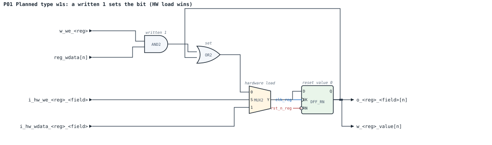

`AND2(w_we, wdata)` detects a written 1; `OR2` with the stored value sets the bit; the hardware-load multiplexer follows.

**P02: `w1t`.** A written 1 toggles the bit.

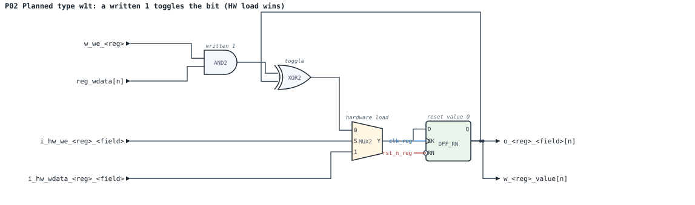

`XOR2` of the stored value with the written-1 detect.

**P03: `pulse`.** A written 1 gives a one-cycle output pulse; nothing is stored and the read value is 0.

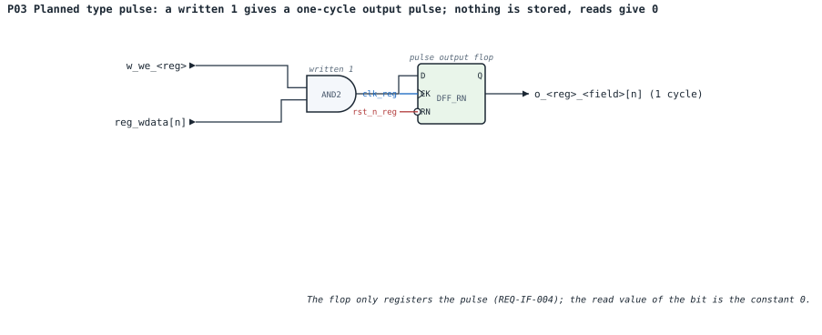

The only flop registers the pulse so that the output is a flop output (REQ-IF-004).

**P04: `hwmode=setclr`.** Per-bit hardware set and clear; set wins.

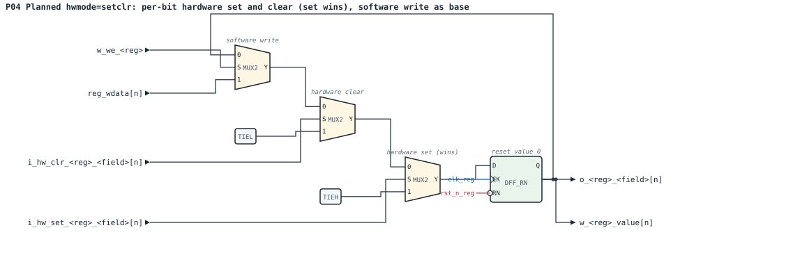

The software write is the base value; a hardware clear selects 0; a hardware set, last in the chain, selects 1.

**P05: write-gating chain.** Level, lock, key, write-once and legal-value checks before a field write (Section C.7.2).

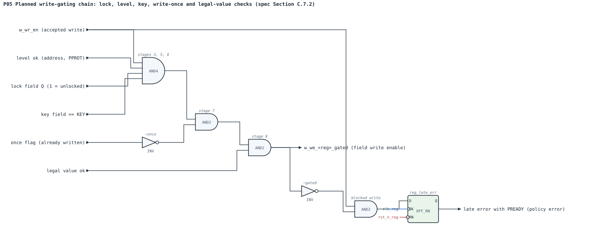

The accepted write enable passes through `AND4` (stages 3, 5, 6), `AND2` with the inverted write-once flag (stage 7) and `AND2` with the legal-value result (stage 8). A write that was accepted but is not gated through sets the late-error flop, whose output reaches `PSLVERR` in the `PREADY` cycle.

**P06: `Strobe Mode = HONOR`.** A bit changes only when its byte lane is strobed.

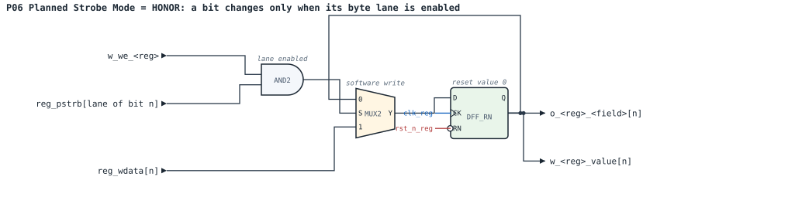

**P07: interrupt source bit (`posedge`).** Event detection, state with hardware priority, masked output.

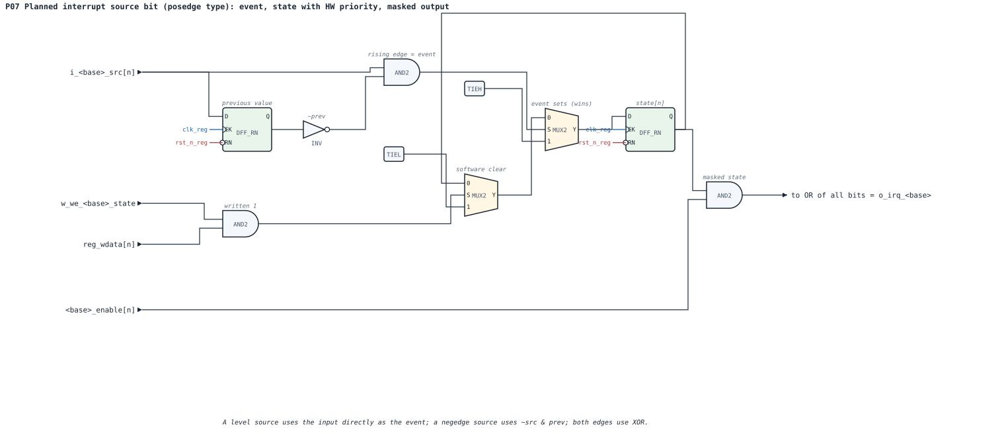

The previous-value flop and the inverter give a rising-edge event. The event sets the state bit (it wins over a software clear); a written 1 clears it; the masked state bits are ORed into `o_irq_<base>`.

**P08: alias windows `set`, `clr`, `tog`.** The same flop written through four address windows.

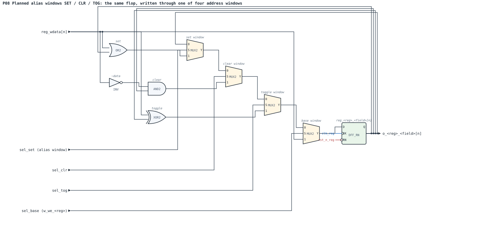

`OR2`, `AND2` with the inverted data, and `XOR2` give the three operations; four multiplexers select by window.

**Not drawn.** The counter (Section C.8.2), preload, wide-register snapshot, shadow compare and parity use adders, comparators, wide registers or XOR trees that are not single basic cells; they are built from the library cells `VLSIT_CELL_FA`, `_HA`, `_XOR3` and `_AOI*` and will be drawn when they are implemented.

### C.20 Implemented multi-protocol CSR interface generation

**Status: Implemented in generator 3.0.** One workbook sheet generates one RTL module with one selected bus interface. APB4 behavior is retained from generator 2.4. AXI4-Lite and AHB-Lite are implemented by dedicated emitters in `CSR_Protocol_Generation.py`, sharing the register-field model in `CSR_Generation.py`.

#### C.20.1 Scope and bus profiles

| Workbook `Protocol` | Generated role | Implemented profile |
|---|---|---|
| `APB`, `APB4` | APB Completer | Legacy APB4 profile in Parts A/B |
| `AXI4-Lite`, `AXI`, `AXIL` | AXI4-Lite Subordinate | 32-bit data, 2–32-bit byte address, five AXI4-Lite channels, no IDs or USER signals |
| `AHB-Lite`, `AHB` | AHB-Lite Subordinate | 32-bit data, 2–32-bit byte address, HTRANS/HREADY pipeline, HSIZE subword accesses; no HPROT/HWSTRB/HNONSEC ports |

The AXI4-Lite profile follows Arm IHI 0022H.c Part B1; the AHB-Lite profile follows Arm IHI 0033C. AXI `AWPROT` and `ARPROT` pins are present but not evaluated. The AHB port list does not include `HPROT`. The generator does not implement the proposed `level` attribute or protocol-level protection filtering; apply protection upstream if required.

#### C.20.2 Workbook configuration

| Key | Allowed value | Default / applicability |
|---|---|---|
| `Protocol` | `APB`, `APB4`, `AXI4-Lite`/`AXI`/`AXIL`, `AHB-Lite`/`AHB` | Required; one bus per sheet |
| `Data Width` | AXI4-Lite/AHB-Lite: `32`; APB4: 8–32, byte multiple | Required |
| `Address Width` | AXI4-Lite: 2–32; AHB-Lite: 2–32; APB4: 1–32 | Required; byte address width |
| `Asynchronous` | `0` or `1` | Required; selects same-clock or separate register-clock operation |
| `Strobe Mode` | `HONOR` or `REJECT` | Default `HONOR`; applies to AXI4-Lite/AHB-Lite writes |
| `AXI Outstanding Mode` | `SINGLE`, `READ_WRITE`, `QUEUED` | Default `SINGLE`; AXI4-Lite only |
| `AXI Read Outstanding Depth` | Integer `1`–`8` | Workbook default; used in `QUEUED` mode |
| `AXI Write Outstanding Depth` | Integer `1`–`8` | Workbook default; used in `QUEUED` mode |
| `AHB Endian` | `LITTLE`, `BE8`, `BE32` | Default `LITTLE`; AHB-Lite only |
| `Register Event Sideband` | `0` or `1` | Default `0`; APB4 only. `1` adds `o_reg_rd_en`, `o_reg_rd_addr`, `o_reg_wr_en`, `o_reg_wr_addr`: the read event is an aligned APB read, the write event is a write to a mapped register with at least one software-writable field (`rw`, `wo`, `rwi`, `w1c`, `w0c`, `w2c`); each address output is the captured address during its event and zero otherwise |

The workbook records the selected settings for reproducible generation. AXI outstanding mode/depth, `PARA_ASYNCHRONOUS`, write-strobe mode and AHB endian are top-level RTL parameters and can be overridden at elaboration. AXI/AHB require 32-bit data even though APB4 retains the earlier width range.

AXI example:

```text
Protocol                    AXI4-Lite
Data Width                  32
Address Width               16
Asynchronous                0
Strobe Mode                 HONOR
AXI Outstanding Mode        QUEUED
AXI Read Outstanding Depth  2
AXI Write Outstanding Depth 4
```

AHB example:

```text
Protocol       AHB-Lite
Data Width     32
Address Width  16
Asynchronous   0
Strobe Mode    HONOR
AHB Endian     LITTLE
```

#### C.20.3 AXI4-Lite interface contract

The Subordinate implements AW, W, B, AR and R channels. AW and W are captured independently and paired exactly once. `WSTRB` maps each data byte to the corresponding CSR byte lane. In `HONOR` mode only asserted lanes update. In `REJECT` mode a write with any strobe pattern other than `4'b1111` returns `SLVERR` and has no field side effect.

| Channel | Generated signals | Contract |
|---|---|---|
| Clock/reset | `i_clk_axi`, `i_rst_n_axi`; register side `i_clk_reg`, `i_rst_n_reg` | Active-low reset; reset both FIFO sides together in asynchronous mode |
| AW | `i_axi_awaddr`, `i_axi_awprot`, `i_axi_awvalid`, `o_axi_awready` | Capture on `AWVALID && AWREADY`; `AWPROT` is currently ignored |
| W | `i_axi_wdata`, `i_axi_wstrb`, `i_axi_wvalid`, `o_axi_wready` | Capture on `WVALID && WREADY` |
| B | `o_axi_bresp`, `o_axi_bvalid`, `i_axi_bready` | Hold response until `BVALID && BREADY` |
| AR | `i_axi_araddr`, `i_axi_arprot`, `i_axi_arvalid`, `o_axi_arready` | Capture on `ARVALID && ARREADY`; `ARPROT` is currently ignored |
| R | `o_axi_rdata`, `o_axi_rresp`, `o_axi_rvalid`, `i_axi_rready` | Hold data/status until `RVALID && RREADY` |

Outstanding counts include requests accepted but not yet response-handshaken:

| Mode | Capacity |
|---|---|
| `SINGLE` | One global read or write operation; after reset read is eligible first, then acceptance preference alternates after each accepted operation |
| `READ_WRITE` | At most one read and one write operation outstanding concurrently |
| `QUEUED` | Separate read and write limits from their respective depth parameters, each 1–8 |

The shared CSR engine uses round-robin arbitration and resets its issue preference to read. If only one direction is ready, it proceeds without waiting for the other. Same-cycle read/write accesses to one register follow issue order, not a global AXI acceptance order. Each response queue preserves order within its direction.

`OKAY` indicates a successful mapped, aligned operation. `DECERR` indicates an unmapped address. `SLVERR` indicates a misaligned address or a partial write rejected by `Strobe Mode=REJECT`. Error reads return zero. In `HONOR` mode, a zero-`WSTRB` write makes no field change and returns `OKAY`. [SRC-BUS-01]

#### C.20.4 AHB-Lite interface contract

A transfer is captured only when `HSEL=1`, `HREADY=1`, and `HTRANS` is `NONSEQ` or `SEQ`. `IDLE` and `BUSY` do not issue CSR accesses. The accepted address/control phase is paired with the following data phase; `HWDATA` supplies write data. Each burst beat is handled as an independent CSR access; `HBURST` does not cause buffering or aggregation. CSR decode uses the containing 32-bit aligned word address, while the original low address bits select subword lanes.

| Group | Generated signals |
|---|---|
| Clock/reset | `i_clk_ahb`, `i_rst_n_ahb`; register side `i_clk_reg`, `i_rst_n_reg` |
| Inputs | `i_ahb_hsel`, `i_ahb_hready`, `i_ahb_htrans`, `i_ahb_haddr`, `i_ahb_hwrite`, `i_ahb_hsize`, `i_ahb_hburst`, `i_ahb_hwdata` |
| Outputs | `o_ahb_hreadyout`, `o_ahb_hresp`, `o_ahb_hrdata` |

Only byte (`HSIZE=0`), halfword (`1`), and word (`2`) accesses are supported. Halfword and word addresses must be naturally aligned. `HONOR` writes update the selected lanes. `REJECT` returns ERROR for byte/halfword writes; subword reads remain permitted. Endian mode selects bus-to-register conversion:

| Mode | Byte at offset 0 on a 32-bit bus | Write data to CSR word | Read data to AHB bus |
|---|---|---|---|
| `LITTLE` | `HWDATA[7:0]` | Pass through | Pass through |
| `BE8` | `HWDATA[7:0]`; multibyte elements use big-endian byte order | Reverse four byte lanes | Reverse four byte lanes |
| `BE32` | `HWDATA[31:24]` | Pass through | Pass through |

An invalid size/alignment or unmapped word returns the required two-cycle ERROR: cycle 1 has `HRESP=ERROR`, `HREADYOUT=0`; cycle 2 has `HRESP=ERROR`, `HREADYOUT=1`. Rejected accesses do not update a CSR field. [SRC-BUS-02]

#### C.20.5 Clocking, reset and generated architecture

`Asynchronous=0` selects the bus clock/reset for CSR state and elaborates single-clock request/response FIFOs without CDC synchronizers. `Asynchronous=1` selects `i_clk_reg`/`i_rst_n_reg`; the bus front end remains in the AXI or AHB clock domain and dual-clock request/response FIFOs cross the boundary. In asynchronous mode reset both FIFO sides together and synchronize reset deassertion externally to each clock domain. The generator does not add reset synchronizers or perform CDC/RDC signoff.

The emitted CSR module is the sole protocol-facing RTL module. `RTL/filelist.f` includes `m_csr_sync_fifo.sv` and `m_csr_async_fifo.sv` for the selected AXI/AHB clock mode and `m_csr_sync.sv` for APB asynchronous mode. These FIFO sources are behavioral models; replace or qualify the asynchronous implementation against the project's approved CDC FIFO before tape-out.

#### C.20.6 Implemented decisions

| Topic | Implemented choice |
|---|---|
| Generated bus | Exactly one selected bus interface per module |
| AXI data width | 32 bits |
| AHB profile/data width | AHB-Lite, 32 bits, no AHB5 sideband extensions |
| AXI outstanding | `SINGLE`, `READ_WRITE`, or `QUEUED`; separate read/write depths |
| Shared engine arbitration | Round-robin; reset selects read; simultaneous same-register accesses follow issue order |
| Partial writes | `HONOR` or `REJECT` |
| AHB endian | `LITTLE`, `BE8`, or `BE32`; workbook default is `LITTLE` |
| Async clocks | `Asynchronous=1` selects separate bus/register clocks and dual-clock FIFO CDC; `0` selects the bus clock with single-clock FIFOs |

#### C.20.7 Requirements and verification status

| ID | Requirement | Evidence |
|---|---|---|
| REQ-BUS-001 | Parse APB4, AXI4-Lite and AHB-Lite sheets and emit only the selected bus interface | Generator regression and workbook examples |
| REQ-BUS-002 | Capture AXI AW/W independently; hold B/R responses under backpressure | `tb_axil.sv` |
| REQ-BUS-003 | Enforce outstanding limits and round-robin issue order, with reset preference read | `tb_axil.sv`; `AXIL_SINGLE`, `AXIL_READ_WRITE`, `AXIL_QUEUED` |
| REQ-BUS-004 | Honor/reject AXI strobes and return AXI error responses | `tb_axil.sv` |
| REQ-BUS-005 | Capture AHB address/control, align CSR decode, map subword lanes, return two-cycle ERROR | `tb_ahblite.sv` |
| REQ-BUS-006 | Support AHB LITTLE/BE8/BE32 mapping and asynchronous FIFO configuration | `tb_ahblite.sv`; `AHB_LITE_LE`, `AHB_LITE_BE8`, `AHB_LITE_BE32`, `AHB_LITE_ASYNC` |

Run the regressions with:

```text
python sim/tests/generator_test/run_generator_test.py
python sim/tests/protocol_test/run_protocol_test.py
```

The reported protocol matrix is the result of the runs listed above. Lint/elaboration is not simulation. CDC/RDC analysis, synthesis/area characterization, and formal verification are outside these regressions.

| Run | Result |
|---|---|
| Generator regression | PASS: 20/20 checks (`sim/tests/generator_test/run_generator_test.py`) |
| AXI4-Lite/AHB-Lite simulation | PASS: 8 generated configurations; 42 self-checking cases across those runs (26 AXI4-Lite, 16 AHB-Lite) |
| Verilator lint | PASS: 8 configurations, matching the protocol simulation matrix |
| CDC/RDC, synthesis, formal | Not performed; FIFO CDC behavior was functionally simulated, not independently analyzed |

#### C.20.8 References

| ID | Source | Clauses used |
|---|---|---|
| SRC-BUS-01 | Arm, *AMBA AXI and ACE Protocol Specification*, IHI 0022H.c, Part B1; [official Arm PDF](https://developer.arm.com/-/media/Arm%20Developer%20Community/PDF/IHI0022H_amba_axi_protocol_spec.pdf) | AXI4-Lite channels, strobes, subordinate response behavior |
| SRC-BUS-02 | Arm, *AMBA AHB Protocol Specification*, IHI 0033C, Issue C; [official Arm specification](https://developer.arm.com/documentation/ihi0033/c/) and [official PDF](https://documentation-service.arm.com/static/6141bf0d674a052ae36ca811?token=) | Transfer acceptance, HSIZE, two-cycle ERROR, data buses, endianness §6.2 |

### C.21 Implemented write-only field support

Generator 3.1 accepts `wo` as a field type for APB4, AXI4-Lite, and AHB-Lite workbooks. The term *write-only* describes software access: software writes the field but bus reads return zero. The generated field remains stored and visible to the IP through an output port.

#### C.21.1 Field behavior

| Property | `wo` behavior |
|---|---|
| Software write | Accepted according to the selected bus profile and write-strobe policy. Enabled byte lanes update the field; disabled lanes retain their previous values. |
| Software read | Returns zero at the `wo` bit positions. A mapped read does not raise an error solely because the register contains `wo` fields. |
| Storage | Resettable field flops hold the last software-written value. The workbook reset value is applied on the generated CSR reset. |
| Hardware interface | The generator emits `o_<register>_<field>` and no hardware write-data or write-enable inputs for `wo`. |
| Mixed register | Readable fields retain their normal read behavior; only `wo` bit positions are forced to zero. |
| Register event sideband | A mapped accepted write to a register containing `wo` qualifies as a software-writable register write event. |
| Repeated register | `wo` behavior applies to each `FIXED` copy and each active `PARAMETERIZED` entry. |

In generator 3.1, `wo` did not provide a hardware clear. Generator 3.2 added an active-high `i_hw_clr_<register>_<field>` input. Generator 3.3 keeps that behavior and uses the compact `i_hw_clr_` prefix to meet the 30-character RTL port-name limit; see C.22 for timing and priority. The output port is available to the IP logic; it is not a software readback path.

The generator bus data width is at most 32 bits. A wider value, such as a 256-bit AES key, must be divided across multiple `wo` fields/registers. The AES wrapper defines their word order and assembly; this generator only emits the individual field outputs.

#### C.21.2 Requirements

| ID | Requirement | Source | Verification method | Status |
|---|---|---|---|---|
| REQ-WO-001 | The generator shall accept `wo` in the `BIT TYPE` column and preserve the workbook reset value in generated storage. | Generator 3.1 implementation | Directed simulation of reset and software writes | Pass in v3.2 regression: APB4, AXI4-Lite, and AHB-Lite |
| REQ-WO-002 | A software write shall update only the byte lanes enabled by the selected bus policy; an accepted write shall contribute to `o_reg_wr_en` when the APB register-event sideband is enabled. | Generator 3.1 implementation; C.20 | Directed APB, AXI4-Lite, and AHB-Lite simulation | Pass: byte-strobe tests on all three buses; APB event-sideband regression passes |
| REQ-WO-003 | A software read shall return zero in every `wo` bit position while preserving the read value of other fields in the same register. | Generator 3.1 implementation | Directed simulation of `wo`-only and mixed-field registers | Pass in v3.2 regression: read-zero and surrounding register-map tests on all three buses |
| REQ-WO-004 | The generated RTL shall expose each stored `wo` field through `o_<register>_<field>` and shall not emit hardware write-data or write-enable inputs for that field. | Generator 3.1 implementation | Generated-port inspection and RTL rule check | Pass: generated-port checks in 23/23 generator regression checks |

#### C.21.3 Integration status

The canonical generator and workbook templates support `wo` and hardware clear. All three example projects were regenerated from their workbooks. The generator regression passes 23 checks; the APB4 golden-map regression passes the synchronous/asynchronous parameter matrix and event-sideband example; the AXI4-Lite/AHB-Lite protocol regression passes eight lint configurations and eight simulations. The explicit `wo` tests cover reset value, software storage, read-as-zero, byte-strobe writes, clear priority over simultaneous writes, post-clear writes, and per-entry clear behavior for a parameterized bank. CDC/RDC analysis is an integration task and has not been run.

### C.22 Hardware clear for write-only fields

Generator 3.2 introduced an active-high hardware-clear input for `wo` fields, named `i_hw_clear_<register>_<field>`. Version 3.3 keeps the same synchronous clear behavior and uses the shorter `i_hw_clr_<register>_<field>` prefix to meet the VLSIT 30-character port-name limit. Clear sets the stored field to zero on the generated register clock, including when a software write is accepted on the same edge. It clears the whole field regardless of write strobes and does not change the `wo` read-as-zero behavior.

#### C.22.1 Interface and timing

| Configuration | Generated port | Behavior |
|---|---|---|
| One register or `FIXED` copy | `input logic i_hw_clr_<register>_<field>` | Sampled on the rising edge of the register clock; high clears the complete field to zero. |
| `PARAMETERIZED` register bank | `input logic [PARA_<REGISTER>_COUNT-1:0] i_hw_clr_<register>_<field>` | Bit `i` clears copy `i`; inactive entries are ignored by the generated register loop. |
| `PARA_ASYNCHRONOUS=0` | Register clock is the selected bus clock | The clear must meet that clock's setup and hold requirements. |
| `PARA_ASYNCHRONOUS=1` | Register clock is `i_clk_reg` | The integrator must provide the clear in the `i_clk_reg` domain; the generator does not synchronize it. |

The priority for a stored `wo` field is: active-low asynchronous reset loads the workbook reset value; otherwise, an asserted hardware clear stores zero; otherwise, an accepted software write updates enabled byte lanes; otherwise, the field holds. If clear and software write are asserted together, clear wins and the write has no effect on that edge. Holding clear high keeps the field at zero. Software reads continue to return zero whether or not the field is cleared.

#### C.22.2 Requirements

| ID | Requirement | Source | Verification method | Status |
|---|---|---|---|---|
| REQ-WOC-001 | The generator shall emit `i_hw_clr_<register>_<field>` for each `wo` field; a parameterized bank shall use one clear bit per entry. | Port prefix in 3.3; clear behavior introduced in 3.2 | Generated-port inspection for scalar and parameterized registers; generator regression | Pass: 23/23 generator checks; scalar and banked ports simulated |
| REQ-WOC-002 | At a rising register-clock edge with clear asserted, the generated `wo` storage shall become zero, independent of byte strobes. | Generator 3.2 implementation | Directed simulation of partial and full-field clear | Pass: APB4 scalar and parameterized tests; AXI4-Lite/AHB-Lite scalar tests |
| REQ-WOC-003 | Hardware clear shall take priority over a simultaneous software write; reset shall retain its existing priority over both. | Generator 3.2 implementation | Directed clear/write collision tests and existing reset tests | Pass: clear overrides partial writes on all three buses; reset behavior covered by the golden/protocol reset scenarios |
| REQ-WOC-004 | The generator shall not add a synchronizer for the clear input; integration shall drive it synchronously to the generated register clock. | Generator 3.2 implementation | Port-domain review and CDC review at integration | RTL interface review pass; CDC review remains an integration task |

#### C.22.3 Integration note

For a functional zeroize operation, connect the zeroize control to every `i_hw_clr_` input for stored key fields. The clear ports are synchronous to the register clock and have priority over writes. The generator clears only the `wo` flops; clearing core key-schedule, pipeline, counter, or output state remains the responsibility of the AES integration.

---

## Part D. Appendices

### D.1 Revision history

| Version | Date | Description |
|---|---|---|
| 1.0 | 2026-03-06 | Initial version |
| 1.1 | 2026-09-20 | Fixed CDC bug in async template (Asynchronous=1): `o_prdata` was captured by an `always_ff @ (posedge i_bus_clk)` gated by `apb_read_en`, a signal generated entirely in the `i_reg_clk` domain, risking a missed/metastable read-data update across asynchronous clocks. `reg_prdata` now latches in the `i_reg_clk` domain (qualified by `apb_read_en`, same domain), and a new `reg_prdata_bus` FF resyncs it into the `i_bus_clk` domain using the already-synchronized `read_aclk_bus_clk_falling` pulse before driving `o_prdata`. Sync template (Asynchronous=0) unaffected. |
| 1.2 | 2026-09-27 | Documentation overhaul: added interface, architecture, APB handshake, field behavior, generation workflow, constraints, configuration parameters, and compliance sections. No RTL or generator changes. |
| 2.0 | 2026-10-28 | Generated RTL follows the VLSIT RTL Design Rule v2: new port, signal and localparam names (table in section RTL rule compliance), `m_csr_sync` replaces `m_vlsi_synch`, aligned port groups, process labels, header, case defaults without `'x`, no latch for uncovered bits, no unused signal, relative file list. Options `--out`, `--project`, `--author`. An empty row of the sheet is skipped instead of crashing the tool. Behavior and timing are unchanged: 300k cycles (sync) and 400k cycles (async) of random APB traffic gave no difference to version 1.2, and the testbenches of `sim/tests` pass. |
| 2.1 | 2026-10-28 | `w1c` fields: a hardware write has priority over a simultaneous software clear. |
| 2.2 | 2026-11-01 | Added `w0c`, `w2c`, and `r2c`; generated one RTL source with `PARA_ASYNCHRONOUS` defaulted from the workbook; both clock architectures use static ports and generate-time selection. |
| 2.3 | 2026-11-01 | Added `FIXED` register expansion and `PARAMETERIZED` packed-array register banks, workbook columns H–K, address and identifier checks, repeated-register specification, and draw.io option diagram. |
| Golden map refresh | 2026-11-01 | Replaced the legacy `abc`/`def` workbooks with `CSR_GOLDEN_FORMAT.xlsx`; added `engine`, `port`, and `monitor` examples; regenerated synchronous/asynchronous RTL and per-sheet debug data; updated project documentation. |
| 2.4 | 2026-11-02 | Generated RTL is lint clean (generate-loop names per HIE-05, 32-bit address compares, one branch statement per line); new golden-map simulation testbench with mutant check; removed the stale duplicate RTL, benches and Makefiles; one reference output, now organized under `examples/APB4_Synchronous/`. |
| 2.4 (documents) | 2026-11-02 | All specification documents merged into `spec/CSR_Generator_Specification.md`: script flow with flowcharts, logic schematics of every option, user guide, normative specification, planned extensions. |
| 3.0 | 2026-11-04 | Added AXI4-Lite and AHB-Lite backends; configurable AXI outstanding modes/read-write depths; AXI/AHB write-lane policies; AHB endian modes; parameter-selected single-clock or dual-clock FIFO models; workbook examples; protocol testbench and regression. C.20 documents the implemented contract. |
| 3.1 | 2026-11-05 | Added `wo` field generation: software writes update resettable storage and the hardware output, while bus reads return zero for those bits. C.21 specifies the behavior; the v3.2 regression suite exercises it. |
| 3.2 | 2026-11-05 | Added active-high `i_hw_clear_<register>_<field>` inputs for `wo`; synchronous clear sets the stored field to zero and takes priority over software writes. C.22 defines timing, parameterized-bank behavior, and the register-clock-domain requirement. Generator, simulation, protocol, and >70% per-example coverage regressions pass; see `sim/results/coverage/`. CDC/RDC signoff remains open for integration. |
| 3.3 | 2026-11-05 | Changed the combinational write mask from `reg_wmask` to the VLSIT `w_wmask` prefix and shortened `wo` clear ports from `i_hw_clear_` to `i_hw_clr_` so generated names fit the 30-character RTL limit. Transaction behavior is unchanged. Generator regression passed 23/23 checks; APB4 golden simulation passed nine clock configurations plus the event-sideband case; AXI4-Lite/AHB-Lite protocol regression passed eight lint configurations and eight simulations. APB4, AXI4-Lite and AHB-Lite each passed the strict >70% line/condition/toggle coverage gate. |

### D.2 Figure index

| File | Title |
|---|---|
| `figures/logic/L01_rw.svg` | L01  Field type rw, one bit: next = w_we_&lt;reg&gt; ? reg_wdata[n] : hold |
| `figures/logic/L02_ro_reserved.svg` | L02  Field types ro and reserved: the read value is the input (ro) or 0 (reserved); nothing is stored |
| `figures/logic/L03_rwi.svg` | L03  Field type rwi, one bit: software write over hardware load over hold |
| `figures/logic/L04_w1c.svg` | L04  Field type w1c, one bit: hardware load, then software clear of the bits written 1, then hold |
| `figures/logic/L05_w0c.svg` | L05  Field type w0c, one bit: hardware load, then software clear of the bits written 0, then hold |
| `figures/logic/L06_w2c.svg` | L06  Field type w2c, one bit: hardware load, then clear by any write to the register, then hold |
| `figures/logic/L07_r2c.svg` | L07  Field type r2c, one bit: hardware load, then clear by a read, then hold |
| `figures/logic/L08_reset_values.svg` | L08  Reset value of a stored bit: 0 uses the asynchronous reset flop, 1 uses the asynchronous set flop |
| `figures/logic/L09_apb_decode.svg` | L09  APB decode: w_apb_setup and w_apb_slverr (error checks gated by i_slverr_en) |
| `figures/logic/L10_apb_complete.svg` | L10  Transfer without error, split into write and read |
| `figures/logic/L11_capture.svg` | L11  Address, write data and error-response capture flops (clock i_clk_apb, reset i_rst_n_apb), one bit each |
| `figures/logic/L12_sync_control.svg` | L12  CFG-SYNC control path: one-cycle delayed enables and PREADY |
| `figures/logic/L13_async_write_path.svg` | L13  CFG-ASYNC write path: request and acknowledge crossing (the read path is identical with rd signals) |
| `figures/logic/L14_async_pready.svg` | L14  CFG-ASYNC PREADY: acknowledged read, acknowledged write, or an error found in the SETUP phase |
| `figures/logic/L15_clock_select.svg` | L15  Clock and reset of the register domain: selected by the elaboration constant PARA_ASYNCHRONOUS |
| `figures/logic/L16_csr_sync.svg` | L16  m_csr_sync: PARA_LEVELS flip-flops in series on the destination clock (default 2) |
| `figures/logic/L17_address_decode.svg` | L17  Address decode of a fixed register: reg_addr == LPARA_&lt;REG&gt;_OFFSET gates the write and the read enable |
| `figures/logic/L18_param_decode.svg` | L18  PARAMETERIZED group: one decode per index inside generate for gen_idx &lt; min(PARA_&lt;BASE&gt;_COUNT, MAX COUNT) |
| `figures/logic/L19_read_mux.svg` | L19  Read data mux, one bit, and the CFG-SYNC read data flop (reg_rdata) |
| `figures/logic/L20_read_async.svg` | L20  CFG-ASYNC read data: snapshot in the register domain, bundled data captured in the APB domain |
| `figures/logic/L21_repeat_structure.svg` | L21  Structure of NONE, FIXED and PARAMETERIZED registers (block level) |
| `figures/logic/P01_w1s.svg` | P01  Planned type w1s: a written 1 sets the bit (HW load wins) |
| `figures/logic/P02_w1t.svg` | P02  Planned type w1t: a written 1 toggles the bit (HW load wins) |
| `figures/logic/P03_pulse.svg` | P03  Planned type pulse: a written 1 gives a one-cycle output pulse; nothing is stored, reads give 0 |
| `figures/logic/P04_setclr.svg` | P04  Planned hwmode=setclr: per-bit hardware set and clear (set wins), software write as base |
| `figures/logic/P05_write_gating.svg` | P05  Planned write-gating chain: lock, level, key, write-once and legal-value checks (spec Section C.7.2) |
| `figures/logic/P06_strobe_lane.svg` | P06  Planned Strobe Mode = HONOR: a bit changes only when its byte lane is enabled |
| `figures/logic/P07_interrupt_bit.svg` | P07  Planned interrupt source bit (posedge type): event, state with HW priority, masked output |
| `figures/logic/P08_alias.svg` | P08  Planned alias windows SET / CLR / TOG: the same flop, written through one of four address windows |
| `figures/flow/F1_script_flow.svg` | F1  Script flow of CSR_Generation.py |
| `figures/flow/F2_register_parse.svg` | F2  Register table: row classification and repeat expansion |
| `figures/flow/F3_rtl_generation.svg` | F3  RTL text generation (one module per sheet) |
| `figures/flow/F4_designer_flow.svg` | F4  Designer flow: from the register map to an integrated, verified CSR |
| `figures/flow/F5_regression_flow.svg` | F5  Regression flow of run_golden_test.py |
| `figures/block_diagram.svg` | block_diagram.svg |
| `figures/wf-001.svg` | wf-001.svg |
| `figures/wf-002.svg` | wf-002.svg |
| `figures/wf-003.svg` | wf-003.svg |
| `figures/wf-004.svg` | wf-004.svg |
| `figures/wf-005.svg` | wf-005.svg |
| `figures/wf-006.svg` | wf-006.svg |
| `figures/wf-007.svg` | wf-007.svg |
| `figures/wf-008.svg` | wf-008.svg |
| `figures/wf-009.svg` | wf-009.svg |
| `figures/wf-010.svg` | wf-010.svg |

The schematics and flowcharts are produced by `spec/figures/tools/make_figures.py` (engine `svgdraw.py`). The waveform files `wf-001` to `wf-010` and `block_diagram` were made earlier with the VLSIT WaveDrom and diagram flows.

### D.3 Repository layout

```text
APB-CSR-Generator/
├── CSR_Generation.py                 workbook parser and APB4 generator
├── CSR_Protocol_Generation.py         AXI4-Lite and AHB-Lite generators
├── CSR_GOLDEN_FORMAT.xlsx            complete golden and simulation workbook
├── README.md                         short entry page
├── examples/
│   ├── APB4_Synchronous/             APB4 workbook, RTL, filelist, and debug report
│   ├── AXI4_Lite/                    AXI4-Lite workbook, RTL, filelist, and debug report
│   └── AHB_Lite/                     AHB-Lite workbook, RTL, filelist, and debug report
├── spec/
│   ├── CSR_Generator_Specification.md   this document
│   └── figures/                      logic/ (L01..L21, P01..P08), flow/ (F1..F5), waveforms, tools/
├── sim/tests/
│   ├── golden_test/                  APB4 golden-map testbench and runner
│   ├── generator_test/               generator regression
│   └── protocol_test/                AXI4-Lite and AHB-Lite testbenches and runner
├── lint/                             verilator and VC Static scripts
└── source_me.sh                      sets CSR_GEN_HOME for the lint scripts
```

### D.4 Merge record

| Former document | Where its content is now |
|---|---|
| `README.md` | Part A (overview, features, workbook reference, outputs, usage, limits), Section D.1 (revision history); the file itself is now a short entry page |
| `spec/APB_CSR_Generator_Design_Specification.md` | Part B, sections B.1 to B.22 |
| `spec/Repeated_Register_Generation_Specification.md` | Section B.23 and Section A.5.5 |
| `spec/CSR_Attribute_Extension_Specification.md` | Part C, sections C.0 to C.19 |
| `docs/architecture.html` | Section A.2 (architecture) and the schematics of Section A.5 |
| `docs/repeated_register_generation.drawio` | `spec/figures/repeated_register_generation.drawio`, referenced from Section B.23 |
| `test_env/README.md` | Section A.6.7 (simulation) and Section B.15 |
